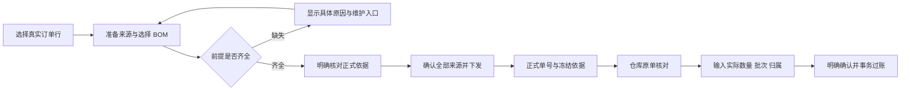

# 生产领料发起入口、来源选择、前提校验、共享办理流程及仓库交接架构审查

审查日期：2026-10-27。

状态：审查方案已按顺序实施，新增入口、来源接口、共享流程及仓库交接已接入当前工作区，验证证据见第 10 节。真实业务订单只读核验；完整下发及仓库填写采用浏览器模拟接口，库存事务由隔离数据库测试验证。正式打印、消息和按部分成品数量拆分覆盖仍未实现。

## 1. 判断

现有后端具备可以延续的领域基础：共享需求展开、稳定订单行身份、BOM 版本及依据指纹、正式单据冻结、有效覆盖唯一约束、显式幂等命令，以及仓库领退与库存过账的同事务处理。适合在这些能力上补完整操作流程。

审查时用户流程尚未形成闭环：生产领料 TAB 主要读取总体进度与历史，正式下发位于料号需求分析抽屉，仓库表单又依赖先选原单、再展开办理。此次实现集中补齐发起、前提检查、缺失依据说明和下发后的仓库定位。

长期方案应当让生产领料领域拥有一套发起流程，由生产 TAB、手册快捷入口和料号需求使用。生产模块负责选来源、核对需求、下发；仓库沿原单填写实际交接数量、批次及订单行归属。

## 2. 用户入口及页面职责

| 位置                                                     | 应提供的操作                                                                               | 职责边界                                                                           |
| -------------------------------------------------------- | ------------------------------------------------------------------------------------------ | ---------------------------------------------------------------------------------- |
| `/mrp/production-material-issuance` 页首                 | 主按钮“发起领料”；同时显示“选订单行 → 核对 BOM 与需求 → 下发领料单 → 仓库确认交接”         | 该页面是主要业务工作区；总体统计与历史继续位于下方                                 |
| `/mrp/production-material-issuance-guide` 准备及下发章节 | “发起领料”快捷入口、前提条件、具体填写说明；页首不重复放置                                 | 导航到同一工作区并打开同一流程；阅读手册不自动请求订单、挂载业务查询或提交命令     |
| `/mrp/requirements` 分析结果                             | “按本次来源发起领料”                                                                       | 用真实订单行 ID 和已选择 BOM 预填同一领域流程；表内搜索和缺料筛选不改变下发范围    |
| `/warehouse/production-material-handovers` 页首及空状态  | 说明如何取得领料单；按权限提供发起入口或联系生产人员的说明；已有单据提供明确“办理领料”动作 | 办理数量、批次、补料、退料属于仓库操作；页面不再成为必须猜测展开顺序的追溯列表     |
| 下发成功结果                                             | 正式单号、“去仓库办理领料”或无仓库权限时的交接说明                                         | 使用正式结果中的 documentId 定位原单；自动打开核对和办理表单，仍需显式确认实际发料 |

建议在现有生产路由公开经校验的 `intent=start`，由页面消费并打开领域流程；手册只使用这个已承接的导航协议。关闭流程时清除该意图，返回、刷新和重复点击行为须有测试。仓库路由公开可选的规范 UUID `documentId`，由目标页面真正读取、查询、选中并展开。参数只用于导航，不携带授权、确认状态、库存数量或已核对依据。

共享流程使用独立对话框，桌面宽度为当前视口的 85%，高度为当前动态视口的 85%，不设置固定像素上限，2K、4K 屏幕随视口扩展。尺寸参考现有新建业务弹窗的视口比例：销售订单为 95% 宽、内容决定高度，采购订单为 95% 宽、90% 高，产品创建向导为 85% 宽、90% 高。领料流程采用产品向导的宽度并降低高度，避免此前只留 24px 边距导致接近全屏。相同视口下，选单及后续核对共用固定外框，新增内容只增加内部滚动，不随步骤撑大弹窗。手机沿用公共浮层的屏幕适配与安全边距。页面负责放置入口，领域组件负责操作状态，不能在手册和三个业务页面各复制一套表单。

## 3. 用户具体填什么

1. 选择订单明细，可按订单号、客户和产品搜索；跨分页的已选来源以真实身份保存，并单独展示完整清单。取消选择必须明确，搜索和翻页不隐式清除或增加来源。
2. 每行展示成品数量、单位、下发覆盖状态和适用 BOM。多份适用 BOM 时明确选择性能版本与修订。缺少 BOM 的行仍应能看到具体原因与修复说明，不能当作需求为零或从列表消失。
3. 核对所选全部来源的物料、标准用量和标准需求。理论需求由后端共享能力计算，浏览器不允许任意改写正式应领量。
4. 用户确认全部来源后明确下发，获得正式单号；下发不会扣减库存。
5. 仓库进入原单，选择本次动作、物料和批次，输入本次实际数量，核对订单行分配；补料和退料填写原因，退料引用原发料归属。确认后才产生正式交接与库存事实。

当前正式覆盖模型是“整条订单明细”，一次支持 1 至 500 行；支持仓库分次领料。它尚不支持把同一订单行按不同成品覆盖数量拆到多张有效领料单。若未来要按生产批次、工单或部分成品数量发起，须先设计覆盖数量、重叠校验和守恒关系，不能只加一个可编辑的成品数量框。

## 4. 前提条件与校验时点

| 前提                  | 当前基础                                                           | 新流程的呈现及最终约束                                                             |
| --------------------- | ------------------------------------------------------------------ | ---------------------------------------------------------------------------------- |
| 订单有效              | 共享来源限定为 Pending、Scheduling、InProgress，排除报价及终态订单 | 显示当前状态；准备、核对及提交重新验证真实来源                                     |
| 来源身份稳定          | 已有 salesOrderId 与 salesOrderLineId；正式命令不依赖可变行号      | 新选单和准备请求都使用真实 ID，订单号与行号用于展示                                |
| 未被其他有效单据覆盖  | 后端有效覆盖以订单行主键保证唯一                                   | 已覆盖行显示原单入口；准备后被他人下发时，提交返回冲突，保留用户选择供核对         |
| 成品基础完整          | 正式核对检查来源、正数量及成品单位                                 | 在下发前明确指出缺失行；界面不得只显示通用失败                                     |
| 采用适用的已发布 MBOM | 已有有效期、产品、客户专供优先及多 BOM 显式选择规则                | 下拉候选由共享服务提供，不在前端重写匹配规则，也不自动采用“最新版本”               |
| 重量和版本可冻结      | 正式核对要求订单/BOM 正版本、正成品重量及重量单位                  | 准备结果应显示这些前提的逐行问题；需求展开完整不等于已具备正式下发资格             |
| 配方物料有效          | 共享展开检查物料启用、单位相符、用量有效及正需求                   | 保留原配方贡献和具体阻塞，不以空表代替异常                                         |
| 生产供料仓库可用      | 下发核对已固定检查系统 MATERIAL 仓及出库能力                       | 显示“生产物料仓库”；不可用时明确阻塞，不自动换其他仓                               |
| 领退库存去向可用      | 仓库确认检查 MATERIAL 与生产待耗用去向及对应出入库能力             | 仓库核对时尽早展示阻塞，确认事务仍重新检查；不让实际确认成为唯一发现前提缺失的位置 |
| 实际批次可领          | 已有批次可用量与 RESERVED 占用计算                                 | 选择批次后读取，确认事务重新验证；暂时缺库存不等于禁止创建需求单                   |
| 退料可追溯            | 已有原发料归属、剩余可退量及原成本返回                             | 只从原单原发料选择可退对象，不能手填来源批次冒充原发料                             |
| 身份与动作权限        | 已有查看、下发、撤回、发料、补料、退料独立权限                     | 身份同步完成后才挂载查询；无下发权限显示原因；手册阅读权限不替代业务权限           |

本会话此前实际读取的订单 ZP6AGS26050003 第 1 行返回过 MISSING_BOM。这说明即使入口补齐，也应当向用户说明先维护并发布适用 MBOM；不能靠重启 DEV 或默认创建 BOM 消除业务前提。该值为此前读取的结果，后续界面须查询当前状态。

## 5. 必须先处理的查询与权限问题

### 5.1 不能直接搬用现有 useRequirements

`src/features/mrp/hooks/use-requirements.ts` 会加载全部有效销售订单，查询来自 `production-material-requirement-order-selection-service.ts`，最终调用 `/sales-orders`。销售接口位于 `server/routes/routes_trading.go`，要求 menu_trading。现有 `/mrp/requirements` 又要求 menu_mrp。

因此，仅有生产领料 TAB、查看及下发动作权限的人，不能保证使用这套现有选单链路；仅有料号需求 TAB 的情况也需要纳入权限回归。直接复用整个 Hook 或放宽销售接口权限，会把生产操作与额外销售访问绑定。

应复用共享领域查询和计算服务，并在生产领料自己的路由组提供窄接口。新增入口不要求额外授予销售模块权限，也不增加一组重复的业务权限位。

### 5.2 总体进度接口不承担长期选单

`production_material_issuance_active_order_scope_frozen_and_current_progress_query.go` 先读取全部有效订单、当前或冻结依据及领退事实，完成总体聚合后才对两个视图分页。这个顺序对总体进度正确，但不是轻量选单职责。

用它给选择器逐页加载，会重复计算完整进度；某张历史单据的数据异常也可能阻断全部选单。长期应把来源浏览与总体进度分开，复用有效订单范围规则，而非复用整个聚合响应。

### 5.3 已实现的窄来源接口

以下接口已注册在现有生产领料只读路由组中：

| 接口                                                        | 输入及输出                                                                                                                           | 约束                                                                     |
| ----------------------------------------------------------- | ------------------------------------------------------------------------------------------------------------------------------------ | ------------------------------------------------------------------------ |
| `GET /mrp/production-material-issuance/source-options`      | 服务端 search、page、pageSize；返回当前页订单行身份、版本、数量/单位、基础显示字段、覆盖单据与可选状态，以及一致范围的 total         | 服务端过滤、稳定排序并分页；不展开所有材料及历史流水；已覆盖行可查看原单 |
| `POST /mrp/production-material-issuance/source-preparation` | 明确的 1 至 500 条来源 `{salesOrderId,salesOrderLineId,bomId?}`；返回适用 BOM 候选、所选依据的需求贡献、逐行前提问题及整体可核对状态 | 只读；空来源拒绝，绝不解释为全部订单；返回来源集合必须与请求完全一致     |

生产来源接口要求生产业务访问及 action_production_material_issuance_view，与现有 source-review 保持一致。来源准备不要求 dispatch 权限，正式下发必须继续校验该独立动作。仓库库存确认继续要求 menu_warehouse、查看及各自动作。

准备查询复用 `ExpandProductionMaterialRequirements` 及适用 BOM 规则，不复制需求算法；它只准备发起所需依据，不强制加载采购供应、包装规则或全部仓库库存。需要展示参考库存时，另行使用已有可用量查询，不能把库存快照作为正式下发依据指纹的一部分。

既有 `POST /source-review`、`POST /dispatch` 和仓库领退接口继续作为核对及写入权威。准备结果仅便于用户选择，不授予正式下发资格；正式核对和提交均需要重新验证来源。

新的准备接口要复用现有严格 HTTP 解析、身份验证、错误码和 no-store 规则。不要仅给旧 GetMrpRequirementsHandler 增加一个路由别名：那仍保留旧的 selectedKeys 语义、全量查询依赖和不同的错误边界。

## 6. 文件架构评价与实施落点

### 6.1 可以延续的部分

- 后端 `production_material_requirement_expansion.go` 与 `production_material_requirement_bom_selection.go` 基于输入快照计算，职责集中。新准备查询应调用它们。
- `production_material_issuance_source_review_and_frozen_basis_service.go` 承接正式核对及指纹；`production_material_issuance_document_dispatch_withdrawal_and_idempotency_service.go` 承接命令事务；仓库确认与库存适配器各有明确职责，入口改造不另起库存账。
- 前端已有 contracts → services → hooks → components → pages 分层，命令请求、响应验证、稳定重试及展示分开，方向合理。
- 下发与仓库动作保留显式确认；命令按操作者和依据范围隔离，重试保留同一 commandId 和原载荷，不自动重放。

### 6.2 需要调整的部分

- MRP 分析抽屉依赖生产领料操作组件，而生产领料 DTO 又依赖 MRP 下的需求 schema，形成双向功能依赖。当前不能据此断言有运行时循环，但继续互相导入会模糊共享依据的归属。
- 建议将共用的 BOM 候选、来源依据及贡献契约提取到明确命名的 `src/features/production-material-requirements/contracts/`；两个业务功能依赖该纯契约层。提取实际复用的内容，不迁入销售 Hook、页面或领料命令。
- BOM 核对展示目前位于 MRP 的 requirements 组件目录。新流程可将其作为共享依据展示组件提取；MRP 与领料共同使用，避免生产领料长期反向依赖 MRP 抽屉和整套 Hook。
- 仓库单物料编辑器目前约 578 个非空行，包含动作选择、物料批次、数量、普通分配建议和退料归属。已有职责相关，但继续往里面加入选订单、BOM 或下发状态会使其失控。若调整交互，按批次数量输入、订单行分配、原发料退回选择拆开；命令提交仍由上层统一拥有。
- 单据追溯组件同时组织列表、详情、撤回和仓库展开。直达原单应通过显式初始 documentId 与展开状态承接，必要时提取详情组合；路由状态与网络请求不塞进列表按钮事件。
- 页眉、按钮及卡片应使用系统公共组件和相邻仓库页面的样式约定。上一阶段的仓库样式调整可保留；样式修复不能替代本次操作链路建设。

### 6.3 主要变更边界

| 文件/区域                                                                                       | 实施职责                                                                               |
| ----------------------------------------------------------------------------------------------- | -------------------------------------------------------------------------------------- |
| `pages/production-material-issuance-page.tsx`                                                   | 放置主操作与简短步骤；继续组合进度和追溯，保持页面轻量                                 |
| `pages/production-material-issuance-operation-guide-page.tsx`、章节定义及中英文词典             | 手册快捷导航、前提及步骤说明，不拥有业务请求状态                                       |
| `components/production-material-issuance-source-selection-bom-review-and-dispatch-workflow.tsx` | 组合选单、准备、正式核对、下发及成功交接；自身不计算正式需求                           |
| `hooks/use-production-material-issuance-source-selection-and-preparation.ts`                    | 所选真实身份、BOM 选择、准备快照、范围变更失效及请求竞态处理                           |
| `components/production-material-issuance-order-line-source-selection.tsx`                       | 搜索、分页、已选清单、已覆盖原单及前提说明                                             |
| 生产领料下 contracts/services 与缓存键                                                          | 来源浏览和准备的严格契约、查询及验证；缓存包含操作者及完整查询范围，并接入既有根键失效 |
| 既有 source-review 与 dispatch 组件                                                             | 复用明确核对和确认；补正式成功后的原单交接动作                                         |
| 仓库页、单据追溯和仓库办理组合                                                                  | documentId 直达、自动展开、空状态指引；沿用现有实际数量编辑器                          |
| 生产与仓库现有路由文件                                                                          | 经验证的 intent / documentId 搜索参数；不新增一个重复业务 TAB                          |
| `server/routes/routes_production_material_issuance_source_review_and_document_queries.go`       | 注册窄来源查询，沿用业务访问与查看权限                                                 |
| `server/handlers/production_material_issuance_source_options_and_preparation_queries.go`        | 只处理身份、严格参数、调用、响应和错误；不包含需求计算                                 |
| `server/services/production_material_issuance_source_options_and_preparation_query.go`          | 分页来源浏览、明确来源准备、共用快照及计算编排                                         |
| 现有共享有效订单查询及依据计算契约                                                              | 提取确有复用价值的范围过滤及前提检查，保持 MRP、准备、正式核对规则一致                 |
| 领域测试及架构说明                                                                              | 验证权限、失效、覆盖、交接导航和真实并发；更新已有职责描述                             |

新增文件按实际职责实现，未引入通用工作流引擎或重复服务层。已有正式单据、覆盖和领退模型继续使用，入口闭环没有新建业务账表。仓库编辑器继续只负责实际交接，未加入订单选择或 BOM 状态。

## 7. 状态、错误及重试规则

- 订单选择、BOM、操作者或准备版本变化时，旧核对和确认立即失效；晚返回的旧请求不得覆盖新范围。
- 准备和正式核对的响应应验证来源身份集合及采用 BOM，不能只验证字段形状。
- 缺少 BOM、资料失效、无动作权限、查询失败和暂无单据分别显示；不能统一渲染为“没有数据”。
- 前提修复链接按目标权限显示，未授权时解释需要哪类人员维护。不要为了修复方便而在领料表单内再创建产品、物料、BOM 或仓库主库。
- 下发成功后保留正式结果，后续单据状态查询失败须显式报错，不重新显示“待下发”。来源列表与总体进度同时失效刷新，不能因列表刷新把成功结果卸载掉。
- 超时或未知响应沿用原请求重试或查询正式历史；不能自动创建新命令。关闭、导航或刷新后恢复能力的边界要如实说明：当前稳定请求仅在 QueryClient 会话内保存。

## 8. 实施顺序与验收

1. 补齐测试基础，先确认真实 PostgreSQL 并发证据；把共用来源/配方契约及范围检查放在适当归属。
2. 实现窄来源浏览与准备查询，以“只有生产领料业务及动作权限、没有销售模块权限”的账号验证闭环。
3. 实现一套可复用发起流程，接入生产 TAB 和 MRP 已选来源；前提不完整时给具体解释与去向。
4. 手册增加同一流程快捷导航，仓库承接准确原单和直接办理；同步中英文文案、空状态与公共样式。
5. 使用模拟单据验证完整浏览器操作，实际业务数据只读取；真实库存事务由隔离数据库测试验证。

必须覆盖的行为：

- 纯手册阅读、未打开流程及无查看权限时不请求业务来源；没有销售模块权限仍能选来源并准备。
- 没有下发权限不能提交，没有仓库各动作权限不能确认对应领退；页面访问和动作权限分别校验。
- 空来源、重复来源、跨订单冒用行 ID、已覆盖行和已终止订单均被拒绝；空列表绝不变为全部订单。
- 单 BOM、多 BOM、客户专供、缺失 BOM、重量/单位/版本缺失有明确结果；缺失不会显示为已齐套。
- 切换订单、BOM、账号，以及请求逆序返回，都不会让旧核对变成新范围的可提交依据。
- 服务端分页的搜索、total 和当前页使用同一条件；搜索与翻页不改变已选清单，批量上限明确。
- 重复点击、同请求重试、并发下发、订单编辑争用、单据版本变化和批次库存争用保持现有事务约束。
- 下发成功进入仓库同一张正式单据，自动展开可操作表单；读取失败、撤回、无权访问和无批次有明确说明。
- 分次领料、补料、按原归属退回及库存金额/数量守恒继续通过；前端改动不生成第二套已领量。
- 桌面与手机完成整个流程且无横向溢出；文案与实际已接入能力一致，不把正式打印和消息提醒写成已完成。

## 9. 实施前的验证基线

- 生产领料前端既有测试：10 个文件、51 项通过。
- 后端 `go test ./services ./routes -run 'TestProductionMaterial(Issuance|Requirement)' -count=1` 通过。该常规命令未配置 PostgreSQL 测试 DSN，不能单独证明真实数据库并发行为。
- 另外使用现有真实 PostgreSQL，在随机且独立的测试 schema 中实际运行并发测试；search_path 只指向该 schema，测试清理该 schema，不读写 public 业务数据。
- 实跑首先发现测试夹具没有显式迁移 SalesOrderLine；补齐后又发现核对查询执行后 ALTER warehouse_categories 改变已缓存查询的结果结构。将 allow_inbound 放入初始建表并移除后续 ALTER，修复测试夹具本身；未修改正式业务服务。
- 修复夹具后，真实 PostgreSQL 四组并发测试全部通过：同/不同命令的并发下发只保留一个正式单及覆盖；下发等待订单编辑后拒绝旧依据；同单同/不同命令的仓库确认只提交一次；不同单据争用同一批次不会超发，并保持库存数量与金额守恒。执行命令筛选为 `go test ./services -run 'TestProductionMaterialIssuance.*Postgres' -count=1 -v`，测试 DSN 由本地开发配置在进程内注入，未记录到本文。

相关既有契约：[下发与库存过账](production-material-issuance-dispatch-warehouse-confirmation-and-inventory-posting-contract.md)、[总体范围与进度](production-material-issuance-active-order-scope-frozen-current-basis-progress-and-pagination-contract.md)、[仓库 HTTP、权限与确认](production-material-issuance-warehouse-http-review-allocation-suggestions-confirmation-permissions-and-error-contract.md)、[指南与业务入口职责](knowledge-base-operation-guides-and-business-document-source-ownership-boundaries.md)。

## 10. 实施结果与新增验证

1. 生产领料页首提供“发起领料”和完整步骤；指南在准备及下发章节使用纯导航链接 `?intent=start`，页首不重复放置。路由适配页读取该意图，关闭流程清除参数。发起流程仅在明确打开且身份同步、业务访问、查看和下发权限齐全后懒加载。MRP 抽屉带入全部分析来源与选择的 BOM，使用同一发起组件。
2. 来源浏览在服务端搜索、计数及分页，复用有效订单范围，不依赖销售接口、总体进度聚合或库存包装计算。准备只读取所选订单及相关产品、已发布 MBOM 和配方物料，调用共享展开。空、重复、冒用、终态和已覆盖来源明确拒绝。可空产品／物料 UUID 转为空字符串时不传入 PostgreSQL UUID 比较，保留为具体资料前提问题。
3. 共用 BOM／来源／贡献 DTO 与 BOM 展示提取至 `src/features/production-material-requirements/`。MRP 与生产领料共同依赖该层；领料流程不导入 MRP Hook 或销售选单。展示组件支持与所在业务一致的说明，领料准备不显示库存或打印已完成的暗示。
4. 订单行、BOM、准备修订或操作者变化时，旧正式核对卸载；逆序返回的旧准备不成为当前依据。正式下发复用既有指纹、版本、覆盖及幂等事务，不以准备结果替代最终校验。
5. 下发成功链接使用结果内准确的正式 `documentId`。仓库路由校验规范 UUID，原单直接选中并自动展开办理，仓库列表内选原单也自动展开；权限不足显示交接说明。`warehouse-review` 新增必有 `warehouseActionBlockers`（issue／supplement／return），提前展示两个系统仓库能力问题并过滤不可办理动作，确认事务继续重检。
6. 页眉、按钮、卡片及输入沿用公共组件和仓库样式。指南中英文已同步主入口、前提与直接办理步骤；正式打印和消息仍标记待接入。当前仍是 1–500 条整行覆盖、仓库可分次领料。

验证结果：

- 相关前端 16 个文件、82 项测试通过，覆盖权限与未打开时不查询、无销售权限选单、准备／正式核对竞态、切换 BOM 失效、缺失前提、正式下发、准确原单链接、自动展开、仓库前提及既有幂等重试。
- `go test ./services ./routes -run 'TestProductionMaterial(Issuance|Requirement)' -count=1 -json` 在注入真实 PostgreSQL 测试 DSN 后通过，140 个测试及子测试通过，0 失败、0 跳过。包含来源接口、范围和前提、共享计算、四组并发场景及新增 PostgreSQL 来源查询／可空 UUID 回归。测试仍使用随机隔离 schema，不写 public 业务数据。结果保存在 `output/production-material-issuance-start-workflow-backend-verification.jsonl`，无连接口令。
- 浏览器真实只读订单 ZP6AGS26050003 第 1 行当前仍返回 `MISSING_BOM`，页面展示已发布适用 BOM 的维护说明与权限链接，未发送下发或仓库确认。`Escape` 关闭流程后清除了 `intent`。390 像素下 document 宽 390、对话框 clientWidth／scrollWidth 均为 382。
- 浏览器模拟接口完整验证手册跳转、选单、前提准备、正式核对、显式勾选、一次下发、准确 UUID 进入仓库、自动展开、选择物料与批次、填写 10 kg 和生成订单行分配。手机上实际交接勾选后确认按钮可用且位于可见正文内，未点击确认或调用仓库写入接口。1440／390 像素截图均已检查，手机 document 宽为 390，无横向溢出。
- 浏览器脚本及截图位于 `output/playwright/production-material-issuance-start-workflow/`；其中 `real-order-missing-bom-prerequisite-*` 是真实只读资料，`mocked-*` 是模拟流程，不能作为真实交接事实。
- 2026-10-28 对照真实“建立订单”弹窗及采购订单、产品创建向导尺寸后，领料外框改为桌面 85vw × 85dvh。在 1366×768、1600×1000、1920×1080、2560×1440、3840×2160 和 390×844 六种视口实测，选择前、选择后及展开第 2 步的外框均保持一致，无横向溢出；2K 下约 2176×1224，4K 下为 3264×1836，手机沿用公共浮层适配，业务写入请求为 0。
- TypeScript 项目检查、变更前端 ESLint、双语结构、中文编码、路由目录与权限目录检查通过。
- 两个新增来源接口已同步到既有查看动作的 `routeBindings`，未新增动作权限位。全局动作闭环检查仍报告既有的 BOM revise 和审批 policies 两处无关漏绑，生产领料新增接口没有漏绑。

已重启本地 DEV 后端以加载新增接口；前端由现有 Vite DEV 加载。当前真实订单必须先维护并发布适用 MBOM 才能继续核对下发，重启不能补齐该业务依据。
