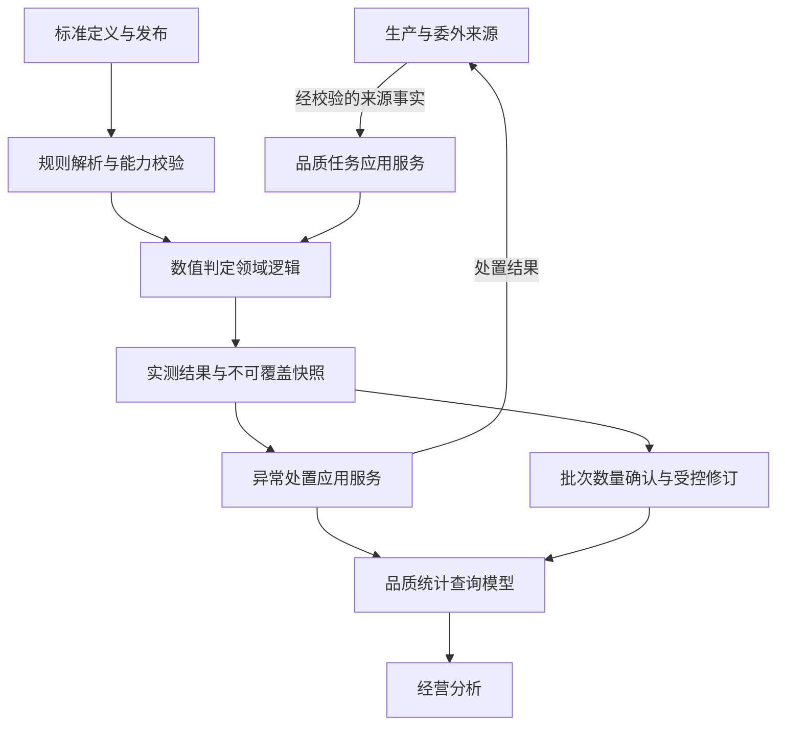

# 品质领域跨模块写入归属、异常处置与数量结算架构审查

2026-11-10 配置范围补充：品质统一维护异常点，现有检验站按需多选绑定，设计与实施验收见[异常点目录、检验站绑定与组件复用](../frontend/quality-shared-defect-type-catalog-inspection-station-bindings-and-reusable-configuration-components.md)。配置归品质所有，不在异常点上固定返修工序。后续返修结合发现站、异常点和实际产品路线确定；当前只实施配置，不改写生产流转或把 `REWORK` 处置关闭当作返修、复检完成。

2026-11-09 检验站与扫码位置确认：品质标准中的“环节”统一指品质所属的检验站，系统默认写入成型检验站、机加检验站、精细检验站、涂装检验站，并允许配置。四站也是实际扫码的地点，扫码发生在相应站点转往下一环节的阶段。内部结构为“检验站 → 重量项目 → 等级规则”；品检站 ID、生产路线节点 ID、工序 ID 分别表达，扫码业务可引用品检站身份。当前已实现目录及规则配置，四站扫码录入与流转不能视为已经接通。

审查日期：2026-11-03。基于当前工作区代码，覆盖标准定义与发布、数值判定、检验任务、委外桥接、异常处置、批次数量结算和经营分析。

初审完成代码追踪和隔离复现；下方问题描述保留初审基线，当前修复状态见本节。初审探针通过 Go overlay 注入测试；PostgreSQL 使用现有测试夹具建立随机 schema，清理由夹具负责；数量修订复现使用内存 SQLite。

## 第一批修复状态：异常处置闭环

2026-11-03 已落实以下边界：

| 初审项                 | 当前状态                                                                                         |
| ---------------------- | ------------------------------------------------------------------------------------------------ |
| 1 来源可改绑           | 已修复；旧客户端来源字段只作为一致性断言，冲突直接拒绝                                           |
| 2 空 UUID 导致处置失败 | 已修复；可空关联写 NULL，真实 PostgreSQL 回归覆盖                                                |
| 3 生产实测接入范围     | 需按既有条码/路线契约核对；不默认新增手工生产任务入口                                            |
| 4 页面未消费处置命令   | 已修复；列表打开处置弹窗，保存失败保留输入，成功后显示只读结果                                   |
| 5 处置和结算可覆盖     | 处置已修复；数量重复确认更新原记录是既有契约，后续只在原契约内审查并发与审计，不默认新建修订流程 |
| 6 委外直接写品质表     | 写入归属仍待统一；本批已阻止异常关闭改写已联动库存的委外处置                                     |
| 7 审批前能力校验       | 待实施                                                                                           |
| 8 查看与写入权限混用   | 已拆分异常处置权限；实测、领取、数量确认等其他命令仍待拆分                                       |

处置应用服务位于 `server/services/quality_abnormality_disposal_immutable_source_and_transactional_closure.go`。它要求当前操作者身份，在异常行锁内验证来源和状态，保存处置与字段前后审计，审计失败整体回滚。已关闭记录的相同请求直接返回原记录，不改处置人、更新时间或重复写审计。未关闭的委外异常只能确认已有决定和数量，不能通过异常界面改库存依据。

历史缺失来源只可从原检验任务恢复，历史缺失发生时间依次采用任务完成时间、异常创建时间；客户端不能指定新的归属或统计期间。任务不可用或两边来源矛盾时拒绝关闭，需后续独立修复流程。普通报废数量必须为有限正数，单位必须已启用；核验单位时使用共享锁。委外关闭只确认既有事实，允许展示和保留已经停用的历史单位。

`action_quality_abnormality_dispose` 已加入后端权限常量、管理员兜底、前端动作目录和生成契约，路由和弹窗均校验。普通品质查看账号保持只读，授权处置人员需获得该动作。品质账号可读取单位目录，单位维护仍要求原有菜单及维护权限。单位选择器抽到基础设置的 `configured-active-unit-select.tsx`，原受控协议组件作为兼容包装，异常处置不再依赖协议专用组件和文案。

回归覆盖：品质前端 91 项、HTTP 动作授权、单位读取与维护隔离、PostgreSQL 手工 FAIL → 处置、来源不可改绑、旧来源恢复、空 UUID、有效单位、并发单一决定、相同请求重试、关闭不可覆盖、审计失败回滚、委外决定锁定。前端构建、ESLint、国际化、编码、字体和权限契约检查通过。PostgreSQL 隔离运行器共通过 15 个工作流组（包含原标准审批与实测回归）。浏览器验证中文失败保留及重试关闭、英文暗色、1366/390/320 宽度和无处置权限只读；320 宽度无横向溢出，控件均为 13px / 20px / 500。浏览器使用隔离数据，不写真实业务记录。

新增正式回归源码：

- `server/services/quality_abnormality_disposal_postgres_source_integrity_and_closure_test.go`
- `server/handlers/quality_abnormality_disposal_http_action_permission_contract_test.go`
- `server/routes/quality_unit_catalog_read_access_preserves_maintenance_permissions_test.go`
- `src/features/quality/components/quality-abnormality-disposal-permissions-retry-and-immutable-source.spec.tsx`

隔离运行器和日志：`output/playwright/run-isolated-postgres-quality-abnormality-disposal-regression.mjs`、`output/playwright/quality-abnormality-disposal-postgres-regression.log`。初审探针断言的是旧缺陷，不能不经修改就作为修复后的通过标准。

## 文档对齐与实施范围校正（2026-11-03）

本报告是审查记录，不是新增业务功能的需求来源。用户明确要求避免无依据的新增功能后，重新对照已有文档，修正初审将集成缺口直接转成新增入口待办的判断：

- [生产委外执行链路设计](生产委外执行链路设计.md)第 4.2 节规定实际工序由条码状态的 `routeStepId` 确定，生产执行复用统一扫码命令；`ProductionPlan` / `ProductionTask` 是计划来源，不能直接代替条码当前工序。`ProductionExecutionLot` 只提供可选计划/任务/批次关联，不能变成普通执行的硬前置。
- [经营分析域架构与数据契约](经营分析域架构与数据契约.md)第 5.1 节明确无稳定生产关联时置灰数量按钮，结算只维护品质数量事实，不改变生产或一维码状态；同计划同批次重复提交更新原记录，是已声明的行为。
- [车圈品质标准设计建议](rim-production-quality-standards-bom-branch-hole-reinforcement-locking-and-barcode-process-measurements-design.md)明确自身为设计建议，逐圈实测涉及实际 BOM、锁定孔数、检测点、路线节点及执行轮次。不能仅凭本报告“补入口”的建议建立另一条仅选生产工单即可完成生产品质接入的流程，也不能把其中尚未实施的建议自动当成本轮授权待办。
- [现有通用实测契约](../frontend/quality-standard-configurable-deviation-grades-and-server-authoritative-measurement-history.md)明确独立手工检测与来源任务的区别。无生产关联的手工检测不能结算，是边界约束；这本身不是需要放宽或新增入口的缺陷。

因此本轮不新增普通生产检验创建页面、来源选项 API、任务创建命令或额外状态流。后续解耦优先审查已有入口中的写入归属、重复校验、事务、并发和审计；不改变既有业务含义。确需新增生产品质接入时，先在现有条码/路线设计中明确范围，不能从“报表需要关联”反推新业务入口。

## 品质规则与生产跟踪单的后续对齐（2026-11-09）

用户明确重量品质标准是独立的规则能力：品质定义各项目重量、上下偏差、等级和合格判定，并维护四个品检站。四站也是实际扫码地点，扫码发生在相应站点转往下一环节的阶段。扫码录入引用产品跟踪单及已发布品质标准；其中生产工序记录由对应来源业务维护，不改变站点的品质归属。标准编辑界面维护配置，现场扫码入口引用该配置。系统未上线，不做旧配置格式兼容。实现状态与最新职责边界统一记录在[品质检验站配置文档](../frontend/quality-standard-configurable-inspection-stage-catalog-and-item-name-snapshots.md)，本次文档校正不表示四站扫码流转已经实施。

已具备项目的品质检验站关联、三层重量规则编辑、独立等级、服务端数值判定、标准版本与结果快照、提交防重和通用不合格异常记录。尚缺四个品检站扫码定位产品跟踪单、录入与规则引用的连接；现有通用实测按整份标准核验必检项，用户确认保留该校验。按现场纸单，一次扫码录入可以包含多个已完成工序分区，具体范围需按四个扫码点逐项对齐，不能将品检站 ID 与生产 `routeStepId` 混用，也不能把四站误写成四站以外的单一转录地点。

新增、编辑、详情继续使用同一三级标准结构。生产侧明确本次录入范围及引用项目，服务端核验产品、版本和项目并复用品质判定；真实作业员、工序日期与录入人、录入时间分开。现场手工输入与后续自动读秤只区别输入来源。报警依据是服务端 FAIL，报警呈现、异常处置和过站拦截分别对齐，不将未达到 S 级、实测不合格、报废、生产暂停和数量结算混成同一个动作。

本轮方向不扩大为整个车圈 BOM／孔数／设备互锁方案的实施。扫码的实际地点是四个品检站；生产来源业务证明条码及工序记录来源，持有产品跟踪单中的生产事实、生产执行及条码状态写入；品质侧持有品检站目录、重量规则与判定，既有异常处置仍按原职责处理。保存跟踪单不自动执行过站；独立手工检测、委外来源和可选执行批次的既有边界继续适用。

## 判断

固定 S/A/B 已从通用判定的必需条件中移除；规则按标准项目保存，通用实测有服务端判定、版本校验、任务锁、提交防重和结果快照。这些是应保留的边界。

整个品质领域仍需核对写入归属：委外与品质服务共同维护检验、异常记录，既有数量更新缺少完整并发和前后审计。生产实测如何接入应依照既有条码/路线契约核对，不能以通用手工实测不能结算为由直接新增生产任务入口。上轮通用实测的回归通过，不能证明这些跨模块路径已经闭合。

## 已确认问题

### 1. P1：异常处置可以改写检测来源关联

位置：`server/services/quality_service.go:250`、`:256`、`:259`。

`RecordQualityAbnormalityDisposal` 对请求中的非空生产计划、订单、产品、批次直接覆盖，随后只对缺失字段回填任务关联。没有检查新关联是否与任务一致，也没有验证所填计划、订单是否存在。

隔离 PostgreSQL 复现：建立产品 A、批次 A 的不合格实测；处置请求携带另一个产品 UUID、批次 B、任意计划和订单 UUID；请求成功，异常归属被改变。`business_analysis_service.go` 优先采用异常自身关联，因此后续统计也会采用被改写的归属。

修正方向：处置命令只携带处置决定和必要数量；来源关联由检验任务派生并锁定。历史缺失关联的修复使用独立命令，要求校验实际来源、记录修复原因和修改前后值。

### 2. P1：新建手工检测的异常无法直接完成处置

位置：`server/services/quality_service.go:299`。

手工实测允许不关联生产计划和订单，但处置更新把空字符串写入对应 UUID 列。通用实测创建时已对这些列处理空值，处置命令未使用同一持久化约定。

隔离 PostgreSQL 复现：正常保存手工不合格实测，然后仅提交 `REWORK` 处置，返回 `22P02`（无效 UUID）。这与尚未完成生产任务建档是两个问题：无生产关联的手工检测仍应允许完成自身异常处置。

修正方向：明确可空关联类型，统一空值持久化，避免每个服务自行判断省略或写 NULL。不可通过允许用户随意补填生产关联来绕过此错误。

### 3. 生产实测接入需核对既有契约，不直接作为新增入口缺陷

位置：`server/services/quality_inspection_measurement_submission_service.go:90`、`:95`；`server/services/quality_quantity_settlement_service.go:148`。

通用录入禁止新建任务携带生产计划、订单、条码或来源，这能防止客户端伪造关联；数量结算又要求任务关联生产计划。全库创建路径追踪中，当前正式来源任务的建立入口只找到委外桥接；通用提交还明确拒绝委外任务。

结果是：新建手工实测可以完成判定，但无法成为普通生产的批次数量结算依据。这符合当前独立手工检测的边界，不能据此推导必须新增生产工单选择和任务建立流程。生产任务来源、条码实际工序和检测点接入是不同问题。

校正方向：保留手工实测不接受任意生产关联的约束，按现有条码状态、路线节点和可选执行批次关联核对生产接入。尚未接入的能力作为集成范围记录，不自动新增页面、API 或业务前置条件。

### 4. P1：处置接口没有被异常页面使用

位置：`src/features/production-quality/tabs/quality-abnormalities.tsx:244`；`src/features/quality/hooks/use-quality.ts:136`。

页面只读取异常并展示卡片，箭头按钮没有动作。处置 service 和 mutation 已定义，但全库检索未找到页面消费该 mutation。因此实测不合格后提示“到异常处置”，普通页面操作仍无法形成闭环。

修正方向：页面消费已有应用命令，增加受权限控制的处置表单、失败保留与重试、只读处置历史。需先收口上述处置服务边界，避免直接把现有宽 DTO 暴露成可编辑表单。

### 5. P1：处置与结算事实可直接覆盖，修订边界不完整

位置：`server/services/quality_service.go:239`、`:304`、`:313`；`server/services/quality_quantity_settlement_service.go:213`、`:223`、`:227`、`:254`。

处置接口不限制当前状态；已 CLOSED 的 SCRAP 可以再次改为 REWORK，原报废数量被清空。数量结算按计划和批次锁定已有行后直接更新，既没有期望版本，也没有修订原因。两处审计调用均未携带修改前后值。

隔离复现确认：同一批次先确认投入 10、合格 8、报废 2，再确认合格 10、报废 0，并把发生日期从十月移到十一月；仍返回同一个记录 ID。两条审计的 diff 均为空数组。

当前重复确认覆盖是已有实现明确允许的行为，不能仅称为“防重”。经营分析按 `occurred_at` 过滤，重复确认还可能改变原期间报表。行锁保证串行，不会阻止旧页面在稍后覆盖较新的确认值。

文档校正：数量重复确认更新同一条记录是现有经营分析契约明确允许的行为，不应直接改为禁止更新，也不默认新增修订/冲正页面和命令。后续在原更新契约内检查旧页面覆盖风险、操作者与修改前后审计；如要改变统计日期或数量的修订规则，应先明确并同步原业务契约。

### 6. P2：委外仍直接拥有品质记录的写入逻辑

位置：`server/services/production_outsource_quality_bridge.go:210`、`:251`、`:281`；`server/services/production_outsource_execution_service.go:428`。

委外流程直接写 `InspectionTask.Result = req.Result`，并自行创建带处置和数量的品质异常。该请求只携带结果、处置和数量，不含标准版本及逐项实测；不会进入通用判定、规则快照和逐项结果链路。

这是当前独立人工委外判定路径，不应误称为通用数值接口被绕过。但同一品质表中的“完成结果”存在两种依据，模型未明确区分，改动品质规则和异常状态约束时必须同步理解委外代码。

修正方向：由品质应用服务维护检验和异常不变量，委外只传来源事实并消费判定/处置结果。数值实测与授权人工判定应有明确的模式和依据。委外库存、生产状态和品质事实仍可使用同一事务。

### 7. P2：审批前规则校验与执行能力校验脱节

位置：`server/services/quality_standard_inspection_criteria_validation_service.go:45`；`server/services/quality_inspection_configurable_deviation_grading.go:164`。

保存和提交审批校验名称、单位、分级等规则，未校验公式是否可执行。执行阶段仅支持空公式或历史 `measuredWeight`。

隔离 PostgreSQL 复现：数值项目带 `formula: unsupportedFormula`，通过待审批项目校验，执行时被拒绝为“尚不支持自动判定”。当前也没有明确的标准执行模式声明该标准仅供人工判定。

修正方向：统一规则解析和能力检查。草稿可保存未完成内容，进入审批或发布前应验证所声明执行模式的能力；人工规则使用明确类型，不能静默当作自动数值规则。

### 8. P2：品质查看权限与业务命令权限未分开

位置：`server/routes/routes.go:105`、`:407`、`:410`、`:413`；`src/features/authz/data/action-permission-catalog.ts:674`。

通用实测、领取、处置、数量确认都继承 `menu_quality`，没有各自操作权限；当前品质动作目录主要是实验分类管理。委外检验已有单独的提交动作权限，两条路径授权粒度不同。

这意味着仅靠当前品质菜单权限无法表达“可以查看、不能处置或确认数量”。认证、CSRF 和领取人保护仍存在，但不能替代业务动作授权。

修正方向：按查询、实测提交、异常处置、数量确认、历史修订划分动作权限，并在路由和页面一致执行；服务层继续验证身份和业务状态。

## 次级技术债

- 分级、标准项目、快照仍多处使用自由 JSON 和类型断言。`quality-standard-api-adapter.ts:95` 只检查数组就转换成项目类型，没有运行时解析。
- 当前标准项目类型只支持品质检验站、重量及上下偏差等级；旧 S/A/B 专用字段、范围转换和旧通用编辑分支已删除。每个项目的检验站和等级字段必填，API 读取按该契约校验。
- 判定算法版本、规则结构版本没有独立记录。现有快照足够展示当时的规则和已存结果；若未来需要按旧算法精确重放，需要额外的版本约定。
- 所有服务仍处于同一个 Go `services` 包。文件拆开有助阅读，但无法通过包可见性限制委外对品质持久化的直接写入。
- `Inspector`、`ClaimedBy` 混用用户名和用户 ID。长期应持久化稳定的用户 ID，显示名称另行快照；当前提交防重标识也应成为明确的命令契约。

## 建议的职责边界

来源模块负责证明“来自哪个计划、工序、条码”；品质任务服务负责领取、完成、关联和判定依据；分级引擎只消费已解析的规则与实测；处置服务维护处置生命周期；结算服务维护完整批次数量与修订历史；经营分析消费明确的品质查询契约。

推荐维持模块化单体，先统一领域写入和类型，不要求拆进程。委外库存、生产动作、品质完成目前在同一事务内具有一致性价值；不应为抽离文件而直接改成跨服务调用或异步分发。通知可以沿用已有 outbox，核心事实应继续原子提交。

## 后续审查顺序（不自动扩展功能范围）

1. 收口处置命令：锁定来源关联、统一可空 UUID、补齐动作权限及修订审计；再接入异常处置页面。
2. 生产品质配置与扫码称重按上方统一对齐清单逐项核对，当前只收口内部三级结构，路线与扫码不自动实施；沿用既有条码／路线和可选批次契约，不新增独立的手工生产任务建立入口。
3. 在既有数量确认更新接口内核对并发保护与修改前后审计，保留原有数量语义；不默认扩展修订或冲正流程。
4. 把委外品质写入委托给品质应用服务；显式区分人工判定与自动数值判定，保留现有事务。
5. 统一规则类型、审批前能力检查和快照版本，再通过 Go 包边界限制直接访问品质持久化。

## 证据及复现文件

- `output/playwright/quality-architecture-cross-domain-boundary-reproduction-results.log`：3 个隔离审查探针，确认当前缺口；探针通过表示缺口被成功复现，不表示问题已修复。
- `output/playwright/quality_architecture_cross_domain_ownership_and_disposition_boundary_reproduction_test.go`：复现源码。
- `output/playwright/run-isolated-quality-architecture-boundary-reproductions.mjs`：从本地环境读取连接信息，使用 Go overlay 执行；不输出凭据。

其他关于入口、权限、委外写入归属及类型结构的结论来自全库静态追踪。当前实施范围以开头修复状态为准；旧复现探针保留为初审证据，正式回归使用新增测试。
