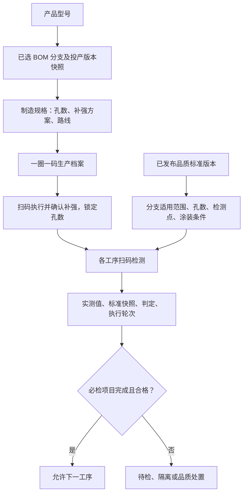

# 车圈品质标准：BOM 分支、孔数补强锁定与逐圈扫码称重设计

2026-11-09 检验站与扫码位置确认：品质标准中的“环节”统一指品质所属的检验站，系统默认写入成型检验站、机加检验站、精细检验站、涂装检验站，并允许配置。四站也是实际扫码的地点，扫码发生在相应站点转往下一环节的阶段。内部结构为“检验站 → 重量项目 → 等级规则”；品检站 ID、生产路线节点 ID、工序 ID 分别表达，扫码业务可引用品检站身份。当前已实现目录及规则配置，四站扫码录入与流转不能视为已经接通。

初稿日期：2026-11-02；能力基线及三层配置方向更新：2026-11-03；现场产品跟踪单与品质／生产职责校正：2026-11-09。本文结合现场说明、标准照片和代码记录整体设计建议；已实现能力见第 3 节，不能把设计章节直接视为当前生产行为。

本轮用户确认先将“检验站 → 重量标准项目 → 等级规则”及后续扫码称重异常报警方向写入相关文档，再逐项对齐。用户最新限定当前只完成标准内部三级系统；新增、编辑、详情统一使用单一等级格式，删除旧编辑及格式兼容。本文跨模块内容保留为后续设计，不自动推进。实施状态和验收统一记录在[品质检验站配置文档](../frontend/quality-standard-configurable-inspection-stage-catalog-and-item-name-snapshots.md)的“逐项对齐顺序与验收”。

本文其余关于 BOM 分支、孔数补强、矩阵、设备互锁和必检过站拦截的内容保留为整体设计建议，不自动转成本轮实施项。报警需求已明确；是否拦截过站、具体处置后的放行条件仍需按项明确。

2026-11-09 现场边界确认：重量品质标准独立定义重量项目、上下偏差、等级及合格判定；成型、机加、精细、涂装四个品检站也是实际扫码地点，扫码处于相应站点转往下一环节的阶段。人员在不便使用手机的工作场合先人工书写记录，再按扫码点的实际要求录入；不能推断四站之外另有一个统一事后转录点。卷制、组合、成型完成后可集中填写这三个工序的内容，不要求三个工序分别扫码。品检站身份与生产路线节点分别表达，产品跟踪单中的生产工序信息仍由来源业务持有。以下完整制造候选场景不自动成为实施前置，自动读秤仅作为后续录入取值方式单独考虑。

## 1. 已确认的业务边界

- 每个车圈有唯一条码，各工序沿用同一码。
- 产品型号下存在 BOM 分支，BOM 承接配方、性能版本、内部／客户归属等信息。
- 孔数目前独立于 BOM，但关联固定的补强位置。21 孔补强的实物不能作为 24 孔车圈继续钻孔。
- 用户最后补充的补强约束明确了先前“生产中可以调整”的边界：孔数必须在补强作业前确定，补强执行后锁定；涂装要求按实际进度单独控制。
- 照片是一份覆盖多个型号、孔数及品检项目的重量标准文件，不能把整份文件压缩成某个 BOM 的一个重量。

条码中的孔数表达这只车圈的制造规格。扫码后还要核对已确认的补强记录；条码本身不能证明实物确实按该补强方案生产。

## 2. 照片说明了什么

以下只摘录图片中 R35-M 清晰可见的前四项，单位均为 g；正式录入仍需品质人员核对原文件。

| 型号  | 孔数 | 内圈重 ±5 | 卷制纱总重 ±5 | 成型纱净重 ±13 | 机加重 ±13 |
| ----- | ---- | --------- | ------------- | -------------- | ---------- |
| R35-M | 21   | 206       | 403           | 357            | 354        |
| R35-M | 24   | 210       | 406           | 360            | 357        |

这些差异在钻孔前的检测环节就存在，不能简单解释成“多钻几个孔，所以成品少几克”，也不能按孔数比例计算重量。

例如机加实测 354g：21 孔标准范围为 341～367g，24 孔标准范围为 344～370g，两者都会通过。重量合格不能证明孔数和补强正确，必须独立验证规格一致性。

图片还包含“涂装工艺精细重”“免涂装重”“涂装无标重”“涂装有标重”。处理原则：

- 每一列先明确测量口径及对应工序，品质负责重量规则，生产侧负责记录与引用。实际测量和集中录入可以发生在不同时间；不能把标准列直接当作扫码站点，也不能只按列顺序创建生产路线。
- 免涂装、涂装无标、涂装有标按适用条件配置。具体哪些是互斥的最终状态、哪些需要中间称重，应由现场工艺确定，不能要求每只车圈无条件完成全部列。
- “涂装工艺精细重”可见 358、361，但图片中没有清晰的公差依据，应标记待确认，不能自行套用相邻列公差。
- 合并单元格只表示纸面表达。确认覆盖哪些型号／孔数后，才能建立明确的共用规则；空白不能解释为 0、任意值或自动继承。

## 3. 当前代码的能力与缺口

| 领域     | 已有能力及依据                                                                                                                                                                                                                           | 本次需求的缺口                                                                                                                                                   |
| -------- | ---------------------------------------------------------------------------------------------------------------------------------------------------------------------------------------------------------------------------------------- | ---------------------------------------------------------------------------------------------------------------------------------------------------------------- |
| BOM      | [BOM 模型](../../server/models/bom.go) 包含产品、客户归属、性能版本及 `MeasuredWeight`                                                                                                                                                   | 一个重量不能表达孔数与多个工序的标准矩阵；也没有逐圈实测记录                                                                                                     |
| 标准     | [品质模型](../../server/models/quality.go)、[前端标准结构](../../src/features/quality/data/schema.ts) 支持产品、项目、中心值、单位、独立等级和审批发布；项目必须关联启用的品质检验站并记录名称，重量规则编辑已按检验站形成三层分组       | 尚未接通生产跟踪单的规则引用；四个品检站也是扫码地点；站点 ID 与生产路线节点 ID 分别表达。BOM 适用范围、孔数、涂装条件、业务版次／生效日期属于更大范围的设计待项 |
| 受控协议 | [协议创建工厂](../../src/features/quality/services/controlled-protocol-standard-factory.ts) 当前关联一个产品，支持多个项目；`type` 使用 FQC 服务分类值，页面已不要求填写类型                                                             | 三层结构按品质检验站组织，不依靠旧类型字段定位工序；跨产品标准矩阵仍为后续设计建议                                                                               |
| 条码     | [签发服务](../../server/services/linear_barcode_print_service.go) 从订单行快照生成型号、外观、孔型、孔数和流水号                                                                                                                         | 码中没有 BOM 标识或客户标识，不能仅靠解析码确定制造分支；打印时的外观也不能自动代表后续实际涂装状态                                                              |
| 孔数来源 | [销售订单行](../../server/models/trading.go) 有孔数、钻孔方案、外观快照；[裁剪下发](../../server/services/production_cutting_issuance_service.go) 从订单行取孔数                                                                         | 需把同一确定规格串到单圈生产档案、补强执行和钻孔校验，避免各处独立修改                                                                                           |
| 投产依据 | [领料来源快照](../../server/models/production_material_issuance_document_source_snapshots_and_active_coverage.go)、[BOM 选择契约](../../server/services/production_material_requirement_basis_contract.go) 已保留订单行和选定 BOM 的依据 | 应让单圈档案引用实际投产依据，不能扫码时重新选当前最新 BOM                                                                                                       |
| 扫码执行 | [生产执行模型](../../server/models/production_execution.go) 已有逐码状态、操作、事件及执行轮次；[扫码命令](../../server/services/production_scan_command_service.go) 已有幂等及路线推进                                                  | 生产侧集中扫码录单尚未接通品质规则引用和异常提示；扫码识别、保存跟踪单与执行过站需要分别处理                                                                     |
| 质量关卡 | [路线模型](../../server/models/production_route.go) 有 `QualityGate`；路线服务校验 NONE／OPTIONAL／REQUIRED                                                                                                                              | 当前扫码推进流程尚未用该配置核验相应称重记录，仅选 REQUIRED 不等于已经防漏检                                                                                     |
| 检验执行 | [服务端判定](../../server/services/quality_inspection_configurable_deviation_grading.go) 已按项目中心值及等级计算结果；通用提交已有产品／版本核验、规则快照、提交防重及不合格异常记录                                                    | 当前通用前后端按整份标准核验必检项，尚未实现生产跟踪单按本次录入范围引用项目的契约；不能将其他录入环节的必检项提前要求本次填写                                   |
| 分级     | [自定义等级编辑](../../src/features/quality/services/configurable-inspection-deviation-grade-rules.ts) 与服务端支持 1–20 个等级、非对称上下偏差及 PASS／FAIL；S／A／B 只是可修改默认值，超差不自动报废                                   | 后续扫码应复用同一判定语义；照片中的 ± 公差不自行推导额外等级，报警依据是 FAIL，处置仍独立确认                                                                   |

能力表沿用 2026-11-03 源码基线，需求归属按 2026-11-09 现场集中录单说明校正。已有标准编辑和通用实测的验证见[检验站配置](../frontend/quality-standard-configurable-inspection-stage-catalog-and-item-name-snapshots.md)及[实测留痕契约](../frontend/quality-standard-configurable-deviation-grades-and-server-authoritative-measurement-history.md)；这些验证不能代替尚未接通的生产跟踪单与品质规则引用验收。

## 4. 建议采用的关系

本节图示为完整制造与放行的候选设计。当前已确认的现场集中录单按第 7.1 节处理，不要求先实现图中的所有制造规格、补强和放行控制。



日常理解可以写成：**BOM 分支确定配方背景，孔数确定补强规格，检测点确定当前重量口径，条码把这些信息绑定到同一只实物。**

匹配时至少使用：产品身份、实际 BOM 分支适用范围、锁定孔数、检测点、已选标准版本；涂装及贴标条件只在受其影响的检测点参与。

### 4.1 孔数放在 BOM 外可以，但不能只剩一个孤立数字

建议建立明确的“BOM 分支可生产规格”，维护：

- 允许的孔数／孔型。
- 对应补强方案及版本，包括补强位置、材料和工艺要求。
- 对应可用钻孔方案／程序的版本。
- 需要执行的检测点及品质标准适用关系。

例如“BOM 分支 B 允许 21 孔和 24 孔”，必须能分别找到经过确认的补强和检测配置，不能只允许操作员自由填写 21 或 24。

是否另建孔数 BOM 分支，取决于真实配方：

| 实际差异                                         | 建议                                                                                           |
| ------------------------------------------------ | ---------------------------------------------------------------------------------------------- |
| 配方及物料用量相同，仅补强布局／工艺或检验值不同 | 可共用 BOM，分别绑定孔数工艺规格和品质规则                                                     |
| 补强材料、片数或用量不同                         | 物料差异也必须进入 BOM／经审核的变型用量规则；如果现有 BOM 不支持变型，使用明确的孔数 BOM 分支 |
| 只是标准文件不同，配方与工艺完全相同             | 维护品质标准适用关系，不因此复制配方                                                           |

现有 BOM 明细使用固定物料与用量，没有现成的孔数条件用量规则。不能假设“孔数在外部”已经解决了不同补强用量的领料和成本问题。

### 4.2 品质标准作为独立文件管理

一份标准文件可以包含多个型号和多个检测点。文件头保存编号、业务版次（例如 A2）、生效日期、适用产品范围、审批发布事实；单元格对应的规则保存中心值、公差、单位及条件。

同一份规则可以被多个已审核的 BOM 分支显式引用，测量时仍保存实物实际使用的 BOM 分支和版本。

客户专用 BOM 和实际销售订单客户是两个字段。内部 BOM 也可能用于某客户订单；客户专用标准有要求时，必须校验实际订单适用性，不能把 `OwnerCustomerID` 当作所有场景下的订单客户。

### 4.3 本轮确认的配置层级与归属

具体产品的品质标准版本下，按品质检验站组织重量标准项目，再在项目下配置等级名称、上下允许偏差和合格／不合格结果。检验站目录维护品检站点的名称、说明、显示顺序和启用状态；中心值、单位和等级归具体标准项目持有，同一个检验站下不同产品和项目的规则彼此独立。

现有 `items[].inspectionStageId`、`inspectionStageName`、`centerValue`、`unit` 和 `levels` 表达配置归属，重量规则的界面分组和保存回读已据此完成。项目必须归属启用的品质检验站；新增、编辑和详情使用同一三级结构，分组不重排保存数组，项目等级彼此独立。系统未上线，不保留未指定分组、旧编辑入口或旧范围规则转换。

品质检验站是品质域独立维护的品检站点，也是用户确认的实际扫码地点，标准按站组织重量项目。`inspectionStageId` 标识品检站，扫码业务可引用它，但不能当作生产的 `routeStepId` 或 `branchOperationId`。四个扫码点各自需要录入哪些跟踪单内容应按现场要求逐项对齐，不从站名或项目数组自动推断，记录引用也不改变站点归属。来源业务负责证明产品身份及记录来源，服务端核验产品、标准版本和项目。实际生产当前位置仍以条码状态中的 `routeStepId` 为依据，但它不等于本次填写范围；补录已完成工序也不把产品当前位置回退。

已确认的目标链路为在四个品检站的相应扫码点识别产品 → 打开产品跟踪单的本次录入分区 → 填写工序信息及重量 → 服务端引用已发布品质规则判定 → 保存生产记录及判定依据 → 显示超差提示。品质侧维护规则，不承接生产扫码表单。生产集中录单与规则引用尚未集成；涉及执行轮次、路线推进或放行的行为由生产业务单独明确，不能从填写重量隐式产生。

## 5. 孔数锁定与错误拦截

### 5.1 两个锁定时点

1. 条码签发时，码中的孔数已固定。订单调整不能静默改变已签发码的含义；未投入实物使用的错误标签走已有未绑定标签作废及重新签发流程。
2. 补强执行前，确认该码的孔数、工单规格和选定补强方案一致。确认执行后锁定实物孔数，并记录补强方案版本、人员、时间及执行事件。

已投入实物使用的车圈需要纠正错贴标签时，先隔离核查实物。若确属标签错误，走专门的受控更标和旧新码关联流程；不得直接编辑孔数，也不得复用未绑定标签库存的报废流程处理实物。

### 5.2 钻孔前的硬校验

至少满足：

```text
条码孔数 = 单圈锁定孔数 = 补强方案孔数 = 所选钻孔程序孔数
```

还要验证补强布局与钻孔孔位适配，单纯孔数相同仍不足以证明方案兼容。钻孔完成可另记录实际检验孔数，不能用程序设定值自动冒充实测结果。

不一致时后端拒绝开始／完成相关操作并提示具体冲突，例如“本圈已确认 21 孔补强，当前钻孔程序为 24 孔”。生产权限、重复扫码、换手机、直接调用接口都不能跳过此校验。

有设备接口时可校验设备实际加载程序；第一期只能人工选择并确认程序时，应如实记录确认来源，不能宣称已实现设备互锁。

### 5.3 生产中更改要求的边界

- 已补强的 21 孔车圈收到 24 孔订单变更：作为不兼容变更隔离评估，安排合适实物；不得只改档案或换品质标准放行。
- 孔数未确定：不能进入要求固定补强规格的生产环节，也不能凭打印码中的 00 自动视为“通用孔数”。
- 涂装／贴标未确定：若已发布规则明确不依赖涂装，前道称重可以继续；涉及涂装路径、称重或最终放行前必须确定要求。
- 更改涂装／贴标：核对当前实物已完成的工序及可返工范围，保留变更历史；受影响的测量和检测点按新执行轮次复检，原实测和原判定保留。

## 6. 品质标准页面应怎样表现

本节的跨型号／BOM／孔数矩阵是整体设计建议。第 4.3 节的单份产品标准三层重量规则编辑已完成，不包含矩阵、适用条件编辑或发布规则扩展。

标准列表显示标准编号、业务版次、生效状态、适用产品／BOM 分支、孔数范围及检测点覆盖情况。

进入车圈重量标准后，使用与纸面接近的矩阵：

| 型号／BOM 适用组  | 孔数 | 补强方案  | 内圈重 | 卷制纱总重 | 成型纱净重 | 机加重 | 涂装工艺精细重 | 免涂装重   | 涂装无标重 | 涂装有标重 |
| ----------------- | ---- | --------- | ------ | ---------- | ---------- | ------ | -------------- | ---------- | ---------- | ---------- |
| R35-M／已审核分支 | 21   | 21 孔方案 | 206±5  | 403±5      | 357±13     | 354±13 | 待确认公差     | 按确认规则 | 按确认规则 | 按确认规则 |
| R35-M／已审核分支 | 24   | 24 孔方案 | 210±5  | 406±5      | 360±13     | 357±13 | 待确认公差     | 按确认规则 | 按确认规则 | 按确认规则 |

编辑单元格时配置检测点、路线节点、适用状态、标准值、上下偏差、单位、必检／抽检要求及检测方法。型号名称可能不是完整产品身份，应关联真实 `productId` 和已审核分支。

“未配置”“不适用”“共用已确认规则”必须区分。必检格未配置、公差未确认、工序未绑定或规则重叠时禁止发布。共用规则的来源应可见，修改后能看到影响哪些规格。

照片里的 ± 公差先采用区间合格判定。例如 354±13g 对应含边界的 341～367g。需要 S／A／B 时再单独维护分级规则。超差产生不合格或待处置事实，返工、报废、让步接收仍由品质处置决定。

## 7. 生产扫码录入与候选放行流程

### 7.1 已确认的现场集中录单

1. 卷制、组合、成型三个工序完成后，在同一录入地点用巴枪扫描产品一维码，识别该件产品并打开产品跟踪单。
2. 同一张单展示卷制内圈、组合圈、成型三个分区，按现有纸单填写各工序实际信息。重量之外的尺寸、批号、治具、作业员、日期等属于生产记录，不全部塞入品质重量标准。
3. 生产侧各重量字段引用相应的品质标准版本及项目，服务端复用独立的品质规则计算等级与合格／不合格，生产页面展示判定和超差提示。操作员不手工决定 PASS，也不在生产侧重写超重阈值。
4. 生产侧保存同一码下的工序记录和品质判定依据。实际作业员及工序日期与录入人及录入时间分开，保存记录不自动执行三个工序的过站。
5. 当前重量采用手工输入。后续电脑接秤只为同一重量字段提供另一种取值方式，不与手工录入、品质标准维护或生产状态推进混在一起。

本节是需求与职责说明，尚未代表已实现的产品跟踪单。成型、机加、精细、涂装四个品检站都是扫码地点，扫码发生在相应站点转往下一环节的阶段；上述三个工序集中录单不表示四站共用一个外部转录地点。各扫码点具体填写哪些内容需逐项对齐，并继续引用同一套品质规则能力。

### 7.2 完整制造与放行的候选场景

以下原完整流程仅用于以后明确逐工序控制时的候选设计，不是第 7.1 节集中录单的实施前提，也不表示现有功能已经整体验收。必检过站、复测及设备接入分别对齐。

1. 工位先绑定或选择生产路线中的具体节点和检测点，同一路线重复出现同一工序时使用 `routeStepId` 精确区分。
2. 扫描这只车圈的唯一条码，后端读取其投产档案和锁定规格。显示型号、BOM 分支／性能版本、孔数、补强确认情况及当前适用状态。
3. 后端返回唯一匹配的标准规则和已绑定版本。操作员不再手工挑 21 孔还是 24 孔重量，也不手填客户或中心值。
4. 工位仅展示当前要测的项目，输入重量或接收电子秤数据。第一期支持人工输入，电子秤接口按实际设备确认后接入。
5. 后端验证单位、数值、规格、标准版本、当前路线节点和执行轮次，计算偏差和合格结果；不能相信前端提交的 PASS。
6. 保存实测、规则快照和判定。必检项全部完成且合格或具有有效的特定让步处置后，才允许推进；不合格测量要成功保存并进入待处置，不能因判定失败把测量一起丢弃。
7. 重复扫码先显示已有记录；网络重试以同一幂等键返回原结果。真正复测建立新记录并引用原测量，不能覆盖到只剩最后一次读数。

R35-M、已确认 21 孔、机加检测点的一次展示示例：

```text
条码：该车圈唯一条码
BOM：本圈实际投产分支及版本
孔数／补强：21 孔，补强已确认
检测点：机加后称重
标准：354g ±13g，允许 341～367g
实测：操作员或电子秤输入
结果：后端计算；若规格冲突则禁止按重量合格放行
```

## 8. 数据与后端边界

下列是职责建议，具体表结构在实现时结合现有审计和快照机制确定。

| 对象                     | 核心内容                                                                                                           |
| ------------------------ | ------------------------------------------------------------------------------------------------------------------ |
| 标准文件与不可变发布版本 | 文件编号、业务版次、生效范围、审批事实、完整规则快照；技术并发版本与 A2 等业务版次分开                             |
| 标准规则／适用关系       | 产品、允许的 BOM 分支、孔数、检测点、涂装／贴标条件、中心值、上下限、单位、必检要求                                |
| 单圈投产档案             | 条码、订单行及来源快照引用、实际 BOM 及版本、孔型孔数、补强方案版本及锁定事实、生产路线版本                        |
| 单圈状态变更记录         | 涂装／贴标要求和实际状态分开，记录受控变更及已发生工序的影响；锁定孔数的变更走异常纠错而非通用编辑                 |
| 工序测量与判定           | 条码、操作／检验任务、路线节点、检测点、执行轮次、实测数值及单位、设备或人工来源、标准规则完整快照、结果、复测引用 |

后端必须保证：

- 一个实物条码只有一个当前有效投产档案，BOM 和客户信息来自明确的投产关联；不能按型号编码取最近更新的产品／BOM 来猜测。
- 同一适用条件和有效时间命中且仅命中一条规则。无规则或有冲突时提示配置异常，不能自动选最新、最宽松或任意一条规则。
- 标准发布时检测必检缺项和条件重叠；草稿、审批通过但未发布的版本不能进入生产判定。
- 生产档案开始执行时绑定已发布标准版本；后续发布新版本不静默改变在制品。紧急切换需记录对象范围、原因及补检要求，已归档版本仍能解释历史测量。
- 规格、标准、路线及测量记录有预期版本校验。并发变更后，旧扫码页面的提交必须失败并重新读取。
- 必检放行检查与路线推进在同一受锁事务内完成；普通工序完成入口及其他有权推进的入口均复用该校验。
- 委外检测沿用现有委外任务边界，通过原委外检验入口调用同一匹配和判定服务，不能从通用品质入口绕过。
- 重量使用明确精度及统一单位换算，包含上下边界测试；单圈实测不可反写 `BOM.MeasuredWeight`，过程标准不从该字段自动推导。

## 9. 建议的落地顺序与验收

当前逐项状态与职责以[品质检验站配置文档](../frontend/quality-standard-configurable-inspection-stage-catalog-and-item-name-snapshots.md)为准：品质标准内部三级系统已收口，四个品检站同时就是扫码地点，扫码发生在相应站点转往下一环节的阶段；后续按各扫码点实际要求确定跟踪单录入内容并引用规则。品检站 ID 与生产路线、工序 ID 分别表达，不能混用。四站扫码录入、规则引用和实际流转尚未完成接通验收，本文完整车圈制造候选场景不自动成为待办。

若后续明确实施 BOM 分支／孔数适用条件，则需先核实实际投产 BOM 快照、允许的孔数及补强／钻孔方案，再实现相应匹配与锁定。尚未定义的适用条件不能默认为全部适用；资料待核实也不阻止先整理现有产品标准的三层编辑关系。

电子秤、钻孔程序互锁及下列完整制造场景继续作为后续候选范围，需先明确具体规则与接口，再列入相应实施项。生产扫码按阶段 C 要求产品码关联有效执行批次与计划，由计划 MBOM 分支解析唯一已发布路线；任务及批次号可选，不新增独立手工生产任务入口来替代实际条码与路线定位。

整体设计的候选验收场景（不是当前已实现声明）：

1. 同型号同 BOM 的 21 孔、24 孔扫码分别取到正确的各阶段目标值；即使重量落在重叠区间，也不能绕过孔数一致性检查。
2. 21 孔补强车圈选 24 孔程序时，开始／完成命令在后端被拒绝；相同孔数但不兼容的孔位布局同样拒绝。
3. 同型号不同客户／性能 BOM 分支不串用标准；同一规则明确共用时仍保留各圈实际 BOM 来源。
4. 缺少补强确认、缺标准、标准冲突、未确认公差或漏测必检项时不放行。
5. 免涂装、无标涂装、有标涂装按实际要求走正确检测点；更改要求后保留原记录并补充必要复检。
6. 重复扫码和断网后重试不重复新增；返工／复测有新执行轮次，历史合格结果不能直接充当新一轮放行依据。
7. 测量越界成功保存并待品质处置；边界值按既定精度正确判定，不自动报废。
8. 发布新标准不改变旧实测及已绑定标准；并发改规格、工序推进或换版后，旧页面不能继续提交。

仍需实施前核实的资料：完整标准原件及空白／合并格含义，各检测点实际发生时点，21／24 孔补强材料与用量是否不同，现有补强和钻孔程序的版本管理方式，以及电子秤和设备接口能力。这些决定具体配置内容，不改变“一圈一码、孔数补强锁定、分工序标准与实测分开”的结构。
