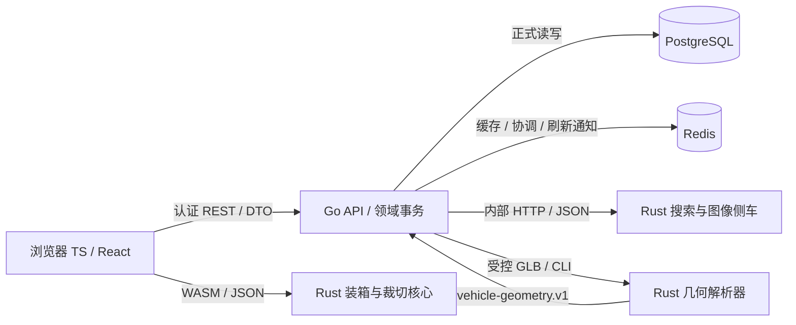

# TypeScript、Go、Rust 与原生 SDK 的运行职责和集成契约

本文按当前仓库实际调用链说明语言分工。业务 API 以 Go 为主，TypeScript 负责浏览器应用及开发工具，Rust 提供专用检索、图像和计算能力。判断职责要同时看目录、进程和调用协议；同为 Rust 的组件也可能运行在完全不同的位置。

## 当前组件与职责

| 语言 / 运行位置             | 源码入口                                                                     | 当前职责                                                                                | 数据与执行权威                                                       |
| --------------------------- | ---------------------------------------------------------------------------- | --------------------------------------------------------------------------------------- | -------------------------------------------------------------------- |
| TypeScript / 浏览器         | `src/routes/`、`src/features/`、`src/components/`、`src/lib/`                | React 页面、路由、表单、React Query、API DTO 适配、搜索弹窗、可视化及 WASM 调用         | 展示、交互和计算预演；正式业务结果由 Go 接口确认                     |
| JavaScript / Node.js        | `scripts/*.mjs`、根 `package.json`                                           | 开发启动、Vite 构建、路由和权限契约生成、验证及 WASM 构建编排                           | 开发与构建工具，当前没有以 Node/TS 承担主业务 API 的服务             |
| Go / 主 API 进程            | `server/main.go`、`routes/`、`handlers/`、`services/`、`modules/`、`models/` | Gin API、鉴权、领域校验、事务、版本控制、审批、审计、数据库读写、后台任务、外部能力编排 | 业务命令及持久化的权威入口，PostgreSQL 保存正式业务记录              |
| Rust / 内部 HTTP 侧车       | `server/search-engine/`                                                      | Axum HTTP、Tantivy 业务检索、pHash 与 WebP 图像处理                                     | 索引和图像是派生结果；不直接读取业务库，不决定用户权限或修改订单     |
| Rust / Go 启动的 CLI 子进程 | `vehicle-loading-engine/cli/`、`core/`                                       | 解析受控 GLB，输出归一化车型几何                                                        | 几何算法由 Rust 实现；Go 验证协议、模板版本及结果，并保存正式快照    |
| Rust / 浏览器 WASM          | `vehicle-loading-engine/wasm/`、`core/`                                      | 车型几何、装载空间、装箱方案与诊断计算                                                  | 输出交互预演及候选方案；不直接执行发货、库存或审批事务               |
| Rust / 浏览器 WASM          | `cutting-engine/wasm/`、`core/`                                              | 裁切求解、约束和利用率计算                                                              | 当前通过 TS 适配器在浏览器使用，服务端批量求解属于后续方向           |
| Rust / 可选独立运维进程     | `server/watchdog/`                                                           | 当前探测上传/备份目录可写性，把完整性状态写入 Redis 并发布刷新信号                      | 运维观测；当前审计函数没有执行数据库业务一致性查询，也不修复业务记录 |
| Go / 现场独立网关           | `attendance-gateway/`                                                        | 设备配置、接收 SDK Bridge 事件、离线队列、重试、向 ERP 投递考勤事件                     | 现场接入与传输；ERP Go API 校验入站事件并持久化                      |
| C++17 / 现场原生进程        | `attendance-gateway/sdk-bridge/native/`                                      | 调用海康官方 ISUP/EHOME SDK，处理设备注册、认证、SessionKey 与报警事件，输出 JSONL      | 厂商协议适配；官方 SDK 头文件和动态库需单独提供                      |

PostgreSQL 保存订单、库存、审批、通知收件等正式业务状态。Redis 用于缓存、协调和刷新通知；Tantivy 用于派生检索。各组件的具体作用由领域契约规定，不能用搜索索引或客户端缓存替代业务数据库。

计算能力按现有领域模块维护：APS 排程模块位于 Go 的 `server/modules/aps-scheduling-engine/`，检索、几何、装箱和裁切核心位于上表所列 Rust 组件。增加算法时先确认所属领域和复用边界，不能仅凭“计算引擎”名称推断运行语言或部署位置。

## 同名目录的含义

- `src/features/<domain>/services/` 是前端 API 和 DTO/SDRTS 适配层。Query 失效、toast、页面状态等界面副作用由 Hook、mutation 回调或 bridge 编排。
- `server/services/` 与 `server/modules/` 是 Go 业务服务层，负责校验、事务和流程编排。它们不受“前端 services 不含界面副作用”的规则限制。
- Rust `core` 是可复用算法；`wasm`、`cli`、HTTP handler 分别提供浏览器、子进程和网络边界。不能因为存在 `core` 就推断三种调用方式均已接入。
- `worker` 表示后台任务角色，不表示编程语言。当前车型解析 worker 在 Go API 进程内运行，再启动 Rust CLI；搜索侧车是另一个长期运行的 HTTP 进程。

## 业务 API 与权限边界

前端的可见性控制用于交互体验，Go 必须独立校验登录、权限、数据范围、版本和业务状态。浏览器 WASM 可以承担数值求解与预演；正式状态流转、库存过账、审批和持久化仍经 Go 领域接口确认。Go 调用 Rust 后也要校验返回协议与领域约束，不能直接透传计算结果作为业务授权。

金额、数量、长度单位、状态枚举、版本和错误语义应在领域 DTO 中明确。跨语言传输使用 JSON/字节协议和显式适配器，不假定 TS、Go、Rust 的内部结构、数值范围或枚举表示天然一致。

## 全局搜索的实际调用链

搜索弹窗同时展示页面入口、业务记录和已有的知识条目等能力。页面入口来自前端共享导航、页签和路由目录；业务记录检索走以下链路：

1. TS 搜索弹窗对关键词防抖，通过 `GET /api/v1/search/global` 请求 Go，携带 `q`、分页位置及后续页的 `generation`。
2. Go 根据登录用户和权限，从 `global_business_search_source_catalog.go` 选择允许检索的来源，把类别和用户范围交给 Rust。字段、关联、权限和结果目的页统一登记在这个目录中。
3. Rust `POST /v1/search` 用 Tantivy 检索片段，在分页前过滤类别和索引中的用户范围，返回记录 ID、类别、分数和快照标识。
4. Go 按同一目录重新读取当前数据库记录，检查软删除、类别、关键词和当前审批归属，过滤过期索引命中并继续补页，再生成结果链接。
5. TS 展示结果并按链接打开页面或详情。导航匹配发生在浏览器，业务记录匹配发生在 Rust，权限判断和当前数据确认由 Go 承担。

前端业务搜索 API/DTO 适配位于 `src/features/global-search/services/global-business-record-search-api.ts`，负责请求编码、Zod 响应校验、分页协议和网络参数；Hook 编排查询缓存、取消及重试，视图只承接状态和交互。搜索使用独立熔断状态，保留共享认证检查，避免侧车故障扩大到其他业务接口。取消信号经浏览器网络请求传递到 Go 及其内部 Rust HTTP 调用，主动取消不作为服务故障处理。

Go 也负责生成索引：用只读一致性快照读取主表与关联表，经 `start / batch / publish / abort` 推送给 Rust，完整构建后原子发布。Rust 不自行猜测数据库字段或扫描业务表。字符串伙伴引用按目录声明的 UUID 类型归一化；非法历史引用只跳过关联补充，主单和历史名称继续进入投影。

每次完整投影计算内容指纹作为 `generation`。Go 在一次补页请求中固定该标识，前端加载后续页也携带它；如果业务内容变化，Go 返回 `409 / GLOBAL_SEARCH_SNAPSHOT_CHANGED`，TS 清除旧分页并从第一页刷新。相同内容的周期重建保持同一指纹，不打断分页。

当前覆盖销售单、报价单、采购单、物料、产品、客户、供应商、库存、销售退货、销售换货和审批请求共 11 类。其他模块仍可搜索其页面入口，不能将其解释为所有业务表均已接入记录搜索。

同一单据的主字段、历史行项目与当前伙伴名称由 Go 投影成一份搜索文档。销售/报价/退换货共用产品行身份字段定义，退换货还包含绑定标签与补发产品身份；这些关联表自动进入统一变更依赖。Rust 只处理投影后的检索字段，不自行解释业务关联。读取权限与 Go 业务列表接口一致，TS 目的页必须实际消费对应记录参数；例如审批页按 `requestId` 从可访问列表展示所选申请。

查询的候选窗口上限由 Go 和 Rust 共同验证；Go 在过滤过期命中后补页，也不能越过这个边界。达到前 100000 条候选且仍有命中时，Go 返回 `candidateLimitReached`，TS 保留已有结果并提示缩小关键词范围。它与侧车故障、无匹配记录和快照变化分别处理，具体字段及边界见搜索契约。

当前同步为最终一致：启动构建、统一 Gorm 表变更通知及 30 秒周期校准，尚未使用与业务事务原子提交的持久化增量变更日志。每次构建扫描完整来源；大规模场景应在现有来源目录上演进持久化索引和增量日志。完整字段、匹配规则和故障行为见[全局搜索契约](../frontend/global-search-navigation-business-records-and-rust-sidecar-snapshot-synchronization.md)。

## Rust CLI、WASM 与现场 SDK 的区别

车型上传由 Go 控制文件路径、权限、模板版本及解析任务。`vehicle_model_template_geometry_parser.go` 使用 `exec.CommandContext` 调用 `xdfc-vehicle-geometry-parser --input <受控路径>`；Rust 输出 `vehicle-geometry.v1` JSON，Go 校验后保存模板版本快照。任务领取与重试由 Go worker 完成，具体见[车型几何解析 worker 边界](logistics/vehicle-geometry-parser-worker-boundary.md)。这条链路没有 Rust HTTP 解析服务。

浏览器装箱通过 `src/features/logistics-config/vehicle-loading/services/vehicle-loading-wasm-engine.ts` 加载对应 `wasm/pkg`。浏览器裁切通过 `src/features/raw-materials/batch-engine/services/batch-engine-cutting-wasm.ts` 加载另一套 `wasm/pkg`。这两套二进制编入前端资产，与搜索侧车单独发布；仅修改 Rust 源码不会自动更新已生成的 WASM。裁切当前支持范围和未实现算法见 [cutting-engine/README.md](../../cutting-engine/README.md) 与其实现状态文档。

考勤链路是设备 → C++ 官方 SDK Bridge → Go attendance gateway → Go ERP API。Bridge 和网关在现场单独部署，网关可通过 JSONL 或 Bridge HTTP 接口接收统一事件。SDK 版本、动态库与真实设备联调见[考勤网关说明](../../attendance-gateway/README.md)；这套接入能力与搜索侧车无关。

## 运行配置与发布单元

| 组件                     | 当前构建 / 配置依据                                     | 发布与故障边界                                                                                               |
| ------------------------ | ------------------------------------------------------- | ------------------------------------------------------------------------------------------------------------ |
| 前端                     | 根 `package.json`、Vite、根 `Dockerfile`                | 发布静态 Web 资产；包含两套浏览器 WASM 构建产物                                                              |
| Go API + 几何 CLI        | `server/go.mod`、`server/Dockerfile`                    | API 镜像包含 Rust 几何 CLI；`VEHICLE_GEOMETRY_PARSER_BIN` 指定可执行文件                                     |
| Rust 搜索/图像           | `server/search-engine/Cargo.toml`、`Dockerfile`         | 独立 `erp-search` 镜像；Go 用 `SEARCH_ENGINE_URL` 访问，Rust 监听端口由 `SEARCH_ENGINE_PORT` 配置、默认 8081 |
| Rust watchdog            | `server/watchdog/Cargo.toml`、`Dockerfile`              | 独立镜像；生产 Compose 的 `watchdog` profile 可选启用                                                        |
| Go 考勤网关 + C++ Bridge | `attendance-gateway/go.mod`、现场部署模板、native CMake | 与 ERP Web/API 分开交付；需匹配厂商 SDK 与现场设备                                                           |

本地默认前端 18010、Go API 18020、搜索映射端口 18030。`pnpm dev` 启动器按开发端口配置生成 Go 环境；直接运行 Go 时应配置 `SEARCH_ENGINE_URL`。生产 Compose 使用 `http://search-engine:8081`，不能把宿主机映射端口当作容器间地址。实际拓扑以 `compose.prod.yml` 与 `server/docker-compose.yml` 为准。

Go 和 Rust 的搜索 RPC 本次改为完整快照及带代际标识的查询，需要配套构建、发布，不支持与旧逐条索引协议混用。查询预算为 5 秒，整次快照构建预算为 2 分钟；索引未就绪或侧车故障返回 503，前端展示失败。侧车 `/v1/health` 是进程存活检查，不代表完整索引已就绪。图像处理仍使用 `/v1/process-image`，故障由调用接口返回。

## 修改责任与验证

- 增加业务规则、权限、事务、审批、版本校验或正式持久化：修改 Go 领域层及其测试；TS 负责相应 DTO 和交互。
- 增加业务搜索来源或字段：修改 Go 统一来源目录，验证关联、权限和跳转；共用投影及同步机制自动消费目录。修改检索/排名：修改 Rust，并验证 Go → Rust → 数据库链路及前端分页。
- 修改几何、装箱或裁切算法：修改对应 Rust `core`，保留 CLI/WASM 协议测试；浏览器能力必须重新生成对应 WASM，服务端 CLI 必须重新构建 API 镜像。
- 修改厂商设备协议：修改 C++ Bridge；修改离线传输与重试：修改 Go gateway；ERP 入站权限和业务记录仍在 Go API 验证。

搜索回归由 Rust 单元测试、Go 服务测试、前端 Vitest 和真实 Rust + PostgreSQL 集成测试共同承担，CI 中的 `global-business-search-rust-integration-tests` 负责跨语言链路。车型及裁切分别使用对应 Cargo 工作区和 TS 适配器测试。架构路线图中的目标能力应明确标为计划，不得作为当前部署事实。
