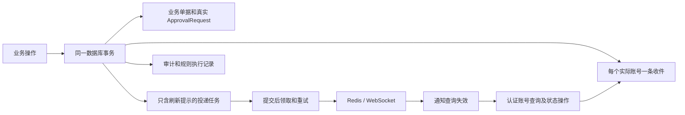

# 消息中心收件箱、跨设备同步与通知投递长期契约

> 更新时间：2026-10-20。状态：本轮代码已实施并部署到生产；本地验证与生产验收范围分别记录在文末。
> 适用范围：正式用户通知、阅读同步、规则执行诊断、提交后实时提醒及审批边界。

## 1. 实施决策

全系统共用 PostgreSQL 用户收件箱。员工未登录、关闭浏览器或暂时断网时，消息仍保存在账号名下；登录或恢复连接后通过接口读取。同一账号的已读、归档、业务解除状态由服务端统一保存，各设备重新查询后最终一致。

使用现有 Go、PostgreSQL、Redis 和 WebSocket，不增加设备收件表、独立未读计数表、永久同步日志或另一套审批引擎。离线办理、断网审批、设备送达回执、邮件与手机系统推送不在本次范围内。收件入库、Redis 发布、账号已读与业务完成是四种不同事实。

本文件是通用消息契约唯一入口。品质业务细节见[品质标准审批事务与通知投递契约](../../quality-standard-approval-transaction-and-notification-delivery-contract.md)，逐来源覆盖见[消息中心业务覆盖地图](../../../src/features/system-mgmt/message-center-business-coverage-map.md)。

## 2. 当前运行链路

业务事务不调用 Redis 投递正式通知。业务事实、必要收件、队列和执行记录同事务写入，任一步数据库写入失败整体回滚。Redis 故障只影响实时刷新；已提交收件仍能通过查询接口读取。配置型业务通知要求业务源启用，并具有真实启用规则、匹配段、内容模板和有效接收账号。公共审批节点和系统告警是基于真实申请或告警轮次的必要提醒，不受配置型规则停用控制。

| 来源             | 已接入口                                           | 实际边界                                                                                                                                                                                                                                       |
| ---------------- | -------------------------------------------------- | ---------------------------------------------------------------------------------------------------------------------------------------------------------------------------------------------------------------------------------------------- |
| 通用审批         | `approval_service.go` 创建申请、推进节点和最终决定 | `approval_requests` 是真实待办；系统必要节点提醒不依赖浏览器，也不代替业务授权                                                                                                                                                                 |
| 品质标准         | 保存、提审、审批、发布和归档事务                   | 必须配置真实审批链，不猜审批人、不自动给正式标准提审                                                                                                                                                                                           |
| 销售             | 状态事务及履约联动                                 | 共用收件和队列；删除订单同事务解除相应提醒                                                                                                                                                                                                     |
| 采购             | 现有采购状态业务入口                               | 共用通用事件服务；没有新增历史扫描补发                                                                                                                                                                                                         |
| 生产、扫码、委外 | 现有计划、任务、工序及收发检验事件入口             | 只覆盖真实服务调用；模板中列出的全部状态不等于全部都有触发入口                                                                                                                                                                                 |
| EBOM / MBOM      | 保存、状态提升、派生、修订入口                     | MBOM 派生实际为 DRAFT，只有真实 RELEASED 映射 EFFECTIVE；研发优化标志等动作尚无事件入口                                                                                                                                                        |
| 系统告警         | 告警 webhook                                       | 按 fingerprint + startsAt 唯一轮次冻结有效管理账号；解除持久化，重复或迟到 firing 不复活                                                                                                                                                       |
| 物流记录         | 新建、真实状态变化、进入异常、删除解除             | 采购/销售分别按 MenuPurchase/MenuTrading 可见；需显式导入源及配置规则；承运商 DeliveryOrder 已统一轨迹事务与购销权限，仍缺可靠业务关联及正式通知接入，详见[物流契约](../../logistics-record-transaction-and-notification-delivery-contract.md) |

旧 Workflow 定义、实例、任务表已由既有迁移移除。不得根据历史文档重建第二套工作流。

## 3. 数据职责与文件边界

| 数据                                    | 唯一职责                                                                        |
| --------------------------------------- | ------------------------------------------------------------------------------- |
| 业务与 `approval_requests`              | 单据状态、当前审批节点、办理人和结果；阅读或归档不修改这些事实                  |
| `system_notification_inbox_entries`     | 实际收件账号、展示快照、业务引用、生成时的业务解除条件、已读/归档/解除/过期时间 |
| `workflow_notification_outbox_entries`  | 提交后刷新提示、领取、次数、错误、下次尝试、发布/取消/暂停时间                  |
| `rule_execution_logs`                   | 匹配及生成证据、关联收件 ID 和投递结果；不调度第二套重试                        |
| `system_alert_notification_occurrences` | 告警轮次去重与解除墓碑，阻止 resolved-first 或迟到 firing 重新生成收件          |
| 前端 Query 缓存                         | 当前账号服务端结果和界面状态；无持久化正式消息 Store 或权威本地未读数           |

| 文件                                                                            | 职责                                                                                       |
| ------------------------------------------------------------------------------- | ------------------------------------------------------------------------------------------ |
| `server/models/system_notification_inbox_entry.go`                              | 收件模型与业务唯一约束                                                                     |
| `server/services/system_notification_inbox_creation_service.go`                 | 账号解析、站内链接校验、快照、去重、收件及刷新任务入库                                     |
| `server/services/system_notification_inbox_query_and_state_service.go`          | 账号与当前权限过滤、同快照分页/未读、精确状态操作及业务解除                                |
| `server/handlers/system_notification_inbox.go`                                  | 认证身份、HTTP 参数与错误映射，不接受任意收件账号                                          |
| `server/services/approval_notification_inbox_service.go`                        | 真实审批节点/结果提醒及上一节点解除                                                        |
| 品质、销售、采购、生产、物流及 BOM 事件适配器                                   | 构造真实事件键、业务引用、模板字段和精确解除条件                                           |
| `server/services/quality_standard_lifecycle_notification_routing_service.go`    | 品质规则匹配、模板校验和 operator 人员适配，委托共享创建器保留真实动作                     |
| `server/services/production_outsource_diagnostics_service.go`                   | 委外事实诊断；通知失败读取原日志当前状态                                                   |
| `server/services/business_rule_notification_inbox_creation_service.go`          | 品质、销售及通用业务共用有效账号解析、去重、逐账号日志及收件创建                           |
| `server/services/business_rule_notification_inbox_status_resolution_service.go` | 根据原收件的解除条件匹配真实状态；统一来源锁顺序，并在受控状态码重命名事务内迁移待解除引用 |
| `server/services/system_alert_notification_inbox_service.go`                    | 告警轮次锁、生成时冻结账号、解除与迟到保护                                                 |
| `server/services/workflow_notification_outbox_delivery_service.go`              | SKIP LOCKED 领取、发布、失败调度及失效任务取消；不重跑业务或审批                           |
| `server/services/system_notification_delivery_queue_operations_service.go`      | 积压诊断、恢复原任务及按统一锁顺序执行有界清理                                             |
| `server/services/rule_execution_log_service.go`                                 | 历史诊断和原任务恢复适配；无日志直投重试                                                   |
| `server/db/system_notification_inbox_cutover.go`                                | 停止旧完整业务载荷任务，不补造历史收件                                                     |
| `src/features/system-mgmt/notifications/system-notification-inbox-service.ts`   | 收件 HTTP 契约                                                                             |
| 同目录 `use-system-notification-inbox.ts`                                       | 按账号/权限隔离查询、状态 mutation、清缓存、周期对账                                       |
| 同目录 `components/notification-center.tsx`                                     | 收件与历史列表、精确本页操作、错误和离线反馈                                               |
| 同目录 `components/system-notification-delivery-queue-diagnostics.tsx`          | 管理员积压、失败及恢复入口                                                                 |
| `src/hooks/use-notifications.ts`                                                | WS 刷新提示和临时信号，不生成正式消息                                                      |

缓存失效、权限刷新、扫码实时动态和健康查询继续使用各自临时通道；不把每个 WS 帧保存为永久用户通知。告警运行监控页的 active/history 投影仍在内存中，重启不保留；它与持久化收件和告警轮次标记职责不同。

## 4. 唯一性、展示快照与授权

每个账号每个明确通知目的只有一条收件。数据库唯一键为 JSON 编码的 `[eventKey, purposeKey, recipientUserId]` 的 SHA256；同一事件重复执行保留原 ID、正文和阅读状态。投递任务 ID 和收件 ID 分开，不能把随机任务 ID 当业务幂等键。

事件键包含业务对象、持久版本或事实轮次：审批使用申请 ID/节点；品质使用标准版本/状态/动作；生产使用实际计划版本、任务或工序事实；委外使用订单版本、收发/检验事实 ID；BOM 使用版本、动作及派生/修订事实；物流记录使用 ID/持久版本/动作。不同真实事实必须有不同键。

通用事件入口拒绝缺少稳定事件键的请求，不使用当前时间生成替代键，避免技术重试变成另一条业务通知。

固定账号与动态人员在生成时解析到有效账号、去重并冻结。账号无效导致必要收件失败时事务回滚。告警重复 webhook 不重新枚举收件人；新一轮告警重新冻结当时接收人。告警轮次标记是小型永久去重墓碑，当前无自动清理，避免历史 resolved-first 事件失去迟到保护。

标题、摘要、动作链接与必要元数据在生成时快照；后续修改命令模板或业务内容不会改写历史消息。消息查询要求当前账号有效且仍具有收件记录的可见权限；操作接口同样检查。站内链接不授予业务权限，办理接口继续校验真实动作权限。

## 5. 接口及状态含义

接口路径相对于 `/api/v1`：

| 接口                                                         | 契约                                                                                                        |
| ------------------------------------------------------------ | ----------------------------------------------------------------------------------------------------------- |
| `GET /message-center/inbox`                                  | scope 为 active 或 history，limit=1..100（默认30），可选 cursor；返回 items、unreadCount、total、nextCursor |
| `POST /message-center/inbox/state`                           | `{ids:[稳定收件ID], action:"read"或"archive"}`；1..100个精确 ID，成功204，非法400，越权/不存在404           |
| `GET /message-center/delivery-queue`                         | perm_manage；待重试数、暂停数、最老积压时间、最近失败                                                       |
| `POST /message-center/delivery-queue/:id/retry`              | perm_manage；恢复同一投递任务，不生成新收件；失效409                                                        |
| `POST /message-center/execution-logs/:id/retry-notification` | 管理诊断适配，仅恢复关联的原任务；无关联的旧日志拒绝                                                        |

个人收件接口只要求认证，不套用整个消息配置页或审批菜单权限；可见性按每条记录过滤。账号从认证上下文获取，提交的自选账号字段不生效。执行日志不再开放浏览器写入接口。

| 状态       | 含义                                       |
| ---------- | ------------------------------------------ |
| ReadAt     | 该账号执行了阅读操作；不证明理解或完成办理 |
| ArchivedAt | 个人移出日常列表；不伪造已读、不改变业务   |
| ResolvedAt | 对应业务条件解除；在业务事务内持久化       |
| ExpiresAt  | 到达展示期限；不删除审批或审计事实         |

状态写入幂等，只补尚未设置的时间戳。批量操作提交本页已展示的精确 ID，全批授权后执行，不包含同时新到的消息。解除按来源、业务目标或明确审批申请、规则和段定位；解除待办不影响其他轮次。解除取消原未发布任务，再入队 UPDATED 刷新提示。

配置通知生成时，将该段 ResolveOnStatuses 和真实实体分别保存为收件内部的 ResolveOnStatusCodes、BusinessResolutionEntity。只有具有解除条件的收件保存匹配实体；这两个字段不进入员工收件接口，不放入展示 metadata。重放同一事件不会覆盖原条件。

品质、销售及通用业务事件都先按来源、实体、业务目标及原收件条件解除已有消息，再按当前启用源/规则决定是否生成配置型消息。品质审批独立读取 `business_approval_policy_configurations`，由标准提审事务创建申请，通知源和规则的启停、删除不影响提审；配置变更只影响新申请，公共引擎通过业务事务契约同步结果。其他来源现有规则内审批动作尚未迁移。规则/段编辑、停用或删除，业务源停用或删除，都不阻止已有消息按原条件解除；来源停用并不直接解除仍有效的消息，也不取消真实审批。先前 EXCEPTION 等自定义动作的通知可以被后续 STATUS_CHANGED 解除，不重新执行旧动作。源表或规则表不再是原收件解除条件的查询来源。

状态码受控重命名是语义引用迁移：现有 `CommitBusinessEventStatusRenameTransaction` 将未解除收件的状态码引用与源配置/规则同事务迁移，即使原规则已删除。展示正文、账号已读/归档以及已解除历史保持原值，不新增消息。事件处理锁定来源（包含停用来源）后才解除收件，重命名也先锁来源，避免并发完成与迁移互相等待或漏解除。没有新增扫描器、状态兼容别名或第二套重试。

公共审批继续按真实申请/当前节点精确解除，告警继续按实际轮次解除；配置规则的状态条件不会接管这两类必要提醒。没有生成时解除快照的旧收件不从日志或现行规则补推条件；原有明确业务删除、审批和告警解除路径继续有效。物流记录的真实状态、HTTP 入口、编辑边界和详情跳转见[物流事务与通知契约](../../logistics-record-transaction-and-notification-delivery-contract.md)。

active 为未归档、未解除、未过期；history 为上述任一条件成立。未读数为当前可见 active 中 ReadAt 为空的数量，与当前列表及总数在同一 RepeatableRead 快照读取。审批角标来自真实 `/approvals/my` 当前节点，不使用通知未读数。

## 6. 跨设备恢复协议

WS 只发布 `NotificationInbox / CHANGED`，载荷含稳定收件 ID（批量状态变化可空）和 CREATED/UPDATED，无展示正文。收到后使当前账号收件及相关业务查询失效。WS 发布成功只表示实时通道发布完成，不等于设备确认或员工已读。

登录、账号/权限变化、WS 重连、重新联网、窗口恢复焦点及在线每30秒对账均重新查询。查询键含账号、权限指纹、列表范围和分页游标；退出/切换账号/权限变化取消未完成查询并删除个人缓存。缓存不持久化，断网时仅可显示当前进程已有快照，明确提示未同步；阅读和归档须服务端成功才刷新，不乐观伪造成功。

分页游标为 `(createdAt,id)`，只用于列表翻页。已读、归档和解除会改变旧记录，所以它不是增量同步游标。当前重查方案避免增加永久同步日志；离线设备之间不承诺实时一致。当前提醒体验为未读角标及列表，没有额外设备推送或声音到达保证。

## 7. 投递恢复与保留

工作器每2秒处理最多50个已提交任务，以 `FOR UPDATE SKIP LOCKED` 支持多实例领取。发布前检查关联收件是否仍活跃；锁序避免 outbox 反向锁定 inbox。发布后进程中断可能重复刷新提示，属于至少一次发布；数据库收件唯一约束保证不产生第二条消息。

失败重试间隔为累计尝试次数×10秒、最长5分钟；达到12次失败后 FailedAt 暂停，诊断页面可见。管理员恢复原任务，保留累计 Attempts、收件 ID 和审计记录；再次失败可再次暂停。日志页恢复也走同一操作。委外诊断只查询原日志当前 failed 状态；恢复后 pending、投递后 success、失效后 skipped 均退出失败列表，不再遍历成功日志或解析 retryOfLogId。没有扫描失败执行日志另行直投的 cron。

两种恢复入口都传递请求上下文，读取原日志、关联任务和加锁均遵守取消/超时；只有记录确实不存在或任务确实失效才返回不可恢复，数据库连接/锁等待等故障保留原始错误。恢复事务失败不改变原任务、次数或日志，也不留下成功审计。

收件归档、解除、过期或已经不存在时，原工作器仍可领取其未完成任务，包含已暂停或尚未到下一次重试时间的任务。工作器只将其标为取消，并同事务将关联执行日志标为跳过，不再发布该条提醒、不增加尝试次数，也不改写员工已读或业务状态。失效任务退出积压/失败诊断后，按取消时间进入原有保留期。关联仍活跃的暂停任务继续等待人工恢复；仅含账号状态刷新、没有关联收件 ID 的任务继续遵守原重试策略。Redis 未初始化或不可用会记录投递失败，不阻止 PostgreSQL 内的失效取消。

| 数据                 | 当前策略                                        |
| -------------------- | ----------------------------------------------- |
| 普通知会             | 90天后过期，不再计未读                          |
| 待办、critical/error | 不自动过期；按真实业务解除或账号个人归档        |
| 已发布/取消队列      | 终态超过30天清理                                |
| 收件                 | 已归档/解除/过期超过180天且无活跃投递任务才清理 |
| 暂停任务             | 关联收件仍活跃时保留供恢复；收件失效后转取消    |
| 告警轮次标记         | 持久去重墓碑，当前永久保留，不含正文            |

工作器每小时执行有界清理，每类最多500条。清理按收件、队列的顺序锁定并删除，均按 ID 排序、使用 `FOR UPDATE SKIP LOCKED`，与员工状态操作、业务解除和人工恢复保持相同锁方向；其他操作占用的记录留给后续批次，不拖住本批清理。收件和队列删除仍在同一事务，任一写入失败整体回滚。业务、审批和审计使用各自保留制度。活跃待办与未解除严重告警不因年龄被清理。

## 8. 一次切换与接入要求

本轮已切换品质、销售、采购、生产/委外、物流记录、现有 BOM 入口及公共审批和告警。两个本地消息 Store、浏览器执行/扫描服务和 BOM 前端通知副作用已删除，保留配置 CRUD。启动迁移取消旧完整载荷的未发布任务；不导入浏览器旧消息，不从执行日志补造历史收件，也不自动补发旧待办。

新增来源必须提供真实事务入口、稳定事实键、生成时收件人、必要权限、模板字段和精确解除条件，并调用共用收件服务。仅登记模板不能标记“全覆盖”；确有存量补提醒需求时必须定义独立的当前事实作业，不重启浏览器扫描。

## 9. 验证范围与限制

### 测试入口与方法

服务端 PostgreSQL 测试使用随机隔离 schema，结束后清理；通知 publisher 为模拟实现，不向正式账号发送测试提醒。设置 `QUALITY_STANDARD_WORKFLOW_TEST_POSTGRES_DSN` 与 `QUALITY_STANDARD_PATCH_TEST_POSTGRES_DSN` 后，在 `server/` 运行 `go test ./services ./handlers ./routes ./db -count=1`。缺少相应 DSN 时专项测试会跳过，编译通过不能替代真实事务验证。

以下服务端测试文件位于 `server/services/`；账号鉴权的 HTTP 测试另在 `server/handlers/system_notification_inbox_postgres_authorization_test.go`。

| 测试文件                                                                           | 验证职责                                                                                                                           |
| ---------------------------------------------------------------------------------- | ---------------------------------------------------------------------------------------------------------------------------------- |
| `system_notification_inbox_postgres_integration_test.go`                           | 并发唯一收件、回滚、多 worker 领取、账号权限、分页和批量状态、必要提醒及告警轮次保护                                               |
| `business_rule_notification_resolution_policy_postgres_integration_test.go`        | 品质/销售/通用物流各五种配置变化，共15种场景；原快照解除、跨动作解除、引用迁移及并发和失败回滚                                     |
| `system_notification_delivery_recovery_and_retention_postgres_integration_test.go` | 待审批与严重告警保留、暂停/延期失效任务取消、Redis 缺失、日志/审计/删除失败回滚、锁跳过、每表500条上限、恢复超时错误及释放锁后恢复 |
| `rule_execution_log_service_test.go`                                               | 恢复原任务，不增加收件或日志、不直接发布；委外诊断随原日志 failed/pending/success 状态变化                                         |
| `quality_standard_workflow_postgres_integration_test.go`                           | 真实单级/两级审批、当前申请、版本和并发、固定/动态账号去重、CREATED/STATUS_CHANGED 动作一致及无效账号整体回滚                      |

前端收件同步测试为 `src/features/system-mgmt/notifications/system-notification-inbox-account-isolation-and-state-synchronization.spec.tsx`，验证切换账号/退出清缓存、操作失败不伪造已读及重查另一设备已提交的状态。物流与承运商事务专项的文件和边界见[物流契约](../../logistics-record-transaction-and-notification-delivery-contract.md)，品质细节见[品质契约](../../quality-standard-approval-transaction-and-notification-delivery-contract.md)。

旧委外 CLI 的 `redis-notification` 入口及“新建重试日志”的验收断言已移除。CLI 继续负责业务事实、并发和权限验收，当前通知恢复验证使用上述隔离测试。

### 2026-10-20 本地验证记录

| 验证阶段       | 已记录结果与边界                                                                                                                            |
| -------------- | ------------------------------------------------------------------------------------------------------------------------------------------- |
| 接入阶段       | 品质、物流和收件前端共8个测试文件65项通过；TypeScript、相关 ESLint、权限契约、账号授权契约和中英文结构检查通过                              |
| 职责与链路回溯 | 设置两种真实 PostgreSQL DSN 后，services、handlers、routes、db 完整回归通过；全库 Go 编译、后端构建、收件同步2项复验及文档格式/链接检查通过 |
| 浏览器核查     | 收件箱/历史空列表、投递诊断、断网提示和重新联网已核查；正式品质标准仅查看检验编辑控件，没有修改或提审                                       |
| 物流详情核查   | 临时拦截 GET 样例验证购销链接从空列表打开目标及关闭；真实404验证错误提示与重试，没有创建正式记录                                            |
| 本地运行       | 回溯后的后端构建已启动，健康接口返回200；该结果记录本地环境，不代表生产部署或设备送达                                                       |

这些是对应日期和阶段的验证记录，代码、配置或部署版本变化后应重新执行相应检查。测试未自动创建正式规则、提审正式标准或向真实人员投递。

### 2026-10-20 生产发布记录

共用收件链路随品质独立审批配置版本 `sha-1cc7534fce03196fa85376e0f2d30115ac81d24d` 上线。CI、镜像扫描与构建、发布目录的 PostgreSQL 隔离回归均通过；生产校验已确认四张新增表、受保护接口、公网资源与镜像一致，以及 API、数据库、Redis 和完整性检查正常。备份批次、回退位置、业务源首次读取初始化机制及验收边界统一见[品质契约的生产发布记录](../../quality-standard-approval-transaction-and-notification-delivery-contract.md#2026-10-20-生产发布记录)。本次未向真实员工发送测试消息，设备实际送达与真实账号审批不在生产烟测的证明范围内。

### 未接入范围

承运商 DeliveryOrder 回调通知、未调用的 BOM 标志动作、设备送达回执和断网办理仍需按各自边界单独接入或验收。离线设备重新联网后读取服务端状态，当前不提供浏览器持久化正式收件、断网已读/归档队列或离线审批。
