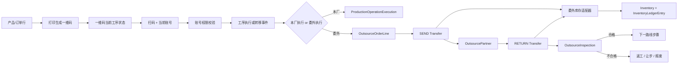

# 生产委外执行链路设计

> 文档状态：生产路线、条码状态、分支工序执行身份、显式路线发布、按计划 MBOM 分支自动选路、统一扫码命令、路线推进、委外单位档案、委外任务、委外收发检验、质量路由、委外消息中心事件源/通知编排、通知失败日志与人工重试恢复、委外运行诊断/对账、跨域读写契约和移动端验收已落地；2026-11-24 同码复检轮次和返工后重复委外周期的服务回归、索引迁移重启验收通过，目标环境迁移及业务验收尚未执行<br>
> 主链路确认日期：2026-07-29；消息投递、恢复与诊断文档复核：2026-10-20<br>
> 适用范围：生产路线、在制品执行、工序转移、委外单位、委外发出/回收/检验<br>
> 前置状态：`产线管理 TAB` 已并入 `产线脑图`，产线拓扑已有唯一维护入口

生产脑图固定为 `L1 → L2 → L3`：L1 关联产品侧 `ProductTemplate`，L2 直接绑定有效生产 MBOM 分支，L3 是该分支下独立维护的工序。路线步骤、条码状态、扫码执行和委外执行事实统一使用 `branchOperationId`；路线步骤 ID 单独表示路线位置，质检跳转只使用 `targetRouteStepId`。委外单不能手填裸 L3 或工序名称；产品当前步骤由条码状态中的 `routeStepId` 定位，再由路线步骤带出分支工序。

本文件中的 `LineSegment` 是脑图 L2 的 MBOM 分支承载行，不是生产位置。脑图 L3 的工序身份是 `ProductionBOMBranchOperation.id`；路线步骤 ID 表示该工序在路线中的位置。实际生产位置、委外持有方和品质检验站分别由各自领域身份表示，不能互换。B5 迁移边界见 [`生产脑图产品BOM分支绑定与生产路线分阶段修正设计.md`](生产脑图产品BOM分支绑定与生产路线分阶段修正设计.md)。

路线头部按稳定 BOM 分支身份绑定产品；分支身份及脑图迁移顺序见 [`生产脑图产品BOM分支绑定与生产路线分阶段修正设计.md`](生产脑图产品BOM分支绑定与生产路线分阶段修正设计.md)。脑图 L1 关联产品侧 `ProductTemplate`；L2 直接从有效生产 MBOM 分支中选择具体产品分支，候选不依赖或受 L1 产品模板筛选；L3 是归属于该分支的独立工序。路线步骤、扫码、条码状态和委外执行事实均已使用 `branchOperationId`；路线质检目标只使用 `targetRouteStepId`。委外任务行只保存来源产品快照与计划数量，不绑定路线步骤或 L3。生产拓扑模板已按独立快照与单向复制实现，应用只创建新 L1/L2，不回写既有实际结构，也不覆盖共享工序、路线或委外执行事实。

## 1. 结论先行

委外/外协不能做成一个“公司 + 数量 + 备注”的孤立表单。它本质上是生产执行链路中的一种工序执行方式，而执行主线必须以产品一维码为锚点：

```text
产品/订单行
  按产品规则打印生成一维码
  一维码反查产品身份
  一维码绑定当前所在工序状态
  当前账号通过页面/命令/动作权限校验是否允许执行扫码动作
  扫码确认后发生工序执行或转移
  按委外任务选择的合作单位执行
  发出、在外、回收、检验
  然后根据质量结果进入下一工序、返工、让步或报废
```

因此委外必须绑定：

- 生产路线步骤；
- 产品打印产生的一维码及其当前工序状态；
- 当前账号的页面/命令/动作权限；
- 发出/回收转移事实；
- 质量检验结果；
- 审计、权限和状态机。

产品主数据、一维码编码、一维码状态和裁纱/卷材追溯必须分开。产品/订单负责生成和打印一维码；生产执行只把状态绑定到一维码上，并通过一维码反查产品。不能为了委外把这些事实拼成一个大对象。

当前已上线委外管理域中的“委外单位”“委外任务”和“委外收发检验”能力。委外任务必须从销售订单或生产计划创建，因此已经支持“销售订单 500 件，本厂做不过来，直接从开始就委外”的基础登记链路。收发检验页按明细扫描产品一维码，发出和回厂写入独立转移流水，回厂检验复用统一扫码事务推进条码工序状态。路线步骤可配置 `qualityRouting`，为合格、让步接收、返工或报废处置指定同一路线内的目标步骤；未配置目标时，合格/让步接收仍按顺序推进，返工保留在当前步骤并标记 `REWORK`，报废进入 `HOLD`。委外不维护第二套工序能力主数据，产品当前工序只认一维码状态中的 `routeStepId`。

## 2. 当前代码现状

### 2.1 已经具备的能力

| 现有对象                                         | 位置                                                                                                            | 可复用职责                                                                                                                                          |
| ------------------------------------------------ | --------------------------------------------------------------------------------------------------------------- | --------------------------------------------------------------------------------------------------------------------------------------------------- |
| 脑图 `ProductionLine` / `LineSegment` / `ProductionBOMBranchOperation` | `server/models/production_topology.go`、`server/models/production_bom_branch_operation.go`、`src/features/production-shared` | L1 产品模板、L2 有效生产 MBOM 分支和 L3 分支独立工序 |
| 当前路线 `ProductionRouteStep` / `ProductionBOMBranchOperation` | `server/models/production_route.go`、`server/models/production_bom_branch_operation.go` | 路线发布前验证有效 MBOM 分支与 L3；扫码和委外事实使用分支工序身份 |
| `ProductionPlan` / `ProductionTask`              | `server/models/production_plan.go`                                                                              | 计划保存本批生产 MBOM 分支，执行批次关联计划；任务是可选明细                                                                                          |
| `Supplier`                                       | `server/models/trading.go`、`src/features/purchase/suppliers`                                                   | 采购合作方主数据，可作为委外单位的基础引用                                                                                                          |
| `OutsourcePartner`                               | `server/models/production_outsourcing.go`、`src/features/production-outsourcing`                                | 生产委外单位档案，可选引用供应商并保留委外域自己的状态、等级、交期和结算说明                                                                        |
| `OutsourceOrder` / `OutsourceOrderLine`          | `server/models/production_outsourcing.go`、`src/features/production-outsourcing/orders`                         | 生产委外任务首期骨架，承接销售订单或生产计划，并保存委外单位、数量和来源产品快照；后续发出/回收必须在扫码时读取一维码当前状态，不由委外单位档案推导 |
| `InspectionTask` / `QualityAbnormality`          | `server/models/quality.go`                                                                                      | 质量检验与异常事实，可承接委外回收检验                                                                                                              |
| `Inventory` / `InboundRecord` / `ShipmentRecord` | `server/models/inventory.go`                                                                                    | 库存余额和出入库流水，可承接物理数量变化                                                                                                            |
| 产品一维码绑定与裁纱追溯                         | `/production/product-barcode-bindings`、裁纱相关模型                                                            | 一维码由产品/订单打印产生，生产执行只绑定工序状态；裁纱/卷材只作为独立可选追溯                                                                      |

> 注：上表中的 `Inventory` / `InboundRecord` / `ShipmentRecord` 仅表示库存物理数量变化的承接点，不等于车型匹配、装车推荐或最终发货确认链路。

### 2.2 关键能力与当前状态

| 能力                   | 当前状态                                                                                                                                                                                                                           |
| ---------------------- | ---------------------------------------------------------------------------------------------------------------------------------------------------------------------------------------------------------------------------------- |
| 扫码入口与账号权限落点 | 已新增 `POST /production/scan-commands/execute`，入口复用账号动作权限 `action_production_issuance_execute`；PDA、Web、USB 执行入口均已接入统一客户端，Web/USB 独立执行页为 `/production-execution`                                 |
| 路线步骤推进           | 已支持 `COMPLETE` 后按同一路线 `sequence` 推进到下一步骤；委外检验的合格/让步接收复用该链路，质量处置可按路线步骤 `qualityRouting` 跳转目标步骤                                                                                    |
| 转移/持有位置          | `product_barcode_transfer_events` 提供路线推进和持有方转移基础事实；委外 `SEND` / `RETURN` 已有独立转移流水、数量校验、条码幂等约束和审计                                                                                          |
| 委外单位档案           | 已新增 `OutsourcePartner`、`/production/outsourcing/partners` API、`action_outsource_partner_manage` 权限、`outsource-partner` 审计和 `/production-outsourcing/partners` 页面                                                      |
| 委外状态机             | 委外任务已有草稿、下发、发出、在外、回收、关闭、取消等状态字段；每码单件、多条码分批回厂/检验、路线步骤 `qualityRouting`、委外固定路线修订联动、同码复检轮次和重复委外周期均已实施 |
| 跨域契约               | 已形成仓储、品质、采购、裁纱对委外事实的读写边界；委外专用库存适配器已接入，通用库存出入库写入口会拒绝 `PRODUCTION_OUTSOURCE` 专用来源；回收检验会先创建/领取正式 `InspectionTask`，再在同一事务内完成品质任务、委外检验和路线推进 |

委外执行链路已覆盖任务、扫码发出/回收、回收检验、品质处置、消息事件、跨域读写边界和委外专用库存适配器。重复事实唯一约束、作废单拒绝、跨路线与无权限扫码拒绝、正式品质任务创建/领取/判定桥接、统一收件与失败任务恢复、运行诊断与对账均已落地。厂内核心路线的业务修订、历史快照、排产绑定、扫码固定和委外来源校验已通过本地隔离 PostgreSQL 验收；每码单件、多条码分批数量、同码复检轮次和返工后重复委外周期也已实现。剩余目标部署数据库迁移和部署后完整链路验收。服务器版本回归确认单独跟踪。

## 3. 文件职责边界

### 3.1 产线脑图维护产品分支与分支工序

产线脑图是产线主数据、产品模板关联、有效生产 MBOM 分支关联和分支工序维护的唯一入口。界面层级固定为：

```text
ProductionLine 产线（L1，关联产品侧 ProductTemplate）
└─ LineSegment（L2，关联有效生产 MBOM 分支）
   └─ ProductionBOMBranchOperation（L3，分支独立工序）
```

拓扑展示固定为 L1 → L2 → L3，不增加产品层级。全局 `ProcessStep` 可作为创建分支工序时的内容来源；保存后分支工序拥有独立身份。B4 路线步骤引用分支工序，执行方式、质量关卡、顺序、预计耗时和转移要求仍由路线步骤承载。委外模块不能在任务创建时手填裸 L3；执行、发出、回收通过条码当前 `routeStepId` 定位路线步骤，并读取其 `branchOperationId`：

- 产线资料；
- 工段层级；
- 工序定义；
- 拓扑模板。

分支 L3 工序由对应 MBOM 分支独立维护；相同名称的工序不因此共享身份或可变内容。产品状态在路线迁移前只认当前路线步骤及其现有作业引用，不把操作人挂到产线节点上。

权限是另一条独立链路：

```text
账号/人员 → 页面权限 / 命令权限 / 动作权限
工序 → 只定义操作内容、顺序锚点和工艺事实
```

扫码时只按当前登录账号校验对应页面、命令或动作权限。工序不引用职位、不引用员工、不引用账号；人员资料里的职位变化不应影响产线拓扑或产品状态历史。

### 3.2 供应商不能直接等于委外单位

采购供应商里已有“外协加工”分类，但它只能作为可引用来源，不应该把生产执行状态直接塞进 `Supplier`：

```text
Supplier = 合作方基础资料、采购/结算关系、联系人
OutsourcePartner = 生产委外单位、质量准入、交期约束
```

长期模型应是 `OutsourcePartner.supplierId` 可选引用供应商档案。这样能复用统一合作方资料，也能保留生产委外自己的准入、交期和状态。

前端也应遵守现有供应商边界：外部消费者通过 `src/features/purchase/suppliers/index.ts` 暴露的公共 API 使用供应商数据，不深层 import 供应商内部文件。

### 3.3 `ProductionTask` 不应被继续撑大

现在 `ProductionTask` 是计划明细，状态只有：

```text
PENDING / RUNNING / HOLD / DONE
```

它适合表达“计划下有一个任务”，不适合承载：

- 单件/批次当前路线步骤；
- 委外发出批次；
- 委外单位持有中；
- 回收待检；
- 返工/让步/报废后的路线跳转。

如果继续往 `ProductionTask` 加很多外协字段，会让计划、执行、物流、质量全部挤在一个表里，后续一定难维护。应新增独立的执行对象和工序执行记录。

### 3.4 现有 `ProductionUnit` 命名需要避让

当前 `server/models/production_unit.go` 的 `ProductionUnit` 更像“生产组织/执行单元层级”，字段包括 `unitType`、`parentId`、`orgUnitId`、`metadata`，不等于“产品单件”。

后续表示批次/单件时，不建议继续用 `ProductionUnit` 这个名字，避免概念冲突。建议代码命名：

```text
ProductionExecutionLot   // 生产执行批次
ProductionExecutionUnit  // 生产执行单件，可选
```

如果未来要整理旧 `ProductionUnit`，更适合改名为 `ProductionOrgUnit` 或 `ProductionStructureUnit`，但这需要单独迁移，不能和委外首期混在一起做。

## 4. 建议领域模型

### 4.1 路线与步骤

```text
ProductionRoute
  id
  code
  name
  productId / productSKU / productName
  bomOwnerType / bomOwnerCustomerId / bomVersionLevel
  version
  status: DRAFT | PUBLISHED

ProductionRouteStep
  id
  routeId
  sequence
  branchOperationId
  defaultExecutionMode: IN_HOUSE | OUTSOURCE_ALLOWED | OUTSOURCE_REQUIRED
  qualityGate
  qualityRouting: JSON
```

路线定义“产品按哪个 MBOM 分支以及该分支的哪些 L3 工序顺序生产”。路线步骤保存 `branchOperationId`，不接收 L2 行或全局 `ProcessStep`；执行和委外事实统一到相同分支工序身份，旧映射路径已移除且不提供兼容读取。草稿保存和显式发布分开；发布时重新校验有效 MBOM 分支及 L3，发布后路线可供扫码读取并锁定编辑/删除。

`qualityRouting` 是路线步骤的可选质量处置路由，键使用 `ACCEPT`、`CONCESSION`、`REWORK`、`SCRAP`，值只允许指向同一路线内的 `targetRouteStepId`。保存路线时会校验目标属于当前路线；执行时委外检验只负责提交处置，统一扫码命令负责写入分支工序执行记录、条码状态和转移事实，不接受 `targetProcessStepId`。

工序不能配置按职位授权。职位属于组织人事资料，不参与生产执行授权。是否能扫码、转移、发出、回收或检验，只能由权限系统按账号权限分配到页面、命令或动作上。

### 4.2 一维码状态与工序执行

```text
ProductBarcodeState
  id
  productBarcode
  productId
  routeId
  routeStepId
  currentBranchOperationId
  status

ProductBarcodeStateEvent
  id
  productBarcode
  fromBranchOperationId
  toBranchOperationId
  action: START | COMPLETE | TRANSFER | HOLD | REWORK
  operatorAccount
  occurredAt

ProductionExecutionLot
  id
  productBarcode
  planId（必填，确定 MBOM 分支）
  taskId（可选）
  productId
  batchNo
  quantity

ProductionOperationExecution
  id
  productBarcode
  routeStepId
  executionMode: IN_HOUSE | OUTSOURCE
  partnerId
  operatorAccount
  startedAt
  completedAt
  result
```

一维码是执行状态的轻量锚点，但不是新的产品主数据。生产扫码按条码读取活跃批次和计划上的产品、MBOM 分支身份，解析唯一已发布路线，再定位当前工序；无需加载整张计划任务明细或卷材追溯链。质量和委外记录仍通过各自 ID 或产品一维码关联。

当前状态链按分支独立工序身份运行：

```text
product_barcode_states
  productBarcode
  productId / productName
  routeId / routeStepId
  currentBranchOperationId
  status

product_barcode_state_events
  productBarcode
  fromBranchOperationId
  toBranchOperationId
  eventType
  operator
  occurredAt
```

对应 API 为 `GET /production/product-barcode-states/:productBarcode` 和 `POST /production/product-barcode-states`。HTTP 初始化只建立未开工状态，不接受路线或工序身份；首次生产扫码根据计划 MBOM 分支写入唯一已发布路线及首个路线步骤。扫码执行与路线推进由统一入口 `POST /production/scan-commands/execute` 承接，Web、PDA、USB 使用同一条命令链。

当前执行批次与计划关联已落地：

```text
production_execution_lots
  productBarcode
  productId / productName
  planId（必填） / taskId（可选）
  batchNo
  quantity
  status
```

对应 API 为 `GET /production/execution-lots` 和 `POST /production/execution-lots`。登记时必须选择有效计划，产品从计划读取；批次不能改绑计划。生产扫码必须找到该条码的活跃批次，并由计划确定实际 MBOM 分支；已有批次或执行事实的计划禁止更换分支。任务和批次号仍可选，卷材追溯不属于该前置条件。

当前工序执行记录已落地：

```text
production_operation_executions
  productBarcode
  branchOperationId
  routeId / routeStepId
  productionWorkLocationId
  executionLotId
  action
  status
  operator
```

查询 API 为 `GET /production/operation-executions`；独立的 POST 写接口已移除。写入统一通过扫码命令，按计划分支及当前路线步骤校验工序，成功后同步追加 `product_barcode_state_events`。调用权限由账号/人员权限体系在入口侧处理。

统一扫码命令已落地：

```text
POST /production/scan-commands/execute
  idempotencyKey
  productBarcode
  productionWorkLocationId
  action: START | COMPLETE | HOLD | REWORK
  commandSource: WEB | PDA | USB
  optional holder transfer fields
```

该入口不接受执行批次、路线、当前路线步骤或当前分支工序身份；每次按条码读取活跃批次与计划，重新验证 MBOM 分支及其唯一 `PUBLISHED` 路线。首次 `START` 由服务端选择首步；后续 `START/COMPLETE/HOLD/REWORK` 从条码当前状态定位路线步骤，并读取启用的分支工序。实际生产地点通过 `productionWorkLocationId` 单独传入，返工目标另用路线步骤 ID 表达。分支失效、路线缺失或不唯一时拒绝执行。`COMPLETE` 成功后按步骤顺序推进，末道返回 `routeCompleted=true`。

路线推进和持有方变化会写入：

```text
product_barcode_transfer_events
  productBarcode
  operationId
  transferType: ROUTE_ADVANCE | CUSTODY_TRANSFER
  fromRouteStepId / toRouteStepId
  fromBranchOperationId / toBranchOperationId
  fromHolderType / fromHolderId
  toHolderType / toHolderId
```

这张表是路线推进和持有方变化的基础事实，不等于委外发出/回收业务状态机。当前委外发出、回收、在外、回收待检和检验处置已由 `OutsourceTransfer`、`OutsourceInspection` 及统一扫码命令共同承接；2026-07-29 已完成真实 PostgreSQL + HTTP 主链路、当时的 Redis Pub/Sub 投递、跨路线扫码拒绝、无权限扫码拒绝、已作废委外单执行拒绝和多连接并发验收。该历史 Redis 验收不代表当前统一收件箱协议或生产部署已验证。

### 4.3 委外单位

```text
OutsourcePartner
  id
  supplierId
  code
  name
  status
  qualityGrade
  settlementPolicyId
  leadTimeDays
  contact / address / notes
```

委外单位只保存合作方、准入和履约资料，不保存产品当前工序，也不维护单位与工序的第二套映射。产品能否被发出、回收或推进，统一由一维码当前状态、生产路线和账号动作权限决定。

### 4.4 委外任务、转移与检验

```text
OutsourceOrder
  id
  orderNo
  partnerId
  status
  createdFrom

OutsourceOrderLine
  id
  orderId
  productBarcode
  executionLotId
  routeStepId
  quantity
  requiredProcessStepId
  status

OutsourceTransfer
  id
  orderLineId
  transferType: SEND | RETURN
  quantity
  fromLocation
  toLocation
  productBarcode
  occurredAt
  operatorAccount

OutsourceInspection
  id
  orderLineId
  inspectionTaskId
  result
  acceptedQuantity
  rejectedQuantity
  disposition
```

当前已落地 `OutsourceOrder` / `OutsourceOrderLine`、`OutsourceTransfer`、`OutsourceInspection` 和委外管理页面：

```text
/production-outsourcing/orders
GET    /production/outsourcing/orders
POST   /production/outsourcing/orders
PATCH  /production/outsourcing/orders/:id
DELETE /production/outsourcing/orders/:id
POST   /production/outsourcing/orders/:id/release
GET    /production/outsourcing/transfers
GET    /production/outsourcing/inventory-category-options
GET    /production/outsourcing/inspections
POST   /production/outsourcing/order-lines/:id/send
POST   /production/outsourcing/order-lines/:id/return
POST   /production/outsourcing/order-lines/:id/inspection-task
POST   /production/outsourcing/order-lines/:id/inspect
```

它只负责“这批产品/订单行准备交给哪个委外单位做、数量是多少、来源是什么、计划何时发出/返回”。销售订单和生产计划只是需求来源，委外任务拥有生产执行责任。每条委外明细从来源订单行或生产计划读取产品快照；创建任务时不绑定 L3，不手填工序 ID 或名称。扫码发出、回收和检验时，以一维码当前状态的 `routeStepId` 定位路线步骤，并从该步骤读取 `branchOperationId`；事实分别记录路线位置 `routeStepId` 和当时执行的分支工序 `branchOperationId`，不再读取旧 `processStepId` / `segmentId` 执行身份。

这里不能把 L3 当成委外任务创建时随意手填或预选的字段。`OutsourceOrderLine` 是计划行，不保存 `branchOperationId`；委外任务创建只读取订单行/生产计划的来源快照和数量。真正发出、回收和回收检验时，必须扫描产品一维码，从条码当前 `routeStepId` 对应路线步骤取得 `branchOperationId`，再由状态机完成转移和后续推进。路线位置与工序身份各自保存在对应执行事实中。

发出和回收必须是事实流水，不要只改订单状态。当前 `OutsourceTransfer` 是发出/回收的事实所有者，委外明细上的累计数量只是查询汇总；这样才能追责“什么时候发出去、谁收回、数量差异在哪里”。

委外执行已接入消息中心独立事件源 `PRODUCTION_OUTSOURCE`。事件源监听 `STATUS_CHANGED` 规则动作，但规则匹配的状态不是只看委外单总状态，而是下达、作废、发出、退回、检验处置和最终关闭这些执行事实：`RELEASED`、`CANCELED`、`SENT`、`RETURNED`、`INSPECTION_ACCEPTED`、`INSPECTION_CONCESSION`、`INSPECTION_REWORK`、`INSPECTION_SCRAP`、`CLOSED`。事件键中，下达、作废和关闭包含订单版本，收发/检验包含对应 `OutsourceTransfer.id` 或 `OutsourceInspection.id`。收件业务目标统一为根订单 ID，元数据保存 factId，既区分不同真实事实，也能在关闭时按规则段解除此前提醒。

委外事实、收件、规则日志和刷新任务同事务写入；数据库失败整体回滚。提交后由共用工作器发布，Redis 失败保留收件可查询并重试原任务。执行日志页 `POST /message-center/execution-logs/:id/retry-notification` 只恢复关联原任务，不重新发送完整业务载荷、不追加新收件。

2026-10-20：委外事件经 `production_business_event_service.go` 和 `business_status_event_service.go` 接入统一服务端收件/提交后队列。原日志扫描自动重试 cron 已移除；失败12次暂停，管理员恢复原任务并更新原日志。委外诊断只读取原日志当前 failed 状态，pending/success/skipped 不再计入通知失败；不遍历成功日志推断恢复。旧 CLI 的 redis-notification 验收已移除，当前通知链路由隔离 PostgreSQL 集成测试维护；CLI 保留 seed、cleanup、concurrency、authorization。已读、归档和业务解除跨设备重查同步；Redis 发布完成不等于设备送达。策略和文件职责见[消息中心长期契约](workflow/system-notification-inbox-cross-device-synchronization-and-delivery-contract.md)。2026-07-29 的实时验收是历史证据，不能代替本轮收件回归。

2026-07-29 已用真实 PostgreSQL + HTTP API 跑通委外主链路验收：下发委外单、扫码 `START`、扫码 `COMPLETE`、委外发出、委外回厂、回收检验和最终关闭均通过。验收条码 `ACCEPTANCE-BC-001` 最终推进到第二路线步骤，订单和明细均为 `CLOSED`，委外明细累计发出、回厂和接收数量均为 `2`，最终条码状态为 `COMPLETED`。验收还确认了 `OutsourceTransfer`、`OutsourceInspection`、`ProductionOperationExecution`、`ProductBarcodeStateEvent`、`ProductBarcodeTransferEvent`、审计日志与 `PRODUCTION_OUTSOURCE` 消息规则处理日志会在同一业务链路中留下事实。

### 4.5 跨域读写契约

委外执行的长期边界不是“把所有模块都连起来写一遍”，而是明确每个域只能拥有自己的事实：

| 领域      | 可读事实                                                            | 可写事实                                                                                                                                                                                                  | 禁止绕行                                                              |
| --------- | ------------------------------------------------------------------- | --------------------------------------------------------------------------------------------------------------------------------------------------------------------------------------------------------- | --------------------------------------------------------------------- |
| 仓储/库存 | 可按产品码、批次和持有方读取委外转移事实，用于库存视图和待收发提示  | 只能通过委外发出/回厂专用动作写 `OutsourceTransfer`、`product_barcode_transfer_events`、`Inventory` 和 `InventoryLedgerEntry`；四类事实必须在同一事务中提交，通用库存接口拒绝 `PRODUCTION_OUTSOURCE` 来源 | 不能用通用销售出库、采购入库、库存调整或手工作废来代替委外发出/回厂   |
| 品质      | 可读取 `OutsourceInspection`、产品码状态和可选 `inspectionTaskId`   | 委外检验动作写委外检验处置，并通过统一扫码命令推进条码；后续品质任务/异常单必须走品质自己的专用 API                                                                                                       | 不能让品质模块直接改委外单总状态或直接推进路线步骤                    |
| 采购      | 可读取 `OutsourcePartner.supplierId` 关联的供应商基础资料、结算信息 | 采购只维护供应商、付款、结算和合同类事实；委外单位自己的准入、交期和执行状态由委外域维护                                                                                                                  | 不能把供应商状态当成委外执行状态，也不能用采购入库完成委外回厂        |
| 裁纱      | 可按产品码读取卷材、裁纱和追溯信息                                  | 裁纱只写卷材绑定、裁切计算和追溯事实；委外只保存可选引用                                                                                                                                                  | 不能把卷材绑定变成普通委外发出/回厂的全局前置，除非路线级配置明确要求 |

当前代码中，仓储通用写入口已经通过 `DedicatedInventorySourceProductionOutsource = "PRODUCTION_OUTSOURCE"` 收口：`CreateShipmentDraft`、`RecordInbound`、`CommitShipment`、`VoidShipment` 和草稿修改都会拒绝该来源。委外专用适配器 `applyProductionOutsourceInventoryTransferTx` 负责把产品快照解析为库存物料，在同一事务内锁定源/目标库存、更新 `Inventory`、写入两条 `InventoryLedgerEntry`，并与 `OutsourceTransfer`、`ProductBarcodeTransferEvent` 一起提交；事务成功后才同步库存搜索索引。委外页面不直接调用通用入库/出库接口。

## 5. 状态不能混在一个字段里

委外至少要拆四个状态维度：

| 状态维度 | 建议值                                                                      | 事实所有者    |
| -------- | --------------------------------------------------------------------------- | ------------- |
| 工序状态 | `NOT_STARTED`、`IN_PROGRESS`、`COMPLETED`、`HOLD`、`REWORK`                 | 生产执行      |
| 委外状态 | `DRAFT`、`RELEASED`、`SENT`、`IN_PROCESS`、`RETURNED`、`CLOSED`、`CANCELED` | 委外执行      |
| 质量状态 | `PENDING`、`PASSED`、`FAILED`、`CONCESSION`、`SCRAP`                        | 品质管理      |
| 持有位置 | 本厂产线、待发区、委外单位、回收待检区、合格区、不合格区                    | 仓储/生产转移 |

一个大 `status` 看起来省事，但会把“任务有没有完成”“东西在哪里”“质量是否放行”混成一团。后期分析、审计、消息规则都会变得很痛苦。

## 6. 数据链路



## 7. 菜单与路由归属

建议仍放在生产管理域，不放采购域：

```text
生产管理
├─ 计划中心
│  ├─ MRP
│  └─ APS
└─ 生产协同
   ├─ 计件管理
   ├─ 生产架构
   └─ 委外管理
      ├─ 委外单位
      ├─ 委外任务
      └─ 委外收发检验
```

首期不建议把“委外单位、委外任务、收发检验”拆成多个侧边栏三级域。更好的方式是一个三级域 `委外管理`，内部用 TAB 承载相关页面。三级菜单代表领域，TAB 代表领域内页面，这和当前生产分析域的修正方向一致。

建议首期路由：

```text
/production-outsourcing/partners
/production-outsourcing/orders
/production-outsourcing/transfers
```

如果 UI 上希望更收敛，也可以先只放一个入口：

```text
/production-outsourcing
```

然后内部 TAB 为 `委外单位 / 委外任务 / 收发检验`。这更符合“三级菜单代表域”的原则。

## 8. API 与权限建议

### 8.1 API 分组

```text
GET    /production/routes
POST   /production/routes
PATCH  /production/routes/:id

GET    /production/execution-lots
POST   /production/execution-lots
PATCH  /production/execution-lots/:id/operations

GET    /production/outsourcing/partners
POST   /production/outsourcing/partners
PATCH  /production/outsourcing/partners/:id

GET    /production/outsourcing/orders
POST   /production/outsourcing/orders
PATCH  /production/outsourcing/orders/:id
POST   /production/outsourcing/orders/:id/release
POST   /production/outsourcing/order-lines/:id/send
POST   /production/outsourcing/order-lines/:id/return
POST   /production/outsourcing/order-lines/:id/inspection-task
POST   /production/outsourcing/order-lines/:id/inspect
POST   /quality/tasks/:id/claim
```

### 8.2 权限动作

```text
page_production_outsourcing
tab_production_outsourcing_partners
tab_production_outsourcing_orders
tab_production_outsourcing_transfers

action_production_route_manage
action_production_execution_manage
action_outsource_partner_manage
action_outsource_order_manage
action_outsource_transfer_execute
action_outsource_inspection_submit
```

委外发出、回收、检验都应记录审计事件；发出和回收必须以产品一维码扫码为入口，账号动作权限校验通过后才能写入转移事实。

## 9. 裁纱与卷材边界

这一点要特别写死：

- 产品主数据、一维码身份和一维码工序状态是生产执行主链；
- 裁纱计算、卷材绑定、卷材追溯是独立模块；
- 一维码绑定错误必须能通过产品引用和状态事件直接定位；
- 产品一维码绑定后即可进入后续生产链路；
- 是否绑定卷材不能阻断普通生产下单、工序流转或委外；
- 委外可以引用裁纱追溯信息，但不能反向要求所有产品必须先完成卷材绑定；
- 只有明确配置为“必须追溯卷材”的特殊工艺路线，才允许增加校验，并且必须是路线级配置，不是全局硬编码。

这能避免裁纱模块变成整个生产系统的隐性前置条件。

## 10. 当前已完成与未完成队列

### 10.1 已完成并可作为后续基础

- [x] 新增 `ProductionRoute` / `ProductionRouteStep` 后端模型；
- [x] 路线步骤只保存 `branchOperationId`，执行事实另存 `routeStepId` 表示路线位置；
- [x] 增加路线版本和发布状态；
- [x] 前端新增生产路线只读/维护入口；
- [x] 明确当前路线与产线脑图的只读引用关系；分支工序接入及旧引用清理由分阶段设计跟踪；
- [x] 新增产品一维码身份与当前工序状态；
- [x] `ProductionExecutionLot` 必须关联计划；生产扫码按条码读取计划 MBOM 分支及唯一已发布路线；
- [x] 新增 `ProductionOperationExecution`；
- [x] 新增统一生产扫码命令入口；
- [x] 新增 `ProductBarcodeTransferEvent` 作为路线推进和持有方转移基础事实；
- [x] 条码状态、生产执行和委外事实切换到分支工序身份，删除旧列和映射表；
- [x] 新增独立生产位置身份，扫码执行只接受已发布路线；
- [x] 增加显式路线发布动作，发布校验有效 MBOM 分支和分支工序，发布后锁定维护；
- [x] 确认工序不承载职位限制，并删除工序与职位映射链路；
- [x] 确认产品码已关联有效计划批次后可进入生产扫码，裁纱/卷材追溯不是普通生产硬前置。

### 10.2 P0：先补生产执行主链

- [x] 明确扫码命令入口：Web、PDA、USB 扫码都进入同一条执行命令；
- [x] 扫码入口接入账号/命令/动作权限校验，不从工序读取人员限制；
- [x] 从一维码扫描入口自动触发工序执行；
- [x] 实现当前路线步骤解析与推进；
- [x] 增加扫码确认的持有位置和转移事件基础模型；
- [x] 工序执行与路线推进写入 `production-operation` 审计，并接入 `PRODUCTION_OPERATION` 消息事件源；
- [x] 返工跳转、质量判定后的路线跳转策略；
- [x] 委外发出/回收转移事件的独立状态机和审计；
- [x] 委外发出/回收/检验消息事件源与通知编排。

### 10.3 P1：再补委外基础资料

- [x] 新增 `OutsourcePartner`；
- [x] 支持从 `Supplier` 引用基础资料；
- [x] 增加委外单位权限、审计和搜索。

### 10.4 P2：最后补委外执行

- [x] 新增 `OutsourceOrder` / `OutsourceOrderLine`；
- [x] 委外任务支持从销售订单或生产计划创建；
- [x] 委外任务支持草稿编辑、删除和下发；
- [x] 实现发出、回收转移流水；
- [x] 接入回收检验；
- [x] 根据检验结果执行合格、让步接收、返工、报废的首期动作；
- [x] 委外与仓储、品质、采购、裁纱的接口契约；
- [x] 配置化返工目标和复杂质量判定后的路线跳转；
- [x] 接入委外审计引擎；
- [x] 接入消息中心事件源和通知编排。

### 10.5 P3：页面与菜单收口

- [x] 新增 `委外管理` 领域入口；
- [x] 已接入 `委外单位` TAB；
- [x] 已接入 `委外任务` TAB；
- [x] 接入收发检验 TAB；
- [x] 保持移动端可用：390px 窄屏下三个委外 TAB 无横向溢出；统计卡片采用紧凑单行布局；委外任务、委外单位和执行弹窗在窄屏接近满宽并保持内部滚动；
- [x] 保持权限不足时按钮显示但置灰；
- [x] 不保留临时旧路由和兼容跳转。

## 11. 不能做的短期捷径

| 捷径                                 | 为什么不做                                |
| ------------------------------------ | ----------------------------------------- |
| 在供应商里直接加生产执行字段         | 会让采购主数据拥有生产执行事实            |
| 在 `ProductionTask` 里继续加外协字段 | 会把计划、执行、转移、质量混进一个任务表  |
| 用销售出库/采购入库代替委外发出回收  | 委外是生产在制转移，不是正常销售/采购交易 |
| 委外页面直接修改产线拓扑             | 破坏产线脑图唯一入口                      |
| 让卷材绑定成为生产流转前置           | 会让裁纱模块干扰普通生产和委外            |
| 先做一个大表单以后再拆               | 一旦数据进库，后面拆状态机会非常痛苦      |

## 12. 下一步未完成工作

委外首期闭环已经完成，后续不再重复建设委外 CRUD、收发流水、检验处置、质量路由或消息事件源。剩余工作按以下顺序推进：

### 12.1 P0：统一扫码终端接入生产执行

- [x] PDA 生产场景改为调用 `POST /production/scan-commands/execute`，不再进入 `/pda/ingest` 重试队列；
- [x] 前端统一扫码客户端完成来源映射、条码规范化和 400/403/409/网络/超时错误分类；
- [x] Web、USB 扫码执行页面 `/production-execution` 调用统一生产扫码客户端；
- [x] 统一命令层按计划分支解析 Web/PDA/USB 的当前路线步骤；Web/USB 页面选择实际作业地点，并按需填写委外单位和持有方字段；
- [x] 用真实产品一维码完成“开始/完成/委外发出/回厂/检验”基础链路验收；厂内返工复检和返工后新委外周期由服务验收测试覆盖；
- [ ] 部署本轮功能后，使用目标环境测试业务数据专项验收厂内返工复检和返工后新委外周期，并核对库存流水、品质任务/异常、审计通知和结单汇总；
- [x] 补齐同一条码重复委外回厂/检验、数据库唯一约束冲突归一化和已作废委外单执行动作的服务层拒绝测试；
- [x] 验收跨路线步骤扫码、无权限扫码、已作废委外单执行拒绝和真实多连接并发拒绝场景；真实 HTTP 路由权限验收确认无扫码执行权限的账号返回 `403`，并发验收确认下发/作废/发出/回厂不会产生超量、重复事实或状态倒退。

完成标准：所有终端只保留一条扫码执行链，不允许某个终端自行修改条码状态、委外状态或路线步骤。

### 12.2 P0：真实依赖验收与生产部署边界

- [x] 使用真实 PostgreSQL、HTTP API 和真实账号权限数据验证路线、条码状态、委外转移、检验、审计和消息规则处理日志；
- [x] 通知先入箱并记录 pending，提交后发布；失败日志与原队列关联，恢复只操作原任务；
- [x] 服务层覆盖重复发出/回厂/检验、唯一约束冲突归一化和作废委外单拒绝；
- [x] 历史验收（2026-07-29）：使用真实 Redis Pub/Sub 验证当时的投递与重试协议及 fixture 清理；旧通知验收入口现已移除，当前原任务恢复以隔离 PostgreSQL 测试为准；
- [x] 使用真实多连接 PostgreSQL 验证并发下发/作废/发出/回厂不会产生超量、重复事实或状态倒退（2026-07-29，实际使用 2 个 PostgreSQL backend connection，验收 fixture 自动清理）；
- [x] 验证消息中心实际规则、通知命令、处理状态和审计记录；
- [x] 重新执行 CI 和镜像扫描回归（2026-07-29，`d2943f04` 的 Continuous Integration 与 Publish Production Images 均成功，本地 `pnpm audit --prod --audit-level high --ignore GHSA-mh99-v99m-4gvg` 通过）；
- [ ] 发布经过审阅的本轮构建；部署后确认 API、Web、搜索和 watchdog 使用同一个新 `sha-*` 镜像标签，并完成服务健康检查。
- [ ] 变更目标数据库前完成备份和迁移/回滚核对；执行迁移后确认新索引与字段生效，生产服务无迁移错误。

2026-11-24 只读核对：Hostinger ERP 当前 API、Web、搜索和 watchdog 镜像标签为 `sha-c837ebf3dbd029020b7bce31773f5437012330f0`；API、Web、搜索、PostgreSQL、Redis 健康，公网 `/api/v1/health` 返回 `200`。该结果只确认现有部署基线，不代表本轮工作区变更已部署。

完成标准：一条真实业务数据可以从来源订单/计划进入委外任务，经扫码发出、回厂检验后，正确推进条码路线并留下完整审计和通知事实。

### 12.3 P1：仓储专用适配器

- [x] 新增 `PRODUCTION_OUTSOURCE` 系统库区，并由委外专用库存适配器负责在制数量；
- [x] 产品通过现有产品到物料解析器解析库存物料，禁止直接把 `ProductID` 当作物料 ID；
- [x] 在同一事务内关联 `OutsourceTransfer`、`ProductBarcodeTransferEvent`、`Inventory` 和两条 `InventoryLedgerEntry`；
- [x] 发出固定目标库区为 `PRODUCTION_OUTSOURCE`，回厂固定来源库区为 `PRODUCTION_OUTSOURCE`；
- [x] 通用销售出库、采购入库、库存调拨、批量同步、负库存对账和库存作废接口拒绝委外专用来源；
- [x] 委外执行页通过生产域只读库区选项接口读取来源/目标库区，不要求额外持有仓储菜单权限；
- [x] 测试夹具覆盖物料映射、库存余额、库存流水、短缺回滚和完整发出/回厂链路。

当前通用库存接口已明确拒绝委外专用来源，委外库存只能沿专用适配器进入，不能用临时放开校验代替。

### 12.4 P1：品质域正式任务桥接

- [x] 将 `InspectionTaskID` 从可选引用扩展为品质任务创建/领取/判定的正式桥接；委外回收检验会创建或领取带 `PRODUCTION_OUTSOURCE` 来源、委外行和产品码绑定的 `InspectionTask`，检验完成后把任务置为 `COMPLETED`；
- [x] 明确品质异常、复检、让步审批和报废审批与委外检验的职责边界：`OutsourceInspection` 只记录委外执行快照，`QualityAbnormality` 记录失败/返工/让步/报废的品质事实和后续处置；同码复检创建新的品质任务/检验轮次并保留父任务，返工后复检按品质域规则关闭上一轮返工异常；让步与报废后续审批仍归品质域；
- [x] 品质域只维护质量任务、结果和异常事实，委外域只维护委外订单、收发和检验执行事实，路线推进继续由统一扫码命令负责；品质任务的领取冲突由数据库行锁和来源唯一约束兜底。

### 12.5 P2：运行维护与扩展

- [x] 增加通知发布失败日志和失败通知人工重试入口；
- [x] 增加委外运行诊断、事件幂等告警和转移/检验对账：`GET /production/outsourcing/diagnostics` 只读扫描委外明细、转移事实、库存流水、条码转移事件、检验事实、品质任务桥接和原通知日志当前失败状态，前端收发检验页显示紧凑诊断面板；诊断层只暴露异常，不反写业务状态，也不调度通知恢复；
- [x] 自动恢复已统一到提交后队列：工作器领取原任务，失败退避、12次暂停；管理页恢复原任务并留审计。旧委外日志扫描 cron 已删除；
- [x] 已发布路线禁止直接编辑/删除；D1 补齐已发布路线及生产/委外执行历史引用的分支工序停用保护，并验证发布/停用并发互斥；
- [x] D2 补齐 L1/L2 子记录归属及删除一致性：拒绝跨 L1 借用/重复/复用已删除 L2 ID，保存/删除锁定同一 L1，删除同事务移除其 L2 关联；不按相同分支推断执行依赖，不改动共享工序、路线与事实；本地隔离 PostgreSQL 并发及 HTTP 验收通过；

### 12.6 实施顺序与范围门禁：核心路线完成后扩展委外

本项目后续的路线修订和委外扩展按主设计文档的阶段门禁执行，不能把两者合并为一次改造：

1. **已完成：核心工序与路线修订。** 已明确 L2 分支可用工序与路线步骤的分工，完成路线家族、不可变业务修订、复制新修订、发布快照、排产绑定及厂内扫码/路线推进/质检跳转/返工固定修订；迁移、服务、HTTP 和路线执行在临时 PostgreSQL 15 隔离 schema 上通过回归。委外不得自行解析或切换到当前最新版。
2. **已完成：每码单件及多条码分批回厂。** 每个生产执行条码、委外发出、回收和检验数量均为 `1`；明细累计量由不同条码事实汇总，部分回厂按不同条码分次完成。没有同码数量拆分，也没有放宽同码发出、回收或检验唯一性。
3. **已完成：委外固定路线修订联动。** 委外不选路线版本；执行已验证条码所属生产计划及条码状态都指向排产时固定的同一修订。来源为生产计划时匹配该计划 ID；来源为销售订单时匹配销售订单 ID 和明细行 ID。委外执行事实保存当时的路线修订和路线步骤，不查询路线家族当前修订指针，也不在委外操作时回退到最新版。服务、HTTP、只读预览和并发回归已通过本地隔离 PostgreSQL 验收。
4. **已完成：同码复检轮次与重复委外周期。** 已实现同次回厂后厂内返工再检，以及返工后再次发往委外方并回厂。每码每次检验仍为 `1`；检验轮次和委外收发周期分别编号，历史事实保留，当前数量按产品码最新有效判定汇总。剩余目标数据库迁移及部署后验收。

首期委外闭环按边界保留。数量阶段只落实每码单件约束及多条码分批回厂/检验，没有放宽同一码数量为 1 的约束。路线联动已通过验收；当前按独立的收发周期和品质轮次支持同码返工再检。

#### 委外固定路线修订关联契约

- 生产计划是路线修订的唯一绑定来源。创建委外计划来源单时，`OutsourceOrder.SourceID` 指向已绑定发布修订的 `ProductionPlan`；委外执行扫描的活动 `ProductionExecutionLot.PlanID` 必须等于该来源计划 ID。
- 销售订单来源单可覆盖同一销售明细拆分出的多个排产计划。每个条码仍按自身执行批次读取计划；`ProductionPlan.OrderID` 必须等于委外单 `SourceID`，`ProductionPlan.SalesOrderLineID` 必须等于委外明细 `SourceLineID`。同产品但不同销售订单或不同订单行的条码必须拒绝。
- 两种来源都要求计划具有 `ProductionRouteRevisionID` 和有效修订号，且条码当前 `RouteID` 必须等于计划绑定修订 ID。委外动作不得查询 `ProductionRouteFamily.CurrentRevisionID`，也不得用同分支新发布修订替代计划修订。
- `OutsourceTransfer.RouteID`、`OutsourceInspection.RouteID` 是执行时采用的不可变路线修订 ID；`RouteStepID` 表示该修订中的路线位置。写入转移、库存、品质任务、检验或扫码执行事实前，须在同一事务内完成来源计划、固定修订和当前路线步骤一致性校验。
- 来源关系缺失、计划未绑定修订、条码计划与来源不一致或条码状态路线不等于计划修订时，SEND、RETURN、INSPECT 和只读预览都明确失败，不写业务事实。路线联动阶段不改变委外行工序选择方式、库存流水、品质任务或通知契约。
- 同一周期内一个条码只允许一条发出和一条回收；复检通过检验轮次和品质任务身份追加历史事实，不覆盖前一轮，也不放宽每码单件数量约束。

2026-11-23 数量身份决策及实现：每个 `productBarcode` 表示一个产品单件，生产执行批次、委外发出/回收和检验数量都强制为 `1`；明细数量等于不同条码事实数量，部分回厂按不同条码分次完成。这样与当前“一条码一个路线位置”一致，不需要为同一码的剩余数量创建子路线身份。当前 `OutsourceTransfer` 唯一约束为“委外明细 + 发出/回收类型 + 周期号 + 条码”，`OutsourceInspection` 唯一约束为“委外明细 + 条码 + 周期号 + 检验轮次”；检验扫码命令也不含数量参数，因此不能通过放宽数量来实现同码拆分。服务层已拒绝非 `1` 的批次、发出、回收和检验数量；扫码预览仅显示当前条码的一件可办理量；验收覆盖两个条码分批回厂、同码复检、再次委外及最终结单。条码登记仍为可选参考，不作为扫码执行的硬前置。

完成固定路线修订联动后，委外进入“首期闭环与复检轮次已实现，剩余目标部署验收”的阶段。任何新增页面或模块都必须继续复用：

```text
统一扫码命令入口
  → 账号/命令/动作权限校验
  → 读取一维码当前状态
  → 写入工序执行记录
  → 推进路线步骤
  → 写入路线推进/持有方转移基础事实
  → 写入审计与消息事件源
```

#### 同码复检轮次与重复委外周期契约

- 同一 `productBarcode` 始终代表一件产品；生产批次、每条 SEND/RETURN 和每轮检验数量固定为 `1`。复检不拆分同码数量。
- `cycleNo` 表示一次物理委外往返周期：每周期最多一条 SEND、一条 RETURN；同码返工后再次外发产生下一个 `cycleNo`。`inspectionRoundNo` 表示该周期或返工链上的检验轮次；同周期因厂内返工复检时递增，进入新委外周期时从 `1` 开始。每个新 `InspectionTask` 以 `parentTaskID` 指向上一轮任务，首轮为空。
- 首周期首轮检验必须有同周期 RETURN。检查判为 `REWORK` 后有两种后续：厂内返工完成后可在原周期新建检验轮次，不新增 SEND/RETURN；若路线返工需再次委外，则按下一个周期重新 SEND/RETURN，再以该周期第 `1` 轮检验。没有前一轮 `REWORK` 结果不得新建同码周期或复检轮次；接受、让步、报废是终止结果。
- 新周期发出前必须存在前周期 `REWORK`，并且条码路线状态仍属于计划绑定修订。回收和检验绑定当前未结周期。厂内复检须在前一轮返工之后完成生产执行，再进入新的品质轮次；不能在返工步骤尚未完成时重复判定。
- `OutsourceTransfer` 以“委外明细 + 产品码 + 周期号 + 转移类型”唯一；`OutsourceInspection` 和委外 `InspectionTask` 以“委外明细 + 产品码 + 周期号 + 检验轮次”唯一。服务端根据既有事实推导下一个编号，客户端不能指定、回退或跳号。相同编号重复请求返回原事实或冲突，不创建副本。
- 品质任务保持追加不可变。每次失败轮次各自关联 `QualityAbnormality`；后续返工完成并产生新检验判定后，上一轮异常按品质域规则关闭，新的失败仍保留自己的异常记录。委外执行不能覆盖已完成任务或重写历史结果。
- 明细 `Quantity` 是计划产品件数，按不同产品码去重；`SentQuantity` 和 `ReturnedQuantity` 表示实际物理流水量，重复委外时可以高于计划件数。`AcceptedQuantity`、`ReworkQuantity`、`ScrapQuantity` 和当前 `RejectedQuantity` 按每个产品码最新有效检验轮次重算，不累加历史轮次；同一条码在这些当前结果汇总中不得重复计数。
- 明细关闭要求计划件数都已有终态且无活动周期：每个计划产品码当前结果必须为 `ACCEPT`、`CONCESSION` 或 `SCRAP`，没有待检、待返工、待复检或在外条码。`REWORK` 是未终结状态，不计入关闭完成量。订单关闭、计数更新、检验任务完成、委外检验事实、路线推进、品质异常和审计在同一事务内提交。
- 所有周期和轮次继续使用生产计划绑定的固定路线修订、统一扫码命令、品质任务、消息事件及审计链路。路线修订和条码路线位置不因新增周期/轮次而重选或重置。
