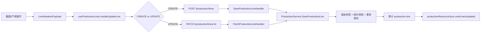
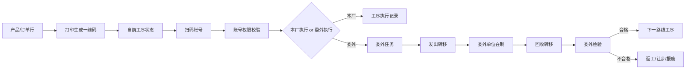

# 生产架构与委外边界设计

> 文档状态：生产路线业务修订、按计划绑定路线修订、销售订单明细级路线适用范围、条码固定路线执行、工序执行、统一扫码命令、路线推进、转移事件基础、委外单位档案、委外任务、委外收发检验、质量路由、委外消息中心事件源/通知编排、通知失败日志与人工重试恢复、跨域读写契约和移动端验收已落地；阶段 G 目标提交的部署和数据库/业务验收仍待完成<br>
> 主链路确认日期：2026-07-29；消息投递、恢复与文件职责复核：2026-10-20<br>
> 适用范围：生产架构、产线脑图、生产路线、在制品执行、委外/外协<br>
> 当前原则：产线领域已收敛到唯一入口；委外必须复用统一扫码入口、路线推进和转移事实；PDA、Web、USB 执行入口均复用统一扫码客户端，不保留旧路由兼容跳转

当前脑图界面保留 `L1 → L2 → L3` 管理展示：L3 是归属于稳定 MBOM 分支身份的独立工序；路线 TAB 可直接从工序库选择工序，服务端为该分支建立或复用 L3 身份并持久化工序来源关联。路线步骤、扫码、条码状态和委外事实使用该分支工序身份，路线位置独立由 `routeStepId` 标识。节点展示名称不用于业务关联。该树形管理结构不是路线执行依赖；路线范围规则见主设计文档阶段 G。

## 术语校正（2026-08-13）

本文件中的 `LineSegment` 只指脑图 L2 的 MBOM 分支承载行，不表示实际作业地点。独立工资环节及工价不引用工段、分支工序或路线步骤；边界见 [`生产拓扑路线步骤与计件工价统一设计.md`](生产拓扑路线步骤与计件工价统一设计.md)。

## 产品模板、BOM 分支与路线调整状态（2026-11-20）

截至 2026-11-24，阶段 A、B1 至 B5、C、D1、D2、E、F2、F3 和 G 已实现。L1 读取产品侧 `ProductTemplate`；L2 直接选择有效生产 MBOM 分支，候选不受产品模板筛选；L3 为该分支独立维护的工序。工序库独立配置；路线 TAB 可直接从工序库选择工序，由服务端建立或复用独立 L3 身份并持久化分支关联，不要求先在 L2 选配。路线按“MBOM 分支 + 分支默认/销售订单明细范围”配置；有 `SalesOrderLineID` 时精确匹配明细路线，没有时使用分支默认路线。计划在排产时绑定当时当前修订，扫码按活跃批次读取计划绑定修订，客户端不选择路线或工序。分支工序身份、独立生产地点和旧引用清理已切换，委外计划行不绑定 L3。`go test ./db ./services ./handlers ./routes`、TypeScript 检查和阶段 G 定向回归已通过；目标部署数据库结构核对及业务验收仍待完成。阶段与证据见 [`生产脑图产品BOM分支绑定与生产路线分阶段修正设计.md`](生产脑图产品BOM分支绑定与生产路线分阶段修正设计.md)。`ProductionTopologyTemplate` 已按独立快照单向复制：实际 L1 生成模板、模板创建新 L1/L2；模板与实际结构互不回写，L3 快照仅供参考。详见 [`生产拓扑模板独立快照与单向复制设计.md`](生产拓扑模板独立快照与单向复制设计.md)。

## 1. 决策摘要

### 1.1 产线管理 TAB 的最终归属

`产线管理` 与 `产线脑图` 当前都围绕同一份 `/production/lines` 数据工作，并且都能修改产线层级。两者长期并存会造成：

- 用户不知道应该在哪个页面维护产线；
- 同一条产线出现两套编辑入口；
- 权限、搜索、最近访问和路由目录需要同时维护；
- 后续委外、工序转移、产能分析无法确定哪个页面是产线结构的权威来源。

最终决策：

```text
产线脑图 = 产线主数据 + L1 产品模板关联 + L2 有效生产 MBOM 分支 + L3 分支工序的唯一维护入口
```

独立的 `产线管理` TAB 应删除，而不是保留空壳、跳转页或兼容入口。

### 1.2 删除前的必要前置条件与当前状态

迁移前，脑图缺少以下产线基础操作；这些能力已在本次迁移中补齐：

- 新增产线；
- 编辑产线名称、编码、描述；
- 启用/停用产线；
- 删除产线；
- 产线级操作菜单；
- 生产拓扑模板维护入口，支持实际 L1 生成独立模板及模板创建新 L1；不自动同步实际结构。

这些前置条件已在 `产线脑图` 迁移中完成，旧 `line` 路由也已删除。实施顺序记录如下（均已完成）：

1. 先将产线基础操作迁入脑图工具栏或“当前产线操作”菜单；
2. 补齐脑图对应的权限状态、确认弹窗和空数据状态；
3. 验证脑图成为完整的产线管理入口；
4. 删除 `line` TAB、旧路由、搜索项、权限目录项和旧菜单引用；
5. 重新生成路由目录与权限索引；
6. 运行前端构建、后端测试和路由/权限一致性检查；
7. 最后再进入委外功能设计与实现。

当前进度：步骤 1 到 6 已完成并提交，生产路线、条码状态、工序执行基础骨架、委外单位档案、委外任务、收发检验、质量路由、委外消息中心事件源/通知编排、通知失败日志与人工重试恢复、跨域读写契约和移动端验收均已落地；PDA、Web、USB 生产入口均已复用统一扫码客户端，Web/USB 独立执行页为 `/production-execution`；委外专项设计已迁入 `docs/architecture/生产委外执行链路设计.md`。当前收发检验已复用统一扫码事务。委外不另建单位与工序的能力映射，产品当前工序只认一维码状态中的 `routeStepId`。

## 2. 当前产线文件职责

### 2.1 页面与路由层

| 文件                                                            | 当前职责                             | 长期处理                       |
| --------------------------------------------------------------- | ------------------------------------ | ------------------------------ |
| `src/features/production-architecture/index.tsx`                | 生产架构页签容器，按路径处理脑图布局 | 保留，删除 `line` 页签后的容器 |
| `src/features/production-architecture/tab-config.ts`            | 定义生产架构页签                     | 只保留脑图、拓扑模板、生产路线 |
| `src/routes/_authenticated/production-architecture/mindmap.tsx` | 产线脑图路由                         | 保留，作为唯一产线入口         |
| `src/routes/_authenticated/production-architecture/index.tsx`   | 生产架构根路径入口                   | 根路径正式进入 `mindmap`       |

根路由切换后不保留 `/production-architecture/line` 的兼容重定向。因为项目尚未正式接入生产，旧地址应直接从代码、权限和路由目录中移除，避免形成长期幽灵入口。

### 2.2 历史产线管理 UI（仅作迁移回顾）

| 文件                                                                                         | 迁移前职责                               | 迁移结果                                    |
| -------------------------------------------------------------------------------------------- | ---------------------------------------- | ------------------------------------------- |
| `src/features/production-shared/tabs/line-mgmt/index.tsx`                                    | 产线管理页组合                           | 页面入口删除                                |
| `src/features/production-shared/tabs/line-mgmt/components/line-list.tsx`                     | 搜索、列表、新增产线、编辑/删除/启停调度 | 交互逻辑迁入脑图工具栏或产线操作菜单        |
| `src/features/production-shared/tabs/line-mgmt/components/line-card.tsx`                     | 产线卡片、拓扑树、模板应用、拓扑编辑     | 不整体搬入；拓扑编辑逻辑整理后由脑图复用    |
| `src/features/production-shared/tabs/line-mgmt/components/line-dialog.tsx`                   | 产线基础资料弹窗                         | 改成脑图专用的 `line-profile-dialog` 后复用 |
| `src/features/production-shared/tabs/line-mgmt/components/topology/security-auth-dialog.tsx` | 拓扑/产线敏感操作二次授权                | 提升为生产架构共享组件                      |
| `src/features/production-shared/tabs/line-mgmt/hooks/use-line-topology.ts`                   | 旧树形 UI 的拓扑变更适配                 | 脑图已具备同等动作后，删除旧 UI 依赖        |
| `src/features/production-shared/tabs/line-mgmt/utils/line-topology-helpers.ts`               | 纯拓扑变更函数                           | 保留并迁移到共享 topology 目录              |

下面的文件职责描述仅用于记录迁移回顾，不代表当前保留的页面职责。

`line-mgmt` 不应继续作为长期领域名称。完成迁移后，建议按职责整理为：

```text
src/features/production-shared/
├─ data/
│  ├─ production-line.ts
│  └─ production-process.ts
├─ contracts/
├─ services/
│  └─ production-lines-service.ts
├─ hooks/
│  ├─ use-production-lines.ts
│  └─ use-production-processes.ts
└─ topology/
   ├─ line-topology-helpers.ts
   ├─ line-topology-mutations.ts
   └─ security-auth-dialog.tsx
```

整理的目的不是制造更多目录，而是让“共享数据链路”和“已删除页面的 UI”彻底分离。

### 2.3 产线脑图 UI

| 文件                                                         | 当前职责                                   | 结论                                          |
| ------------------------------------------------------------ | ------------------------------------------ | --------------------------------------------- |
| `src/features/production-shared/tabs/line-mindmap/index.tsx` | 脑图页面组合、查询、节点动作、弹窗挂载     | 保留，补齐产线基础操作                        |
| `.../components/line-mindmap-toolbar.tsx`                    | 产线选择、新建一级/二级/三级节点、编辑节点 | 增加新增/编辑/启停/删除产线操作               |
| `.../hooks/use-line-mindmap-view-model.ts`                   | 当前产线、节点投影、节点选择               | 保留，未来增加当前产线操作状态                |
| `.../hooks/use-line-mindmap-actions.ts`                      | L1/L2/L3 节点增删改                        | 保留，改为依赖共享 topology 类型              |
| `.../hooks/use-line-mindmap-topology-auth.ts`                | 拓扑变更的二次授权和待提交状态             | 保留，抽离 `LineMutationPayload` 的旧路径依赖 |
| `.../hooks/use-line-mindmap-process-panel.ts`                | 分支 L3 工序创建、编辑与状态维护           | 保留，作为脑图的三级节点配置                  |
| `.../components/line-mindmap-dialogs.tsx`                    | 统一挂载脑图弹窗                           | 增加产线资料、产线删除确认、产线状态变更弹窗  |
| `.../adapters/line-mindmap-adapter.ts`                       | 将产线 DTO 投影为脑图节点                  | 保留，只负责投影，不负责写入                  |

当前脑图已经能完成：

- 产线选择；
- L1、L2、L3 节点新增；
- 节点重命名、删除；
- L2 关联有效生产 MBOM 分支；
- 按分支新增、查看、编辑和启停 L3 工序；
- 可从全局标准作业复制名称和说明，复制后独立维护。

缺失的是产线自身的生命周期操作，而不是拓扑能力。

## 3. 当前数据链路

### 3.1 前端读取链路


脑图和旧产线管理页读取同一个 Query Cache，因此删除页面不会影响数据源；必须保留 `useProductionLinesQuery`、`productionLinesService`、DTO、适配器和缓存失效逻辑。

### 3.2 前端写入链路



当前共享 hook 已整理为 `useProductionLines`，旧 `useLineMgmtLines` 文件和页面入口均已删除。

### 3.3 后端保存边界

| 层         | 文件                                                                                                                                                                  | 责任                                                                                                        |
| ---------- | --------------------------------------------------------------------------------------------------------------------------------------------------------------------- | ----------------------------------------------------------------------------------------------------------- |
| 路由       | `server/routes/routes_production.go`                                                                                                                                  | 注册 `/production/lines`、`/production/processes`、映射接口及权限中间件                                     |
| Handler    | `server/handlers/production_topology_handlers.go`                                                                                                                     | 解析请求、映射操作者/客户端 IP、返回 HTTP 状态                                                              |
| Service    | `server/services/production_topology_service.go`、`server/services/production_process_service.go`、`server/services/production_route_service.go`                      | 分别负责拓扑、标准作业和产品路线；`production_service.go` 只保留兼容聚合类型与错误定义                      |
| Repository | `server/repositories/production_topology_repository.go`、`server/repositories/production_process_repository.go`、`server/repositories/production_route_repository.go` | 分别负责拓扑、标准作业和产品路线的查询、保存、删除与映射维护；`production_repository.go` 只保留兼容组合接口 |
| Model      | `server/models/production_bom_branch_operation.go`、`server/models/production_process.go`、`server/models/production_topology.go`、`server/models/production_route.go` | 分支 L3 工序、当前路线标准作业、产线层级、产品路线与路线步骤的持久化结构                                  |
| DTO        | `server/services/production_process_dto.go`、`server/services/production_topology_dto.go`、`server/services/production_route_dto.go`                                  | 分别负责标准作业、拓扑和路线的 HTTP DTO 与模型转换                                                          |

后端目前没有“旧页面专用 API”。因此应删除旧前端入口，而不是删除 `/production/lines` API。

## 4. 重复职责与长期风险

### 4.1 重复职责

旧 `line-mgmt` 和 `line-mindmap` 都：

- 读取 `/production/lines`；
- 展示产线与层级；
- 修改产线拓扑；
- 触发版本更新；
- 受生产域权限保护。

差异仅在呈现方式和脑图的分支工序配置操作。继续保留两个页面会让同一份拓扑出现“双写入口”。

### 4.2 当前保存模型的风险

`SaveProductionLine` 会按整棵层级树保存，并删除不再提交的关联节点。该模式可以保证一棵树的整体一致性，但要求：

- 所有写入都携带最新 `version`；
- 任何页面都不能只提交局部旧快照；
- 脑图和未来委外页面不能直接修改产线拓扑；
- 发生 409 时必须让用户重新读取，而不是静默覆盖。

因此脑图成为唯一拓扑写入口后，版本冲突更容易定位，长期稳定性更高。

### 4.3 权限风险

旧独立产线入口涉及的配置位置已完成清理；当前维护以下文件，避免再次登记已删除的 `/production-architecture/line`：

- `src/features/authz/data/authenticated-route-catalog.ts`
- `src/features/authz/data/route-permission-labels.ts`
- `src/components/layout/data/search-data.ts`
- `src/features/production-architecture/tab-config.ts`

旧 `line.tsx` 路由已删除，当前页签仅保留 mindmap、topology、routes；路由、搜索和权限目录应与这些真实入口保持一致。

后端的权限边界仍应保留：

- 读取产线：生产配置菜单权限；
- 修改拓扑：`action_production_line_update`；
- 新增/删除产线：管理员权限；
- 拓扑敏感操作：`topology_auth_password` 二次授权。

## 5. 产线唯一入口的目标结构

```text
生产管理
└─ 生产协同
   └─ 生产架构
      ├─ 产线脑图（唯一产线管理入口）
      │  ├─ 产线选择与搜索
      │  ├─ 新增产线
      │  ├─ 编辑产线资料
      │  ├─ 启用 / 停用
      │  ├─ 删除产线
      │  ├─ 新增 / 编辑 L1、L2、L3 节点
      │  ├─ L2 有效 MBOM 分支关联
      │  └─ L3 分支工序维护
      └─ 拓扑模板维护（独立快照、单向复制新 L1）
```

脑图工具栏建议分为三组，避免按钮继续堆叠：

1. **产线选择**：搜索、切换当前产线；
2. **产线操作**：新增、编辑、启停、删除、模板；
3. **结构操作**：新建 L1/L2/L3 节点、编辑当前节点。

产线资料弹窗与节点编辑弹窗必须区分：

- 产线资料：名称、编码、描述、状态；
- 节点编辑：L1 产品模板关联、L2 MBOM 分支关联、L3 分支工序维护。

## 6. 迁移实施清单

### 阶段 A：脑图补齐基础能力

- [x] 将 `LineDialog` 整理为长期命名的产线资料弹窗；
- [x] 在脑图 Toolbar 增加“新增产线”；
- [x] 在当前产线操作菜单增加“编辑资料、启用/停用、删除”；
- [x] 复用现有版本、拓扑授权、审计和乐观更新链路；
- [x] 空产线时仍能从脑图直接创建第一条产线；
- [x] 无权限时保留按钮但置灰，并说明缺少的权限；
- [x] 删除产线使用管理员权限和明确确认。

### 阶段 B：共享职责整理

- [x] `use-line-mgmt-lines.ts` 重命名为 `use-production-lines.ts`；
- [x] `LineMutationPayload` 移到共享 contracts；
- [x] `line-topology-helpers.ts` 移到 `production-shared/topology`；
- [x] 安全授权弹窗移到生产架构共享组件；
- [x] 脑图不再从 `tabs/line-mgmt` 深层导入共享能力；
- [x] 检查所有跨域深层 import，保持显式共享模块边界。

### 阶段 C：删除旧入口

- [x] 从 `getProductionArchitectureTabs` 删除 `line`；
- [x] 删除 `src/routes/_authenticated/production-architecture/line.tsx`；
- [x] 根路径进入 `mindmap`，不保留旧兼容跳转；
- [x] 从 `search-data.ts` 删除产线管理搜索项；
- [x] 从 `authenticated-route-catalog.ts` 删除旧路由；
- [x] 从 `route-permission-labels.ts` 删除旧页签标签；
- [x] 删除旧 UI 组件和只服务于旧页面的 hook；
- [x] 删除生产架构页签中旧“产线管理”文案；
- [x] 重新生成路由树、权限清单和搜索索引。

### 阶段 D：验收

- [x] 新增、编辑、启停、删除产线均可在脑图完成；
- [x] 拓扑和 L2 MBOM 分支关联编辑不丢失；
- [x] 版本冲突能阻止覆盖；
- [x] 二次授权仍生效；
- [x] 删除产线后相关层级级联清理；
- [x] 搜索、侧边栏、最近访问不再出现旧路由；
- [x] 直接访问旧路径不产生兼容页面；
- [x] 完整前端构建、后端测试和部署前检查通过。

## 7. 委外/外协的长期领域边界

产线入口收敛后，再设计委外。委外不是采购订单的附属页面，也不是供应商资料的另一个别名；它是生产执行在某个工序节点上的外部执行方式。

### 7.1 领域归属

```text
生产管理
├─ 计划中心
├─ 生产协同
│  └─ 生产架构 / 产线脑图
└─ 委外管理
   ├─ 委外基础
   │  ├─ 委外单位
   │  └─ 委外协议/价格
   └─ 委外执行
      ├─ 委外任务
      ├─ 发出
      ├─ 在外
      ├─ 回收
      └─ 委外检验
```

委外属于生产管理域。采购域可以维护结算、付款和供应商合作信息，但不能拥有“某个产品当前处于哪个生产工序”的事实。

### 7.2 产品、一维码、账号权限与产线必须分开

| 对象                              | 原因                                                                             |
| --------------------------------- | -------------------------------------------------------------------------------- |
| `Product`                         | 产品主数据和产品规则来源，可用于打印生成一维码，但不保存某个一维码当前在哪道工序 |
| 产品一维码                        | 由产品/订单打印发号产生，可反查产品；生产执行把当前工序状态绑定到一维码          |
| `ProductionBOMBranchOperation`    | 当前脑图 L3 分支工序；现有路线中的 `ProcessStep` 引用待迁移，不承载人员授权     |
| 账号权限 / 命令权限               | 决定某个账号是否能打开页面、点击按钮或执行扫码命令，属于权限系统                 |
| `Position` / `EmployeeAssignment` | 组织人事资料，可用于人员档案展示，不参与生产扫码或工序执行授权                   |
| `ProductionLine` / `LineSegment`  | 产线和工段主数据，只描述生产结构，不保存操作人状态                               |
| `Supplier`                        | 供应商适合采购合作方，不能自动代表生产执行事实                                   |
| `EquipmentPartner`                | 设备/工装合作方与生产加工委外不是同一事实                                        |
| 裁纱卷材绑定                      | 裁纱与卷材追溯是独立模块，不能成为后续生产或委外的硬前置                         |

一维码的最短执行链路固定为：

```text
产品/订单行
  → 打印生成一维码
  → 扫码反查产品
  → 按活跃执行批次读取计划已绑定的路线修订
  → 读取一维码当前工序状态
  → 扫码账号
  → 页面/命令/动作权限校验
  → 工序执行或转移事件
```

这条链路只读取所需的计划产品与 MBOM 分支身份，不加载整张计划任务明细、库存或卷材追溯数据。其他领域通过明确 ID 或产品一维码关联。

绑定错误时，必须能从一维码直接查到：

- 对应的产品；
- 当前工序；
- 最近一次状态事件；
- 操作账号；
- 关联路线版本。

当前已落地基础状态链：

```text
product_barcode_states
  └─ product_barcode_state_events
```

该链路以一维码为锚点保存当前工序状态和事件历史。HTTP 初始化不接受路线或工序身份；首次生产扫码读取计划已绑定的路线修订并写入首个路线步骤，后续执行按条码状态定位当前工序。卷材绑定不是生产扫码前置。

`production_execution_lots` 将产品码关联到必填的生产计划，任务和批次号可选。活跃执行批次及其计划是生产扫码解析 MBOM 分支的前置条件；计划已有批次或已开始执行后禁止改分支。

当前已落地 `production_operation_executions`，用于记录某个产品码在某个工序上的开始、完成、暂停或返工动作。该服务只校验工序、路线、批次等生产事实；是否允许调用扫码、按钮或接口，由账号/人员权限体系在入口侧处理。写入成功后会同步写入一维码状态事件。

当前已落地统一扫码命令入口：

```text
POST /production/scan-commands/execute
```

该入口是 Web、PDA、USB 扫码的统一后端命令层，复用 `action_production_issuance_execute` 动作权限，不从工序或人员档案推导授权。客户端提交条码、动作及作业地点等执行信息；服务端按活跃批次读取计划固定的路线修订，再从条码状态与路线步骤确定当前工序，完成后按路线 `sequence` 推进下一步骤。独立的 `POST /production/operation-executions` 已移除，执行事实通过统一扫码命令写入。

当前已落地转移事件基础表：

```text
product_barcode_transfer_events
```

它用于记录路线推进和可选持有方变化，不等于委外发出/回收业务状态机。当前委外发出、回收、在外、回收待检和检验处置已由委外执行首期链路承接，并在同一事务中写入对应执行事实。

### 7.3 建议的核心实体

```text
ProductionRoute
  └─ ProductionRouteStep

生产脑图当前模型
  ProductionLine（L1，关联 ProductTemplate）
    └─ LineSegment（L2，关联有效生产 MBOM 分支）
        └─ ProductionBOMBranchOperation（L3，分支独立工序）

当前 B4 路线配置模型
  ProductionRoute
    └─ ProductionRouteStep
        └─ branchOperationId

B5 迁移前的执行身份（本阶段清理对象）
  ProductBarcodeState / ProductBarcodeStateEvent
    └─ currentProcessStepId / fromProcessStepId / toProcessStepId
  ProductionOperationExecution / OutsourceTransfer / OutsourceInspection
    └─ processStepId

B5 已迁移的执行身份
  条码状态、路线推进、工序执行及委外扫码事实使用 branchOperationId
  OutsourceOrderLine 仅为计划行，不绑定 L3；委外事实从条码当前 routeStepId 读取工序身份
  实际作业地点使用独立 ProductionWorkLocation 身份

ProductBarcodeState
  ├─ productBarcode
  ├─ productId
  ├─ routeStepId
  ├─ currentBranchOperationId
  └─ status

ProductBarcodeStateEvent
  ├─ productBarcode
  ├─ fromBranchOperationId
  ├─ toBranchOperationId
  ├─ operatorAccount
  └─ occurredAt

ProductionExecutionLot
  ├─ productBarcode
  ├─ planId（必填，计划确定稳定 MBOM 分支）
  ├─ taskId（可选）
  └─ optional batch reference

ProductionOperationExecution
  ├─ productBarcode
  ├─ routeStepId
  ├─ branchOperationId
  ├─ productionWorkLocationId
  ├─ startedAt / completedAt
  └─ result

OutsourcePartner

OutsourceOrder
  └─ OutsourceOrderLine
      ├─ product snapshot / source snapshot
      ├─ quantity
      └─ no L3 binding

OutsourceTransfer
  ├─ sentAt
  ├─ returnedAt
  ├─ routeStepId
  ├─ branchOperationId
  ├─ quantity
  └─ custody/location

OutsourceInspection
  ├─ result
  ├─ routeStepId
  ├─ branchOperationId
  ├─ acceptedQuantity
  ├─ rejectedQuantity
  └─ disposition
```

当前已经落地 `OutsourceOrder` / `OutsourceOrderLine` 任务骨架，以及 `OutsourceTransfer` / `OutsourceInspection` 收发检验首期链路。它支持从销售订单或生产计划创建委外任务，销售订单和生产计划只作为来源快照；委外任务自己保存委外单位、数量、来源产品快照、计划发出/返回日期和状态，创建时不手工绑定 L3。因此“销售订单 500 件，本厂做不过来，直接开始委外”目前已有基础登记入口。B5 中只有扫码产生的委外发出/回收、检验等执行事实记录当时的 `branchOperationId`；计划行不保存该字段，避免任务创建时预选或固化 L3。

委外任务行不手工选择 L3。L3 属于分支路线定义；一个产品当前处于哪个工序，由条码状态的 `routeStepId` 和对应路线步骤的 `branchOperationId` 表达。扫码发出/回收及回收检验从条码当前路线步骤取得该分支工序身份并写入执行事实，而不是在委外页反向修改产线脑图或工序库。

当前已经形成“下发 → 发出 → 回厂 → 检验 → 关闭”的基本流转：发出/回厂写入 `OutsourceTransfer` 和 `product_barcode_transfer_events`，委外专用库存适配器在同一事务中更新 `Inventory` 并写入成对的 `InventoryLedgerEntry`，回厂检验先创建/领取带委外行与产品码来源绑定的正式 `InspectionTask`，再在同一事务内写入 `OutsourceInspection`、完成品质任务并调用统一扫码命令推进条码；失败、返工、让步和报废会在品质域留下 `QualityAbnormality`，委外域不直接承担后续审批。下达、作废、发出、回厂、检验处置和关闭也会通过 `PRODUCTION_OUTSOURCE` 事件源进入消息中心规则编排；通知收件、执行记录和刷新队列与业务同事务写入，发布失败关联原任务，执行日志页只恢复该原任务；仓储/品质/采购/裁纱的跨域读写契约已经明确，通用库存出入库会拒绝 `PRODUCTION_OUTSOURCE` 专用来源。路线步骤可配置质量处置目标，未配置时保持顺序推进或当前步骤返工的默认行为。

2026-10-20：生产与委外已接通用服务端收件和提交后队列；旧日志直投及扫描重试已移除。失败恢复操作原任务，委外诊断只查询原日志当前失败状态；恢复和发布不创建另一条重试日志。阅读/归档/解除持久化，离线恢复重新查询。旧 CLI 的实时通知验收入口已移除，通知恢复由隔离 PostgreSQL 集成测试维护；CLI 保留业务事实、并发和权限验收。Redis 发布完成不等于设备送达或员工已读；历史2026-07-29实时验收不代替本轮专项回归。统一保留、恢复和文件职责见[消息中心长期契约](workflow/system-notification-inbox-cross-device-synchronization-and-delivery-contract.md)，委外触发条件见[委外执行链路设计](生产委外执行链路设计.md)。

2026-07-29 已用真实 PostgreSQL + HTTP API 对委外主链路做端到端验收：委外单下发、统一扫码开始、统一扫码完成、委外发出、委外回厂、回收检验和最终关闭全部跑通。验收确认同一链路会写入委外转移、委外检验、工序执行、条码状态事件、路线/持有方转移事件、审计日志和 `PRODUCTION_OUTSOURCE` 消息规则处理日志。该验收还修复了真实 PostgreSQL 暴露的可选 UUID 空字符串写入问题：创建时对空的可选 UUID 字段 `Omit`，更新时写入 `NULL`，不把空值伪装成零 UUID，也不继续向 PostgreSQL 的 `uuid` 列写 `""`。本轮还补齐了重复委外回厂/检验、数据库唯一约束冲突归一化、作废委外单拒绝、跨路线步骤扫码拒绝、无权限扫码拒绝、真实 HTTP 路由权限返回 `403`、真实 Redis Pub/Sub 通知投递/人工重试恢复和真实多连接 PostgreSQL 并发验收；验收 fixture 已自动清理。

### 7.4 状态必须拆开

委外设计不能只用一个 `status` 解决所有问题，至少要区分：

| 状态维度 | 示例                                                                        |
| -------- | --------------------------------------------------------------------------- |
| 工序状态 | `NOT_STARTED`、`IN_PROGRESS`、`COMPLETED`、`HOLD`                           |
| 委外状态 | `DRAFT`、`RELEASED`、`SENT`、`IN_PROCESS`、`RETURNED`、`CLOSED`、`CANCELED` |
| 质量状态 | `PENDING`、`PASSED`、`FAILED`、`CONCESSION`、`REWORK`                       |
| 持有位置 | 本厂产线、待发区、委外单位、回收待检区、合格区、不合格区                    |

“产品到了路线的哪个具体作业”由一维码的 `routeStepId` 和状态事件表达；B5 完成后，当前/前后工序身份统一使用 `branchOperationId`。“这次操作是否完成”由工序执行记录表达；“东西由谁持有或移交到哪里”由独立转移事实表达；实际作业地点使用 `ProductionWorkLocation`，不复用 L2、工序、持有方或品质检验站身份；“是否允许进入下一道工序”由工序完成和质量判定共同决定。

工序与账号权限的关系必须分开：

```text
ProductionBOMBranchOperation
  └─ 保存当前脑图 L3 的分支工序定义

ProcessStep（当前路线模型，待迁移）
  └─ 保存现有路线引用的作业定义

账号
  └─ 页面权限 / 命令权限 / 动作权限
```

不允许把员工、账号或人员授权写进产线层级，也不允许通过产线节点推断操作人。组织人事域负责人员资料和组织归属；生产执行链路只记录操作账号。

### 7.5 委外执行链路



委外任务创建只绑定来源订单/计划、委外单位和数量；委外执行动作必须扫描产品一维码并读取其当前 `routeStepId`，不允许在任务表里手填或预选 L3。当前发出、回厂和检验接口会校验条码状态存在、产品和当前工序匹配，并将事实写入独立流水。

委外库存只表达物理数量和在制持有位置，不拥有委外状态机或产品工序状态。发出时由专用适配器把来源库区数量转入系统库区 `PRODUCTION_OUTSOURCE`；回厂时从该库区转出到明确目标库区。每次动作必须在一个数据库事务内同时写入：

```text
OutsourceTransfer
ProductBarcodeTransferEvent
Inventory
InventoryLedgerEntry (OUT + IN)
```

产品快照先经过产品到物料解析器映射到库存物料，不能把 `ProductID` 直接当作 `MaterialID`。通用仓储出入库、库存调拨、批量同步、负库存对账和作废接口不能写入 `PRODUCTION_OUTSOURCE`。委外页面读取库区选项时走生产域只读投影，不要求委外操作员额外拥有仓储菜单权限。

### 7.6 一维码与裁纱边界

产品、一维码和裁纱/卷材追溯是三个独立事实：

- 产品主数据只描述产品本身；
- 一维码由产品/订单打印产生，可反查产品，并承载当前工序状态；
- 产品只要完成必要的一维码/产品绑定，就可以进入后续下单和生产流程；
- 是否绑定卷材、是否完成裁纱计算，不得成为普通生产或委外的强制阻断条件；
- 裁纱结果可作为追溯、自动切割和后续质量分析的补充事实；
- 委外系统只能引用裁纱追溯信息，不能反向要求所有产品必须先绑定卷材。

一维码绑定错误必须通过一维码、产品引用和状态事件快速发现，不能依赖卷材、库存或整张生产计划才能判断。

这是生产执行和裁纱引擎之间的硬边界，必须在后续接口契约和验收用例中明确。

## 8. 委外实施前置条件

在实现委外页面前，已完成的前置基础：

- [x] 产线管理 TAB 删除，脑图成为产线唯一入口；
- [x] 生产路线与产线拓扑的关系定义；
- [x] 产品一维码状态链落地；
- [x] 执行批次绑定计划，生产扫码按条码读取计划 MBOM 分支；
- [x] 工序执行记录落地；
- [x] 账号/命令权限边界确认：生产工序不参与扫码权限限制。
- [x] 统一扫码命令入口落地；
- [x] 当前路线步骤解析与推进落地；
- [x] 路线推进和持有方转移事件基础表落地；
- [x] 生产扫码执行接入审计实体和消息事件源。
- [x] 委外单位档案、权限、审计、搜索和委外管理域入口落地。
- [x] 委外任务首期模型、API、权限、审计和页面落地。
- [x] 委外任务支持从销售订单或生产计划创建。
- [x] 委外消息中心事件源和通知编排落地。
- [x] 委外与仓储、品质、采购、裁纱的读写边界和接口契约落地。
- [x] 委外专用库存适配器、系统库区和库存流水落地。
- [x] 委外检验正式品质任务的创建、领取、判定桥接落地；同一产品码的复检轮次及返工后重复委外收发周期已按独立周期/轮次、父任务和最新结果汇总实现，让步/报废审批继续由品质域后续扩展。

仍必须补齐的前置基础：

- [x] 委外扫码发出、扫码回收、检验状态机首期；
- [x] 与仓储、品质、采购、裁纱模块的读写边界；
- [x] 返工跳转、质量判定后的路线跳转策略；
- [x] 委外发出/回收转移事件的独立审计；
- [x] 委外下达/作废/关闭/发出/回收/检验消息规则。
- [x] 委外发出/回厂与库存余额、库存流水的同事务一致性。

当前状态机已经覆盖“发出、在外、回收、检验”、质量处置路由、消息通知和跨域读写边界的基本闭环；委外页面已完成移动端验收。

## 9. 阶段完成记录与后续事项

本节的勾选项记录既有阶段结果。厂内路线业务修订、发布快照、排产绑定及扫码固定已完成并通过本地隔离 PostgreSQL 验收；每码单件、多条码分批回厂/检验、委外对计划固定路线修订和来源身份的校验、同码复检轮次及返工后重复委外收发周期的身份与数量/关闭语义均已实现并通过服务回归。当前待办是目标部署迁移和部署后验收。E 已完成拓扑模板独立快照与单向复制，模板编辑/删除不会回写实际结构。D1 已完成分支工序停用的引用保护：已发布路线或当前/历史生产及委外事实引用时禁止停用，并以家族、路线、工序顺序加锁防止并发发布绕过。D2 已完成 L1/L2 子记录归属及删除一致性：拒绝跨 L1 借用、重复或复用已删除 L2 ID，保存/删除锁定同一 L1，删除原子移除其 L2 关联，审计失败整体回滚；本地隔离 PostgreSQL 并发和 HTTP 验收通过。L1/L2 是脑图关联，移除不级联修改工序、路线或执行事实。具体状态与证据以分阶段修正设计为准。

### 产线架构

- [x] 脑图补齐产线基础资料 CRUD；
- [x] 共享 hook、类型、拓扑 helper 重命名和归位；
- [x] 删除旧 `line` TAB、路由、搜索项和权限目录引用；
- [x] 更新根路径默认入口；
- [x] 完成完整构建、后端回归和部署前检查；
- [x] 当时的产线入口迁移已部署到服务器；本轮 MBOM 分支、工序身份及自动选路修改尚未完成目标部署验收。

### 生产执行主链（P0）

- [x] 生产路线实体和版本策略；
- [x] 路线步骤只保存 `branchOperationId`，执行事实另存 `routeStepId` 表示路线位置；
- [x] 建立产品一维码状态链；
- [x] 确认并删除工序与授权映射链路；
- [x] 执行批次绑定计划，扫码读取计划已绑定的路线修订；
- [x] 工序执行记录；
- [x] 统一扫码命令入口；
- [x] 扫码入口接入账号/命令/动作权限校验；
- [x] 扫码触发工序执行；
- [x] 当前路线步骤解析与推进；
- [x] 持有位置和工序转移事件基础；
- [x] 条码状态、生产执行和委外事实切换到分支工序身份并移除旧字段/映射表；
- [x] 生产扫码事实单独记录 `ProductionWorkLocation`；
- [x] 显式发布路线，发布前验证有效 MBOM 分支及 L3，草稿路线不得执行；
- [x] 工序执行与路线推进接入消息中心和审计；
- [x] 返工跳转、质量判定后的路线跳转策略；
- [x] 委外发出/回收转移事件的独立状态机和审计；
- [x] 委外下达/作废/关闭/发出/回收/检验消息规则。

### 委外基础资料（P1）

- [x] 委外单位档案；
- [x] 委外单位可选引用供应商基础资料；
- [x] 委外单位权限、审计和搜索；
- [x] 委外与采购供应商的字段边界确认；

### 委外执行（P2）

- [x] 委外任务首期模型、API 和页面；
- [x] 从销售订单或生产计划创建委外任务；
- [x] 委外任务草稿编辑、删除和下发；
- [x] 发出、回收转移流水；
- [x] 回收检验；
- [x] 根据品质结果执行合格、让步接收、返工、报废的首期动作；
- [x] 配置化返工目标和复杂质量判定后的路线跳转；
- [x] 委外与仓储、品质、采购、裁纱的接口契约；
- [x] 委外状态机测试；
- [x] 委外消息中心事件源和通知编排测试；
- [x] 委外审计测试；
- [x] 委外专用库存适配器与库存流水测试；
- [x] 真实 PostgreSQL + HTTP API 委外主链路验收；
- [x] 通知发布失败日志和失败通知人工重试恢复；
- [x] 重复事实、唯一约束冲突归一化和作废委外单拒绝的服务层测试；
- [x] 历史 Redis 验收（2026-07-29）：当时的投递、人工重试和恢复通过；旧验收入口已移除，当前统一收件箱与原任务恢复以2026-10-20隔离 PostgreSQL 回归为准；
- [x] 真实多连接 PostgreSQL 并发拒绝场景验收（2026-07-29，验证并发下发/作废/发出/回厂的数量、重复事实和最终状态）；
- [x] 每码单件：生产执行批次、委外发出、回收和检验数量强制为 `1`；部分回厂按不同条码分次登记；
- [x] 委外执行校验生产计划/销售订单及明细行来源，并沿用计划排产时固定的路线修订；不查询路线家族当前修订指针；
- [x] 同码复检轮次与返工后重复委外收发周期：已完成轮次身份、最终判定汇总、明细关闭条件实现；剩余目标部署迁移和部署后验收。

### 页面与菜单（P3）

- [x] 委外页面和菜单归属；
- [x] 一个三级域 `委外管理`，当前内部承载 `委外任务`、`委外单位`、`收发检验` TAB；
- [x] 权限不足按钮显示但置灰；
- [x] 移动端布局验收：390px 窄屏下委外任务、委外单位、收发检验无横向溢出；统计卡片压缩为单行紧凑布局；新增任务和委外单位弹窗可滚动到底部并显示操作按钮；
- [x] 不保留临时旧路由和兼容跳转；
- [x] 委外专项架构文档落位：`docs/architecture/生产委外执行链路设计.md`。

## 10. 最终验收原则

### 产线架构

- 一个产线只有一个维护入口：产线脑图；
- 产线资料与产线拓扑在同一领域内，但弹窗职责分离；
- 所有写入共享同一版本、授权、审计和缓存链路；
- 删除旧路由后，搜索、权限、侧边栏和最近访问不再出现旧入口；
- 不保留兼容跳转和旧连接。

### 委外/外协

- 委外任务创建不预选 L3；发出、回收和检验必须以扫描的一维码当前状态为准；
- 工序状态、委外状态、质量状态、持有位置互不混淆；
- 产品、一维码、账号权限和产线工序互不混淆；
- 委外单位不是简单复制采购供应商；
- 委外回收必须经过质量判定才能进入下一工序；
- 委外发出/回厂同时留下委外转移、条码持有方、库存余额和库存流水事实；
- 委外专用在制库区只能由委外专用适配器写入，委外页面不绕过生产域调用通用仓储写接口；
- 裁纱/卷材追溯不会阻断未绑定产品进入正常生产链路；
- 生产、采购、品质、仓储和裁纱分别拥有自己的事实所有权。

> 当前状态：产线唯一入口迁移已完成。L1 关联产品侧模板，L2 直接绑定有效生产 MBOM 分支，L3 为分支独立工序；生产位置使用独立身份。阶段 G 已使路线按销售订单明细或分支默认范围匹配，并在排产时绑定当前已发布修订；扫码和委外继续校验并使用该固定修订及来源身份。同码复检轮次和返工后重复委外周期已实现并通过服务回归。阶段 G 的新代码尚未完成目标部署；目标数据库结构核对和部署后业务验收待部署完成后进行。
