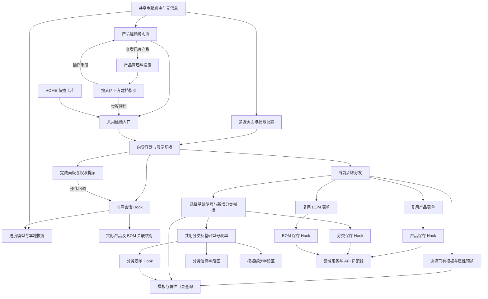

# 产品建档向导架构与文件职责梳理

核查日期：2026-10-22。

范围：`/engineering/product-creation-guide` 说明页、产品管理与手册之间的入口、HOME 共用建档入口、四步向导、第二步分类／基础型号弹窗，以及它们直接使用的表单、查询和保存模块。

本文记录当前实现、已完成的四轮整理及后续建议。第一轮已分离四个步骤、共用弹窗和提交锁；第二轮已分离分类弹窗的表单 Hook 和两个字段区；第三轮已分离向导会话 Hook 与完成面板；第四轮已统一步骤顺序、页面与阶段定义，并使导航列数适应步骤数量，操作规则保持原样。型号选择推导和目录查询职责的后续建议尚未实施。优先级表示后续增加交互前的整理顺序，不表示已确认的数据丢失或保存故障。

## 1. 当前架构

总体分层已经存在：说明页、向导会话、步骤组件、领域表单、保存 Hook、服务及 API 适配器。四轮整理已建立独立步骤文件边界，分离分类弹窗的表单状态与字段展示，拆开向导会话控制与完成面板，并统一步骤定义。下一步可分别收敛型号选择推导和目录查询职责。

## 2. 文件职责现状

行数为本次核查时的快照，只辅助定位；是否拆分主要取决于是否承载多个独立变化的职责。

| 文件 | 当前职责 | 判断 |
| --- | --- | --- |
| [product-creation-operation-guide-page.tsx](../../src/features/engineering/pages/product-creation-operation-guide-page.tsx)（464 行） | 手册内容、章节导航、示例、维护入口权限、打开向导和查看已有产品；复用共享步骤顺序 | 内容较长，但基本为展示；暂不优先拆分 |
| [product-management-creation-guide-entry.tsx](../../src/features/engineering/components/product-creation-guide/product-management-creation-guide-entry.tsx) | 产品管理搜索区下方的建档指引、手册入口权限和打开共用向导 | 只负责入口展示，不承接产品搜索、保存或向导会话 |
| [product-creation-operation-guide-launcher.tsx](../../src/features/engineering/components/product-creation-guide/product-creation-operation-guide-launcher.tsx) | 打开／关闭向导与懒加载；HOME、手册和产品管理共用 | 职责清晰，保留 |
| [product-creation-operation-guide-dialog.tsx](../../src/features/engineering/components/product-creation-guide/product-creation-operation-guide-dialog.tsx)（拆分前 385 行，现 85 行） | 账号就绪检查、按账号重建会话、组合导航与当前步骤／完成面板 | 第三轮已完成拆分，具体模块见第 5 节 |
| [product-creation-guide-business-operation-dialog.tsx](../../src/features/engineering/components/product-creation-guide/product-creation-guide-business-operation-dialog.tsx)（拆分前 901 行，现 24 行） | 按当前步骤分发至独立步骤组件，使用完整注册表检查遗漏 | 第一轮已完成拆分，第四轮补齐注册表类型检查，具体模块见第 3、6.1 节 |
| [product-type-action-dialog.tsx](../../src/features/engineering/components/product-type-action-dialog.tsx)（拆分前 767 行，现 141 行） | 弹窗容器、组合表单 Hook 与字段区、显示提交状态和保存按钮 | 第二轮已完成拆分，具体模块见第 4 节 |
| [product-action-dialog.tsx](../../src/features/engineering/components/product-action-dialog.tsx)（500 行） | 产品表单布局、规格及预览组合、图片选择、错误定位、删除入口 | 已使用独立表单 Hook 和子组件；后续按交互区域拆分即可 |
| [use-product-form.ts](../../src/features/engineering/hooks/use-product-form.ts) | 组合初始化、模板解析、规格预览与提交 Hook | 可作为分类表单拆分的现有参考 |
| [bom-action-dialog.tsx](../../src/features/product-structure/components/bom-action-dialog.tsx)（262 行） | 组合 BOM 表单、权限、并发冲突、协议恢复、提交和工作区 | 保持产品结构域职责，由向导复用 |
| [product-creation-operation-guide-step-definitions.ts](../../src/features/engineering/data/product-creation-operation-guide-step-definitions.ts)（24 行） | 共享步骤顺序、步骤 key 类型、页面 TAB 与阶段元信息 | 第四轮新增的轻量定义模块，不依赖进度、组件或权限计算 |
| [product-creation-operation-guide-progress.ts](../../src/features/engineering/data/product-creation-operation-guide-progress.ts) | 进度结构校验、前置确认与后续确认失效规则；读取共享步骤顺序 | 现有纯规则模块，保留；继续导出原步骤列表与类型以兼容调用方 |
| [use-product-creation-guide-saved-record-verification.ts](../../src/features/engineering/hooks/use-product-creation-guide-saved-record-verification.ts) | 实际产品与关联 BOM 查询、缺失／失败／权限状态及重试 | 边界明确，继续独立 |
| [product-creation-guide-step-navigation.tsx](../../src/features/engineering/components/product-creation-guide/product-creation-guide-step-navigation.tsx) | 步骤按钮、解锁与完成标记展示 | 第四轮已改为按传入步骤数量等宽分列，保留原导航规则 |
| [product-creation-guide-base-model-selection-availability-notice.tsx](../../src/features/engineering/components/product-creation-guide/product-creation-guide-base-model-selection-availability-notice.tsx) | 目录数量、层级缺失、停用、模板不匹配等说明 | 展示已分出，但仍自行重复计算型号筛选相关数据 |
| [use-product-type-write-actions.ts](../../src/features/engineering/hooks/use-product-type-write-actions.ts) 等保存 Hook | 调用领域保存服务并刷新关联查询 | 继续作为共用写入入口 |
| [product-type-service.ts](../../src/features/engineering/services/product-type-service.ts)、适配器及请求契约 | HTTP、完整目录读取、保存协议、版本与字段转换、服务端模板解析 | 保持领域服务边界，不吸收向导展示逻辑 |

## 3. 已完成：向导业务弹窗拆分

拆分前，四个步骤虽然是独立函数，但没有独立文件边界。第一步修改属性预览、第二步修改新增分类反馈、第三步修改保存后的衔接，都会修改同一个模块。

第一轮已按已有函数边界拆出，保留原有行为。下列模块均已落地：

| 已实现文件，位于现有 `components/product-creation-guide/` | 单一职责 |
| --- | --- |
| `product-creation-guide-template-selection-step-dialog.tsx` | 选择已有模板、展示一级属性分类及二级选项、确认所选模板 |
| `product-creation-guide-base-model-selection-step-dialog.tsx` | 选择基础型号、打开共用分类弹窗、接收保存结果、确认模板匹配 |
| `product-creation-guide-product-save-step-dialog.tsx` | 为共用产品表单提供已确认型号，衔接产品保存结果 |
| `product-creation-guide-bom-followup-step-dialog.tsx` | 为共用 BOM 表单提供本次产品，衔接后续 BOM 保存结果 |
| `product-creation-guide-configuration-dialog-shell.tsx` | 前两步的弹窗标题、正文滚动区、底部操作区及尺寸 |
| `product-creation-guide-configuration-request-state.tsx` | 配置加载、失败提示和重试展示 |
| `product-creation-guide-step-dialog-contracts.ts` | 步骤弹窗共用输入与完成回调类型 |

原 `product-creation-guide-business-operation-dialog.tsx` 保留为薄分发入口，只根据步骤选择组件。步骤组件通过完成、关闭和忙碌回调与会话交互，彼此不直接调用。

共用类型由独立契约文件导出，步骤不从分发组件反向导入。提交锁副作用已提取为 `hooks/use-product-creation-guide-submission-lock.ts`，只负责报告忙碌状态。

第一步的二级属性选项是用户需要查看的内容，应保留完整查询和展示；不能因拆分而删成只有一级属性名称。

第二步交互复杂度最高。完成组件拆分后，再视新增交互需要提取选择与确认 Hook，避免为了缩短文件把所有步骤的状态重新塞进一个总 Hook。

## 4. 已完成：分类与基础型号弹窗拆分

拆分前，`ProductTypeActionDialog` 同时承担表单会话、业务推导和展示。第二轮沿用产品表单已有的组织方式，分离为以下模块：

| 已实现文件 | 负责内容 |
| --- | --- |
| [hooks/use-product-type-dialog-form.ts](../../src/features/engineering/hooks/use-product-type-dialog-form.ts)（421 行） | 表单初始化与草稿、目录加载和重试、手填编码保护、父分类与目标层级推导、提交转换及错误状态 |
| [components/product-types/product-type-category-details-fields.tsx](../../src/features/engineering/components/product-types/product-type-category-details-fields.tsx)（218 行） | 父分类、名称、编码、说明及启用状态字段 |
| [components/product-types/product-type-template-binding-fields.tsx](../../src/features/engineering/components/product-types/product-type-template-binding-fields.tsx)（114 行） | 模板选择、模板说明与绑定属性预览 |
| 原 [components/product-type-action-dialog.tsx](../../src/features/engineering/components/product-type-action-dialog.tsx)（141 行） | 弹窗容器、组合字段区、显示提交状态及保存按钮 |

两个字段组件通过 `ProductTypeDialogFormState` 的 `Pick` 类型声明各自所需的数据与回调，不自行加载目录或提交表单。编码输入仍先标记人工编辑，再通过原规范化工具交给原字段 `onChange`；表单控制对象、校验器及保存协议保持原样。

层级和编码规则优先复用现有 `product-type-tree.ts`、`product-code-normalization.ts`。若名称生成建议编码、可选父级计算后续需要复用或单独验证，再提取命名明确的纯函数；不为每个短表达式创建文件。

分类表单不应自行推进向导、写向导进度或决定后续 BOM 操作。领域保存仍由调用方通过现有保存 Hook 完成，向导只接收保存结果。

尤其要保留两种结果的区别：分类已经保存成功，但后续模板确认失败；以及分类保存本身失败。拆分不能把前者重新变成“保存失败”，也不能触发重复创建。

## 5. 已完成：会话与完成面板拆分

拆分前，`product-creation-operation-guide-dialog.tsx` 的前半部分管理会话，后半部分绘制完成面板。第三轮已按以下边界分离：

| 已实现文件 | 负责内容 |
| --- | --- |
| [hooks/use-product-creation-guide-session.ts](../../src/features/engineering/hooks/use-product-creation-guide-session.ts)（178 行） | 账号对应的进度读取与持久化、当前步骤、步骤切换与完成、忙碌状态、重新建档确认、打开 BOM 后续表单与完成操作；调用已有实际记录核对 Hook |
| [components/product-creation-guide/product-creation-guide-completion-summary-dialog.tsx](../../src/features/engineering/components/product-creation-guide/product-creation-guide-completion-summary-dialog.tsx)（250 行） | 产品核对结果、BOM 状态、重试、查看产品、继续 BOM、重新建档确认和权限说明的展示，通过会话回调执行操作 |
| 原 [components/product-creation-guide/product-creation-operation-guide-dialog.tsx](../../src/features/engineering/components/product-creation-guide/product-creation-operation-guide-dialog.tsx)（85 行） | 账号就绪检查和会话边界，组合会话 Hook、导航、当前步骤与完成面板 |

外层仍在账号信息同步完成后按 `user.id` 重建会话，保留现有本地存储 key 和进度版本。完成面板通过 `ProductCreationGuideSessionState` 的 `Pick` 类型声明所需显示数据与操作回调，不直接写本地进度或持有状态 setter。

本地进度与服务端记录继续分别维护。本地记录用于恢复上次操作，实际产品及 BOM 关联以现有服务端查询结果为准。记录核对 Hook 已经独立，不需要再实现第二套。

## 6. 扩展前应收敛的共享职责

### 6.1 已完成：统一步骤定义与导航布局

第四轮已将原来分散在进度模型、步骤配置和手册页的顺序统一为以下职责：

| 文件 | 负责内容 |
| --- | --- |
| [data/product-creation-operation-guide-step-definitions.ts](../../src/features/engineering/data/product-creation-operation-guide-step-definitions.ts) | 唯一的步骤顺序 tuple，由其推导步骤 key 类型；按 key 定义目标 TAB 与所属阶段，使用 `satisfies Record` 检查元信息遗漏 |
| [data/build-product-creation-operation-guide-steps.ts](../../src/features/engineering/data/build-product-creation-operation-guide-steps.ts) | 按共享顺序组合编号、翻译、页面入口与现有权限投影；保留目标 TAB 缺失时跳过该项的处理 |
| [data/product-creation-operation-guide-progress.ts](../../src/features/engineering/data/product-creation-operation-guide-progress.ts) | 读取共享顺序执行原进度规则；继续导出原步骤列表及类型，保留既有导入入口 |
| [pages/product-creation-operation-guide-page.tsx](../../src/features/engineering/pages/product-creation-operation-guide-page.tsx) | 直接读取轻量定义模块的步骤顺序展示说明，不依赖进度校验或权限配置模块来取得顺序 |
| [components/product-creation-guide/product-creation-guide-business-operation-dialog.tsx](../../src/features/engineering/components/product-creation-guide/product-creation-guide-business-operation-dialog.tsx) | 显式注册步骤组件，使用 `satisfies Record` 检查步骤遗漏和组件输入类型 |
| [components/product-creation-guide/product-creation-guide-step-navigation.tsx](../../src/features/engineering/components/product-creation-guide/product-creation-guide-step-navigation.tsx) | 使用 Grid 隐式等宽列，根据传入步骤数量布局；不再固定四列 |

当前仍为模板、基础型号、保存产品、BOM 后续四步，文案、保存、权限、回退及解锁规则保持现状。进度 schema 的字段和本地存储格式保持原样；共享定义不承担业务校验。后续真正新增步骤时，仍需补充对应表单、翻译和进度数据结构，不引入通用工作流引擎。

### 6.2 模板查询存在两层缓存职责

向导使用 React Query，`productTemplateService` 同时维护模块级 `templateCache` 和 `templateRequest`；分类弹窗另以本地 state 保存目录。这是多种数据获取方式并存，需要调用方分别知道何时使用 `fresh: true`、何时刷新 Query、何时重新载入弹窗目录。

建议统一模板／产品分类目录的查询配置和刷新策略，逐步将服务职责收敛为请求与契约转换，查询层负责共享缓存。迁移前需核对所有 `getTemplates()` 使用方，包含产品表单模板解析和产品展示查询，不能直接删除内部缓存后只验证向导。

这是缓存职责及扩展风险的判断，不据此断言已经发生了跨电脑数据丢失。缓存收敛与组件迁移应分别实施、分别验证。

### 6.3 基础型号可选列表与原因说明重复推导

第二步主体计算层级和匹配模板的型号列表；可用性说明组件再次计算层级、有效模板、停用数量和模板不匹配数量。

建议提取 `utils/build-product-creation-guide-base-model-selection-state.ts`，从同一份分类及模板快照生成可选型号、层级统计及不可选原因。主体和提示组件共用结果，提示组件只负责翻译和展示。

前端推导仍用于列表与说明。用户确认时调用服务端模板解析的现有核对保留，不能用展示用计算代替服务端确认。

## 7. 暂不优先拆分的部分

- 手册页虽有 464 行，但主要是说明内容。后续有独立交互的章节再按“型号与卡片”“建立步骤”“展示与维护”等语义拆组件，不必先拆成大量静态碎片。
- 产品表单已经拆出初始化、模板解析、派生与提交 Hook；BOM 也已经有独立工作区、权限和提交编排。向导继续复用，不复制成向导专用表单。
- 共用保存 Hook、API 适配器、模板本地化与产品聚合名称工具继续由原模块负责，步骤文件不再各写一份。

## 8. 整理时必须保持的业务边界

1. 三级基础型号由用户在分类弹窗手填命名；向导选择的是已保存基础型号。分类维护与具体产品卡片是不同操作。
2. 同一基础型号下可以保存多个具体产品卡片；卡片来自实际 `Product` 记录，名称沿用现有产品聚合预览规则。
3. 产品通过 `typeId` 对应基础型号，BOM 通过 `productId` 对应具体产品。
4. 产品可先保存；BOM 独立准备、验证后再关联。BOM 的生命周期必备地位不改变操作解耦。
5. 第一步只选择已有模板，保留属性分类及二级选项预览；内置模板随界面语言显示，自定义名称保持原样。
6. 保存失败保留草稿，已保存但确认失败允许重试确认；返回前步、依赖确认失效、账号进度隔离及权限规则保持现状。
7. 向导采用统一尺寸、正文内部滚动、底部操作区固定。拆文件不改变弹窗布局和胶囊按钮样式。

## 9. 建议实施次序与验证范围

1. 已完成：将四步组件、弹窗公共部分、类型及提交锁移出原 901 行文件，保持外部入口与业务行为；已验证模板复用、分类保存 HTTP 契约、产品保存、会话导航、实际记录核对和 HOME 入口。
2. 已完成：拆分分类弹窗的表单 Hook 和两个字段区；保留目录失败重试、草稿、手填编码、模板默认值、层级限制及保存错误处理，继续使用原弹窗入口及调用方保存回调。
3. 已完成：拆分向导会话 Hook 和完成面板；保留回退、关闭恢复、账号隔离、重新开始，以及独立页面修改产品／BOM 后的实际记录核对。
4. 已完成：统一步骤顺序、页面与阶段元信息，手册和进度模型复用同一定义；步骤组件完整注册并接受类型检查，导航按步骤数量等宽分列。
5. 分别收敛共享型号选择状态和目录查询策略，按实际变更增加验证范围；缓存迁移还需覆盖其他模板使用方。

优先复用已有测试：`product-creation-guide-existing-template-reuse-and-product-save.spec.tsx`、`product-creation-guide-category-and-base-model-save-http-contract-and-failure-recovery.spec.tsx`、`product-type-action-dialog-catalog-load-failure-retry-preserves-draft.spec.tsx`、`product-creation-operation-guide-dialog-navigation-and-persistence.spec.tsx`、`product-creation-operation-guide-current-record-verification.spec.tsx`，以及进度模型、步骤配置和手册入口测试。

第一轮验证：迁移前后共 9 个函数／类型定义经 TypeScript 语法树打印结果比对一致，只有模块边界及导出发生变化；8 个相关测试文件、57 项测试全部通过，提取模块 ESLint 和全项目 `tsc -b` 通过。未增加业务规则，未修改现有测试来适配拆分。

第二轮验证：迁移前后全部 33 段表单逻辑语句、校验失败处理一致，两个字段区的结构与事件处理经规范化比对一致，仅将手工编码标记委托给 Hook；10 个相关测试文件、62 项测试全部通过，覆盖分类真实表单保存、目录加载失败重试与草稿保留、跨客户端完整目录读取，以及第一轮向导回归范围。提取模块 ESLint 和全项目 `tsc -b` 通过，现有测试未修改。

第三轮验证：进度读取和账号就绪检查函数保持一致；全部 20 段会话逻辑语句、步骤导航和展示分支保持一致，仅移除 Hook 内不再使用的 `verifiedProduct` 解构；完成面板的五个操作保留原回调内容，展示结构经规范化比对一致。10 个相关测试文件、62 项测试全部通过，包含账号隔离、忙碌期间导航锁、重新开始、独立页面更新核对及迟到核对结果隔离。提取模块 ESLint 和全项目 `tsc -b` 通过，现有测试未修改。

第四轮验证：进度模块保留的 7 个 schema、类型及函数定义经 TypeScript 语法树比对一致，存储格式和进度规则保持原样。10 个相关测试文件、62 项测试全部通过，改动模块 ESLint、格式检查和全项目 `tsc -b` 通过，现有测试未修改。Playwright 隔离挂载真实导航组件，核对中文／英文、1440／390 像素视口及三／四步共 8 种组合，列宽一致且导航无横向溢出；保留当前四步的桌面与窄屏截图，未创建业务记录。

## 10. 相关文档核对

- [产品模板属性分类业务组件复用](product-template-attribute-classification-business-components-reuse-guide.md) 已说明基础型号、具体产品卡片与 BOM 的操作边界，后续拆分应遵循该约定。
- [首页快捷入口与全厂概览独立导航及权限约定](../architecture/HOME快捷入口与全厂概览独立导航及权限约定.md) 中仍有“弹窗按内容决定高度”的旧描述。当前共用样式已按后续要求使用统一视口尺寸，后续更新该文档时应同步，避免将旧尺寸描述当成重构要求。

## 11. 已补齐：手册与产品管理双向入口

手册顶部将“开始 / 继续建档”和“查看已有产品”并列展示，并说明已有产品可到产品管理中搜索、查看和编辑。“查看已有产品”沿用 `/engineering/products` 及现有页面权限投影。

产品管理在搜索和新增区域下方展示简短指引：“步骤建档”在当前页打开共用向导，“操作手册”进入 `/engineering/product-creation-guide` 阅读说明；两者按手册页面权限显示。入口采用胶囊按钮和紧凑布局，保持原搜索、分类维护与生成产品入口。新组件只管理入口展示，共用 Launcher 继续管理弹窗开关，向导业务规则不变。

验证：既有 10 个相关测试文件、62 项测试通过，改动模块 ESLint、全项目 `tsc -b` 和中英文词典结构校验通过。Playwright 通过真实 Router、手册页和产品列表组件隔离验证往返跳转、已有产品搜索、原页打开向导、关闭后保留搜索，以及入口权限过滤；中文／英文、1440／390 像素布局均无页面横向溢出。浏览器验证使用内存中的产品和目录数据，未创建业务记录。
