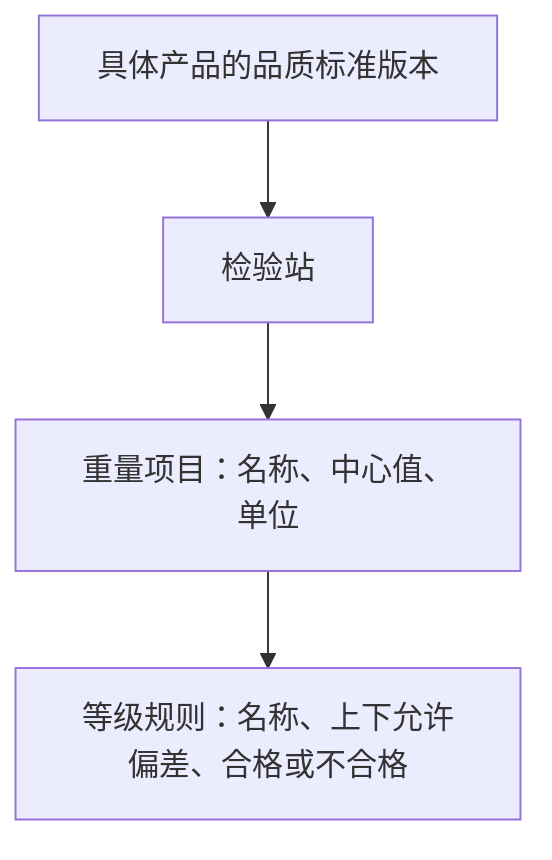

# 品质标准内部的检验站配置

2026-11-10 范围补充：除重量项目外，品质开始配置[统一异常点目录与检验站绑定](quality-shared-defect-type-catalog-inspection-station-bindings-and-reusable-configuration-components.md)。该配置与下述重量三级规则并行，继续引用同一检验站目录，不将针孔等问题塞入重量等级，不表示实际检验或返修已发生。本文原实施记录中的“只包含重量”描述对应此前重量规则批次。

更新日期：2026-11-09。当前实施范围只包含“检验站 → 重量项目 → 等级规则”。品质标准中原称“环节”的目录统一表示品质所属的检验站。系统尚未上线，采用单一数据格式，不提供旧编辑器、旧规则转换或数据迁移。

## 品质规则与生产录入的职责边界（2026-11-09）

本次确认的目录是品质检验站，默认包含成型检验站、机加检验站、精细检验站、涂装检验站。用户进一步明确，这四个品检站也是实际扫码的地点，扫码发生在相应站点转往下一个环节的阶段。检验站独立维护名称、说明、显示顺序和启用状态；品检站 ID 与生产路线节点、工序 ID 分别表达，扫码业务可以引用品检站身份。当前仅实施检验站目录。

系统初始化直接将四个默认检验站写入现有 `quality_inspection_stages` 表，界面通过现有 `/quality/inspection-stages` 接口读取和维护。默认站不构成固定枚举；有管理权限的人员可以新增、改名、排序和启停。重复初始化不覆盖已维护的数据。

内圈重、卷制纱总重、成型纱净重、机加重等属于重量项目名称，不再作为默认检验站。具体项目由实际要求决定所属检验站，不自动推断或搬移。检验站目录不持有中心值、单位、偏差或等级，这些规则由具体标准版本中的项目独立持有。

保留现有目录实体、接口路径及项目的 `inspectionStageId`、`inspectionStageName` 字段，含义统一为检验站 ID 与名称快照。复用现有配置弹窗、三级编辑器和保存链路，不另建站点实体或接口。

本地开发库核查确认原八个默认目录没有标准项目引用，也没有检验记录，因此直接修正该目录。运行时代码只保留四个正确默认站，不加入旧目录兼容或项目归属迁移。生产录入、扫码、过站及异常处置不在本次实施范围。

2026-11-09 实施验证：本地开发库已在事务中删除八个错误默认目录项并写入四个检验站，回读顺序为成型、机加、精细、涂装，均已启用。品质前端 13 个文件、134 项测试通过；后端目录初始化、可配置维护、名称及启停引用校验和 HTTP 权限契约测试通过。重复初始化验证保留改名、停用、排序和新增的自定义站。TypeScript 项目构建检查、相关 ESLint、中英文键一致性、中文编码及格式检查通过。本轮未执行浏览器验收。

2026-11-09 内部链路复查：新建和差量保存共用服务端检验站引用校验；改名保留站点 ID，编辑时显式重新选择当前名称；停用站不能新增项目或用于标准保存、提审。项目移动只更新所属检验站，保留项目标识、重量、等级、顺序及必检属性。校正四个回归文件中仍以重量名称充当站名的测试样本，项目名称继续独立；相关 66 项测试及 ESLint、格式检查通过。

## 已确认的三层结构

检验站目录只维护名称、说明、顺序和启用状态。中心值、单位和等级由各标准版本中的具体项目持有。同一检验站可以包含多个项目；不同项目、产品和标准的重量及等级独立。

存储使用项目数组：每个项目必须包含 `inspectionStageId`、`inspectionStageName`、`centerValue`、`unit`、`gradingMode = DEVIATION_BANDS` 和 `levels`。界面按检验站 ID 分组；显示分组不重排保存数组。改变项目所属检验站仅改变归属，项目名称、中心值和等级随项目保留。

已有项目编辑仅更新可编辑字段，保留自身的 `order`、`isRequired` 和 `remarks`。修改重量或等级、跨检验站移动、删除其他项目都不重新编号剩余项目；编辑中新增的项目从当前标准最大顺序值后追加。例如原顺序为 `10、20、30`，新增项目为 `31`。新增项目通过统一构造函数取得默认值。

## 逐项对齐顺序与验收

| 顺序 | 内部对齐项 | 当前实现                                                                         |
| ---- | ---------- | -------------------------------------------------------------------------------- |
| 1    | 数据归属   | 检验站组织项目，项目独立持有重量及等级；不存在全局重量表或可变等级表             |
| 2    | 新增       | 先选启用检验站再新增重量项目，也可在检验站组内新增；自动带入检验站               |
| 3    | 编辑       | 新增与编辑复用同一个三级编辑器；可增删项目、调整归属、增删和修改项目内等级       |
| 4    | 详情及回读 | 详情按相同检验站 ID 分组；保存重开恢复项目归属、中心值、单位和独立等级           |
| 5    | 校验       | 前端要求项目有检验站，服务端校验目录存在、启用及名称一致；只接受上下偏差等级规则 |

品质标准在内部五项收口。检验站目录属于品质配置，本次只对齐默认数据、配置入口、项目归属和相关文案。更大范围的候选设计见[车圈逐圈扫码称重设计](../architecture/rim-production-quality-standards-bom-branch-hole-reinforcement-locking-and-barcode-process-measurements-design.md)，不作为本次实施前置。

## 现场人工记录与系统录入的边界

2026-11-09 用户确认：机加、精细、涂装等现场工作完成后，由人工书写相关记录，现场环境脏，不方便拿手机操作。系统扫码的地点就是成型、机加、精细、涂装四个品检站，扫码处于相应站点转往下一环节的阶段。人工书写与系统扫码录入是不同动作，不能推断所有数据要在四站以外另找一个地点事后集中转录，也不能把扫码理解为必须拿手机操作。

现有接口正式提交时要求必检信息齐全，用户确认这项校验正确。本次保留现有校验，不将其列为分站提交缺口，也不因此新增分站接口或放宽必检要求。后续逐一对齐四个扫码点本次要录入的跟踪单内容；不能只凭站点分组推断数据填写范围、提前要求未来环节数据，或要求全部环节结束后才首次扫码。具体字段范围和下一环节去向尚未逐项确认，不在本次自动定义。

有转录或代录时，需要区分原始记录中的实际检验人员、检验发生时间，与系统中的录入人员、录入时间。现有通用实测的 `Inspector` 取提交账号，`CompletedAt` 取服务器提交时间，不能直接作为各品检站更早发生的现场检验时间。扫码识别、录入提交及判定、是否允许进入下一环节分别表达，扫码本身不自动证明已经合格或放行。本文记录需求和现状，不自动新增字段或改变现有接口。

四个品检站也是扫码地点这一需求已经明确，但目录初始化和三级规则编辑的验证不代表“扫码定位产品跟踪单 → 录入本站业务要求的信息 → 判定 → 进入下一环节”已经接通。现有判定与记录机制的后端 17 组测试通过，其中 6 组使用真实 PostgreSQL 独立 schema 验证并发和事务行为；覆盖客户端 `PASS` 被服务端结果覆盖、非对称及十进制端点、缺失／未知／重复项目、错误单位及标准版本、失败留存、完成记录不可覆盖、重试防重及审计回滚。该验证不代替四个扫码点实际录入与流转的验收。

## 页面操作

品质标准列表提供“检验站管理”，可新增检验站、修改名称、说明、顺序及启用状态。默认目录按顺序为成型检验站、机加检验站、精细检验站、涂装检验站。

“新增受控协议”选择产品后，按检验站新增重量项目，并在各项目内配置等级。“编辑检验站与规则”使用同一编辑器，仅编辑检验站、重量和等级；基础信息通过独立入口编辑。详情按检验站展示项目及其等级。检验站管理关闭后可继续填写标准。

规则弹窗最大宽度 1600px，正文滚动，底部操作区固定。检验站标题为 14px / 600，项目及等级标题为 13px / 600，字段标签和控件为 13px / 20px / 500。手机按单列排列，桌面按宽度展开字段。

操作按钮沿用系统 `Button` 的主按钮、描边次按钮和轻量图标按钮，统一为 `rounded-full`；图标按钮呈圆形。覆盖列表页头、分页、新增、检验站管理、重量项目及等级增删、规则编辑、基础信息、详情及审批确认。移除列表图标按钮和局部主按钮的独立悬停缩放、阴影等覆盖，字号保持 13px。单位加载失败重试及权限不足提示内的共享操作按钮同样采用胶囊样式。

编辑弹窗以打开时的数据为基准，后台刷新不重置未保存输入；保存失败保留表单，关闭有变更的弹窗时可继续编辑或放弃。仅选择待新增项目的检验站不产生业务变更。

项目必须关联检验站，没有“未指定检验站”分组或清空归属操作。目录改名后，项目的所属检验站选择框显示待选择状态，可以直接重新选择同一检验站 ID 的当前名称再保存，重量和等级不变；停用检验站不可用于保存或提审。目录加载中、失败或只读时，已保存的检验站名称仍可见，选择框不可修改，也不能新增项目；加载失败在顶部显示一次并提供重试。

品质标准页面不要求选择或展示“标准类型”。服务内部的 `type` 分类字段及既有审批发布流程不参与三级配置归属。

2026-11-04 状态切换修正：列表使用不含检验项目的 `QualityStandardListSummary`，只映射标准基础信息与生命周期；单条详情及保存回读仍严格解析完整三级规则。DEV 原有一份旧格式草稿时，空状态列表能显示总数 1，但“全部标准”原先会因解析该草稿的旧项目失败而错误显示 0。现在规则格式错误不再使列表及统计失效，也不把旧规则转换成新规则。查询失败时明确显示可重试提示，未取得的数量显示“—”，不伪装成空列表；有缓存数据时保留原统计并显示刷新失败提示。状态筛选继续由服务端执行，统计仍覆盖当前关键词等范围内的全部状态。

此次验证包含 DEV 数据库只读检查，确认原记录仍为旧格式草稿，没有迁移或改写业务数据。品质前端 13 个文件、121 项测试通过，TypeScript、品质目录 ESLint、中英文键一致性、中文编码及相关文件格式检查通过。桌面和手机使用模拟 API 连续切换已发布、已驳回、草稿、全部标准，总数始终为 1；模拟请求失败时数量显示“—”，重试后恢复列表，品质业务写入为 0。浏览器脚本为 `output/playwright/quality-standard-status-counts-and-failed-query-retry-browser-verification.js`。

2026-11-04 详情查看修正：完整规则不符合当前格式时，适配器继续拒绝将其作为可执行标准返回，同时通过 `QualityStandardInspectionRulesValidationError` 保留基础信息和未经转换的原始检验项目。详情弹窗展示名称、编号、版本、状态、备注与审核履历，并明确提示“检验规则需要重新配置”；该提示优先于查询缓存中的旧详情，不显示旧缓存的发布等操作。草稿和已驳回标准可进入现有检验站与规则弹窗，手动从空配置填写当前三级结构；已批准、已发布等只读版本不提供重新配置入口。

重新配置沿用现有编辑会话、完整规则校验和版本受控 PATCH。打开或取消不产生保存请求；空配置不可保存，保存失败保留输入，未保存关闭仍需选择继续编辑或放弃。确认保存时只提交 `items` 变更，新值为手动填写的有效规则，旧值保留接口返回的完整原始项目，基础信息、产品绑定和状态不随重新配置改变。不存在自动推断检验站、自动补齐等级、旧规则编辑器或后台数据迁移。

详情修正验证：品质前端 13 个文件、134 项测试通过，覆盖格式错误时的摘要与原规则保留、草稿和驳回重新配置入口、只读状态及过期缓存操作隐藏。TypeScript、品质目录 ESLint、语言键一致性与中文编码检查通过。桌面和手机通过模拟 API 验证详情提示、空编辑器与关闭无写入；另验证规则不完整禁止提交、保存失败保留输入、关闭继续编辑、版本校验、仅替换规则及保存后完整预览。浏览器脚本为 `output/playwright/quality-standard-invalid-inspection-rules-preview-and-explicit-reconfiguration-browser-verification.js`，两次模拟保存分别失败和成功，实际业务写入为 0。DEV 原有草稿仍保持原样，需用户在当前编辑器手动配置后保存。

## 指南内直接建立品质标准

“如何建立品质标准”指南提供“直接建立品质标准”胶囊按钮。入口由品质页面组合专用业务组件，通用章节指南继续只负责阅读布局。点击后按需加载已有 `ControlledProtocolDialog`，使用同一套“检验站 → 重量项目 → 等级规则”表单；弹窗内可以打开已有检验站管理，关闭后保留标准输入。

入口显示要求身份同步完成，且账号同时具有 `menu_quality`、`menu_engineering` 和 `perm_manage`。其中产品选择及其显示元数据读取现有工程产品接口，需要 `menu_engineering`；标准创建和检验站维护使用现有品质管理权限。这里只组合已有权限，不修改后端授权。指南只读或前置权限不全时仍可阅读章节，隐藏快捷入口，不挂载业务弹窗；有权限但尚未点击入口时也不查询产品、单位或检验站目录。

保存沿用 `buildControlledProtocolStandard` 和 `useQualityMutations().saveStandardMutation`，创建状态为 `DRAFT`，成功后刷新既有标准查询并关闭弹窗，页面仍停留在指南。失败由共享保存链路提示，保留当前表单供修正和重试。提交期间禁用操作并阻止关闭，同步提交锁阻止连续点击重复保存。查看已有标准、审批和发布继续从指南内的标准列表链接进入。

实现入口：[指南页面](../../src/features/quality/pages/quality-standard-creation-operation-guide-page.tsx)、[快捷创建组件](../../src/features/quality/components/quality-standard-creation-guide-business-entry.tsx)、[指南与保存回归](../../src/features/quality/pages/quality-standard-creation-operation-guide-reading-and-navigation.spec.tsx)。中英文操作说明已对齐快捷创建及保存后停留指南的行为。

## 等级与保存边界

每个项目配置 1–20 个等级；等级名称可改，S/A/B 只是新建默认值。等级名称最多 40 个 Unicode 字符，表单、API 回读和服务端使用相同计数，扩展汉字计为一个字符。上下偏差必须为非负有限数，按从严到宽分别严格递增；判定必须明确为 PASS 或 FAIL，不合格等级之后不能再配置合格等级。

后端只使用项目自己的上下偏差按顺序取首个命中等级，包含范围端点；超出全部范围判为 FAIL。等级判定与异常处置分开，重量超差不自动决定报废。

详情保留中心值的实际精度，等级上下限按十进制加减显示，不固定截成两位或三位小数。例如中心值 `450.123456`、下偏差 `0.000001`、上偏差 `0.000002`，显示范围为 `450.123455` 至 `450.123458`。显示计算仅用于呈现，合格判定仍由服务端执行。

前端类型和 API 解析要求完整三级结构，项目及等级字段名必须准确匹配大小写；服务端明确拒绝 `ID`、`CenterValue`、`LowerTolerance` 等非契约字段名，避免 Go 忽略大小写的字段匹配使不可回读的数据写入。旧的 `tolerance/min/max/deviationMinExclusive` 规则及旧 S/A/B 编辑、转换分支已删除；缺少新格式必填字段的配置直接校验失败。服务端保存校验与标准写入处于同一事务，检验站查询加共享锁；目录名称过期或停用时拒绝保存，不为原草稿提供豁免。

项目的 `order`、`isRequired` 和 `remarks` 可以省略，但不能显式传入 `null`；后端在写入前拒绝，避免保存成功后前端无法回读。无消费者且仍使用旧规则格式的品质标准 JSON 样本已删除，契约以当前前后端校验及回归测试为准。

项目编辑使用独立等级数组。移除一个等级只影响该项目，移除项目才移除该项目及其等级。标准审批发布沿用既有生命周期。

## 实现位置

- 检验站目录：[后端服务](../../server/services/quality_inspection_stage_catalog_service.go)、[API](../../server/handlers/quality_inspection_stage_catalog.go)、[前端查询](../../src/features/quality/hooks/use-quality-inspection-stages.ts)。
- 统一三级编辑：[新增弹窗](../../src/features/quality/components/controlled-protocol-dialog.tsx)、[项目编辑器](../../src/features/quality/components/controlled-protocol-inspection-criteria-editor.tsx)、[等级编辑器](../../src/features/quality/components/configurable-inspection-deviation-grade-editor.tsx)。
- 分组和详情：[检验站分组](../../src/features/quality/presenters/group-quality-standard-inspection-items-by-stage-for-display.ts)、[详情矩阵](../../src/features/quality/components/standard-preview-matrix-table.tsx)。
- 精度呈现：[等级边界十进制格式化](../../src/features/quality/presenters/format-quality-inspection-grade-weight-boundary-without-rounding.ts)。
- 保存校验：[项目校验](../../server/services/quality_standard_inspection_criteria_validation_service.go)、[检验站引用校验](../../server/services/quality_standard_inspection_stage_reference_validation.go)、[偏差等级](../../server/services/quality_inspection_configurable_deviation_grading.go)。

## 验证

2026-11-04 指南快捷创建验证：品质前端 13 个文件、134 项通过，其中指南回归 12 项，覆盖权限前置、身份同步、失败保留及成功重试、重复提交和既有章节导航。TypeScript、相关 ESLint、Prettier、中英文键一致性和共享控件文字检查通过。

浏览器完成 12 组检查：桌面 1366×900、手机 390×844、窄屏 320×640、中文浅色与英文深色；指南阅读不触发目录查询，五个章节可切换，正文独立滚动、换章归顶；快捷弹窗使用真实组件，检验站管理关闭后输入保留，取消不保存；指南只读、品质只读、缺少工程权限和身份未同步四种情况均隐藏入口且不读取业务目录；另验证首轮保存失败后重试、提交期间禁用和 Escape 关闭保护、手机成功保存，以及三级保存数据与草稿状态。控件为 13px，操作按钮为胶囊或圆形，未发现横向越界。保存服务使用内存替身，实际品质业务 API 写入数为 0。

脚本及结果为 `output/playwright/quality-standard-creation-guide-shared-dialog-permissions-and-draft-save-browser-verification.js` 与同名 `-results.txt`，截图名称以 `quality-standard-guide-quick-create-` 开头。隔离验收容器使用明确视口高度，避免输出目录未生成的 Tailwind 高度样式干扰阅读区验证。

前端回归覆盖新增、编辑、详情分组、多项目等级隔离、跨检验站移动、保存重开、无检验站禁止保存、单位和等级校验、只读、失败保留、关闭草稿保护。后端覆盖检验站目录持久化、缺失／无效／停用／名称过期的引用拒绝、新等级边界、旧格式拒绝及事务回滚。

2026-11-03 再次排查后验证：品质前端 12 个文件、118 项通过，包含检验站改名、目录不可用时的已选值、可选字段空值拒绝、Unicode 名称长度，高精度、十进制尾差、零边界和科学计数法的详情呈现，以及编辑、删除后新增时的项目顺序及元数据保留；Go 品质服务及处理器相关测试通过，覆盖项目及等级字段名大小写错误的拒绝；PostgreSQL 随机独立 schema 的 11 个工作流组通过，包含三种可选字段空值和两种字段名大小写错误的拒绝及保存回滚、审批发布、并发与审计失败回滚。TypeScript、品质目录 ESLint、语言键一致性、中文编码及共享控件排版检查通过。

Playwright 的 9 组中英文、主题、桌面／手机、目录失败／加载中场景共检查 18 个规则及检验站管理弹窗，字段标签和控件均为 13px，无横向越界。桌面 1800×1000 与手机 390×844 另完成新增三个重量项目 → 详情 → 修改等级及移动检验站 → 保存 → 重开，核对等级隔离及底部按钮可见。检查使用真实组件和内存服务替身，实际业务 API 写入数为 0。

本次针对选择框修改，另在桌面和手机复查改名、目录加载中、目录失败共 6 个场景。改名后重新选择同一 ID、保存重开，确认当前检验站名称正确且中心值、单位、等级不变；目录不可用时保留已保存名称且禁用选择，失败提示只出现一次。控件仍为 13px，无横向越界，实际业务 API 写入数为 0。

精度显示修复后，在桌面和手机另完成高精度重量新增 → 详情逐级核对上下限 → 修改偏差 → 保存重开。中心值 `450.123456` 和偏差 `0.0000025` 完整保留，其余等级不受修改影响；控件保持 13px，无横向越界，实际业务 API 写入数为 0。

项目保存逻辑修正后，在桌面和手机使用原顺序为 `10、20、30` 的三个项目，完成修改等级、跨检验站移动、新增项目、保存重开。保存顺序为 `10、20、30、31`，其余项目重量和等级保持不变，重开后无未保存标记，实际业务 API 写入数为 0。证据为 `output/playwright/quality-standard-item-order-and-project-rule-isolation-browser-verification-results.txt`。

操作按钮复查：品质标准组件及独立编辑／详情页面的 50 处直接操作按钮调用均具备胶囊圆角，分页在品质标准调用范围内统一圆角。补充浏览器检查桌面 1800×1000、手机 390×844、中文浅色和英文深色，共 90 个界面状态、560 次按钮样式测量，覆盖悬停、禁用、新增、规则编辑及等级增删、检验站管理、基础信息、详情底部、放弃修改、审批／驳回／归档确认、待发布操作、目录加载中及失败、单位失败，以及标准加载失败／不存在／权限不足。实测操作按钮均为胶囊或圆形、13px，未发现按钮横向越界，实际业务 API 写入数为 0。此次未发现新的三级配置串改问题；品质前端回归仍为 12 个文件、118 项通过，TypeScript、相关 ESLint、Prettier 和共享控件文字检查通过。

本次按钮验收结果为 `output/playwright/quality-standard-capsule-action-buttons-browser-verification-results.txt` 和 `output/playwright/quality-standard-capsule-action-buttons-standard-load-errors-browser-verification-results.txt`，截图名称以 `quality-standard-capsule-buttons-` 开头。检查使用真实组件与内存服务替身；审批、发布、归档未实际提交。

浏览器证据在 `output/playwright/`：`quality-standard-three-level-create-preview-edit-save-reopen-browser-verification-results.json`、`quality-standard-internal-three-level-final-typography-browser-verification-results.txt`、`quality-standard-stage-rename-and-unavailable-catalog-browser-verification-results.txt`、`quality-standard-precise-weight-create-preview-edit-save-and-reopen-browser-verification-results.txt`；截图名称以 `quality-standard-three-level-`、`quality-standard-stage-catalog-recheck-` 或 `quality-standard-precise-weight-preview-` 开头。PostgreSQL 日志为 `quality-configurable-grading-postgres-regression.log`。

相关契约：[等级与实测](quality-standard-configurable-deviation-grades-and-server-authoritative-measurement-history.md)、[品质架构审查](../architecture/quality-domain-cross-module-write-ownership-disposition-and-quantity-settlement-architecture-audit.md)、[产品编码生命周期](../architecture/linear-barcode-lifecycle-contract.md)。
