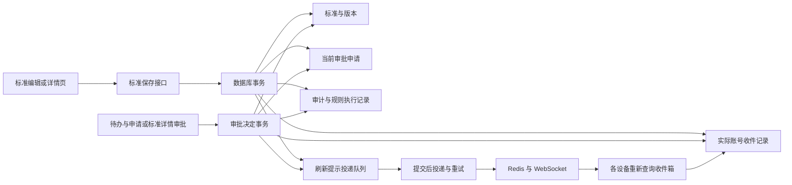

# 品质标准审批事务与通知投递契约

> 核查日期：2026-10-20。本文记录已实现的品质标准事务、统一服务端收件和提交后投递；对应版本已部署到生产，实际验收范围见文末。

全系统消息存储、阅读同步、投递职责及后续迁移统一见[消息中心收件箱、跨设备同步与通知投递长期契约](architecture/workflow/system-notification-inbox-cross-device-synchronization-and-delivery-contract.md)。本文只维护品质标准的业务事务细节，不另建通用消息方案。

## 业务事实与事务边界

品质标准状态、当前审批申请、审批决定和审计记录均由后端维护。浏览器只提交编辑内容或操作意图，不创建第二份审批申请，不自行填写审批人、审批时间、发布人或归档时间。

提交审批时，后端锁定标准并校验版本、检验项目、有效系统单位和独立审批配置。品质标准的审批链保存在 `business_approval_policy_configurations`，以 `QUALITY_STANDARD` 唯一标识业务；必须启用且配置有效账号。通知业务源或监听规则的停用、删除不影响提审和审批。标准变为待审核、创建审批申请、写入 `approval_request_id`、审计与必要审批提醒入队在同一个事务内完成。任一步数据库写入失败全部回滚，配置缺失也不留下“待审核但没有申请”的记录。

审批入口锁定申请并核对当前节点的实际审批人，同时确认申请仍是标准明确关联的当前轮次。两级审批的一级通过保留标准待审核，最终通过或驳回才更新标准状态及版本。已经处理的申请不能再次决定。驳回后重新提审创建新申请，并清空上一轮的审查字段；历史申请保留在审批记录中。

## 独立配置与业务契约边界

- 配置入口为审批中心 → 审批配置，路径 `/approval/business-approval-policies`；接口为 `GET /approvals/policies` 与 `PUT /approvals/policies/:businessType`。读取需要审批访问权限，写入需要 `perm_manage`。
- 管理员显式选择一级及可选二级审批人，不猜测或自动指派。配置带版本号；并发创建或修改仅一个成功，过期版本返回409。配置与审计同事务提交，配置保存本身不创建审批申请。
- 新申请保存提交时的审批人快照，提交审计记录配置 ID、版本和申请 ID。修改或停用审批配置只影响后续提审；在途申请继续使用原链。不存在自动绕过审批的停用模式。
- `approval_service.go` 只维护申请与节点推进，通过注入的 `ApprovalBusinessTransactionContract` 校验创建、同步业务结果、决定是否发授权码和提供通知跳转。品质实现负责自己的状态和当前申请约束。统一装配集中在 `approval_business_transaction_contract_composition.go`，公共引擎及审批收件服务不再判断 `Quality`。
- 品质标准不生成或核销授权码，空授权码也不能消费业务审批结果。公共申请接口不能绕过标准提审创建孤立品质申请。
- 品质监听规则只保存通知对象、模板和解除条件，后端拒绝其中的 `approval` 字段。审批创建不再伪装为通知规则执行日志；审批申请及审计分别记录真实事实。
- 本次独立配置只接入具有完整业务事务契约的品质标准。其他来源现存规则内审批动作尚未迁移，不能宣称所有业务均已独立配置；扩展时必须先提供该域的提审和决定契约，再接入同一配置存储与审批引擎。

数据库启动执行 `quality_standard_independent_approval_policy_configuration_cutover.go` 的一次性切换：明确且唯一的固定审批链迁入独立配置，保留其启用状态；无审批人的关闭字段仅移除，不补造配置。通知模板和接收人保留，规则版本递增并记录切换审计。多条链、动态审批人或与现有独立配置冲突时整笔回滚，不自动选人。重复启动不再次迁移；运行时不回读旧规则作兼容。已有审批申请、标准和历史执行日志不重建。

## 状态与检验契约

| 操作           | 允许的变化                   | 事实来源             |
| -------------- | ---------------------------- | -------------------- |
| 编辑、保存     | 草稿或已驳回状态内编辑       | 标准接口，版本校验   |
| 提交审批       | 草稿或已驳回 → 待审核        | 标准事务创建当前申请 |
| 一级通过       | 待审核保持不变，申请进入二级 | 指定一级审批人       |
| 最终通过、驳回 | 待审核 → 审批通过或已驳回    | 指定当前审批人       |
| 发布           | 审批通过 → 已发布            | 后端记录操作者和时间 |
| 归档           | 已发布 → 已归档，原因必填    | 后端记录操作者和时间 |

发布和归档不得顺带修改已经审批的检验内容。直接修改标准状态不能代替审批决定。

中心值项目使用绝对偏差：S 等于中心值；A 为 `0 < 偏差 ≤ A上限`；B 为 `A上限 < 偏差 ≤ B上限`；超过 B 上限报废。后端要求 `0 < A上限 < B上限`、等级边界连续且上下限关于中心值对称。单位必须精确对应基础设置中的有效单位编码。页面不提供自由输入单位或旧等级推断。

## 文件职责

以下服务均位于 `server/services/`，每个文件按一个业务职责组织，避免页面、HTTP 映射与审批事务相互混杂。

| 文件                                                            | 职责                                                                                                        |
| --------------------------------------------------------------- | ----------------------------------------------------------------------------------------------------------- |
| `quality_service.go`                                            | 保存事务入口、标准行锁、版本递增和事务内服务编排                                                            |
| `quality_standard_lifecycle_validation_service.go`              | 状态转换、编辑边界以及服务端发布和归档事实                                                                  |
| `quality_standard_inspection_criteria_validation_service.go`    | 检验项目、系统单位与中心值等级校验                                                                          |
| `quality_standard_approval_routing_service.go`                  | 读取独立审批配置，创建并关联当前申请，审计保存配置版本和审批人快照                                          |
| `quality_standard_approval_decision_service.go`                 | 品质业务契约：请求校验、结果回写、审批意见及必要提醒跳转                                                    |
| `quality_standard_approval_summary_query_service.go`            | 按明确的当前关联返回审批摘要，不从历史记录推断                                                              |
| `quality_standard_status_event_factory.go`                      | 标准状态事件及模板字段，不构造另一份展示载荷                                                                |
| `quality_standard_lifecycle_notification_routing_service.go`    | 品质新建/状态规则匹配、模板校验及 operator 字段适配；调用共享通知创建器                                     |
| `business_rule_notification_inbox_creation_service.go`          | 品质、销售及通用业务共用账号解析、去重、逐账号日志和收件创建；保留真实 CREATED/STATUS_CHANGED 动作          |
| `business_rule_notification_inbox_status_resolution_service.go` | 共用原收件解除条件，按来源、实体和标准 ID 解除；源或规则停用/删除后仍生效；取消旧任务和刷新复用共用收件服务 |
| `workflow_notification_outbox_delivery_service.go`              | 提交后的通知发布、并发领取、重试和投递结果记录                                                              |
| `business_event_source_default_quality_standard.go`             | 可持久化的品质标准默认业务源配置                                                                            |
| `business_approval_policy_configuration_service.go`             | 独立审批配置查询、有效账号校验、版本冲突处理和配置审计                                                      |
| `approval_business_transaction_contract.go`                     | 公共审批引擎依赖的业务事务契约与注入入口                                                                    |
| `approval_business_transaction_contract_composition.go`         | 已接入业务、配置定义与事务契约的唯一装配位置                                                                |

`server/handlers/quality.go` 与 `quality_dto.go` 只承担 HTTP 解析、差量更新入口、查询与响应映射；`quality_standard_write_error_response.go` 统一标准写入错误。独立配置的存储模型为 `server/models/business_approval_policy_configuration.go`，HTTP 映射为 `server/handlers/business_approval_policy_configuration.go`。通用 `approval_service.go` 负责审批节点权限和状态，品质回写集中在对应业务契约中。通用投递队列模型在 `server/models/workflow_notification_outbox_entry.go`，由数据库启动迁移注册，后台工作器由 `server/main.go` 启动。

前端 `src/features/quality/services/quality-standard-workflow-service.ts` 只生成操作差量；`quality-standard-approval-submission-service.ts` 只验证单次服务端提交结果。两个操作 Hook 负责页面反馈与查询刷新。审批调用统一审批接口；`src/hooks/use-notifications.ts` 收到刷新提示后重新查询服务端收件和业务状态。已移除浏览器自行派发品质标准规则的旧服务。

## 通知可靠性和实际边界

- `CREATED` 在新建成功时触发一次；`STATUS_CHANGED` 在初始状态建立和后续状态变化时触发。普通编辑不会重复触发生命周期通知。
- 通知先写入同一数据库事务，提交后工作器再发布。服务重启后继续领取未完成记录，多实例使用 `FOR UPDATE SKIP LOCKED` 避免同时领取同一记录。
- 每个实际账号一条稳定收件，业务事件、通知目的和账号形成数据库唯一键。重复事件保留原快照和阅读状态；投递任务只包含收件变更提示。
- 执行日志先为待发布，随后记录发布成功、失败或失效。自动重试和人工恢复都操作原投递任务，不另建收件、不重建审批、不直接从旧日志发送。失败12次暂停，由管理诊断恢复。
- 配置通知生成时保存该段解除条件；进入相应实际状态时，同事务更新原收件 ResolvedAt，取消其未发布任务并入队刷新。源/规则停用、删除或段修改不改写既有条件；状态码受控重命名沿现有事务迁移引用。审批节点推进仍按当前明确申请解除旧待办，已存在的有效申请可继续决定；离线设备重新查询也能得到解除结果。
- 标准详情、真实审批待办与消息中心各有职责：待办来自当前 ApprovalRequest，阅读或归档不修改审批。未读与状态来自统一收件接口，前端不再依赖本地正式消息 Store。
- 品质、销售、采购、生产/委外、现有 BOM 入口及公共审批和系统告警均使用共用收件/队列服务；模板动作的实际覆盖限制见通用契约。Redis 发布完成不表示设备已收到或员工已读。
- 系统不会猜测审批人或自动创建正式业务规则。品质提审要求管理员维护独立审批配置；通知源与监听规则只控制额外的配置型消息。

## 验证方法

服务端集成测试分别使用 `QUALITY_STANDARD_WORKFLOW_TEST_POSTGRES_DSN` 和 `QUALITY_STANDARD_PATCH_TEST_POSTGRES_DSN` 指定测试 PostgreSQL；随后在 `server/` 运行 `go test ./services ./handlers -count=1`。测试使用独立随机 schema，结束后清理，通知发布使用测试函数，不触发真实人员通知。未配置这两个变量时相关 PostgreSQL 测试会跳过，不能把普通单测通过视为事务链路已验证。

覆盖单级与两级审批、驳回重提、当前申请关联、版本冲突与并发提交、错误配置和检验数据拒绝、中途失败整体回滚、发布归档字段、模板与接收人、提交后发布、原任务恢复、解除通知和旧提醒取消。共享创建器专项验证 CREATED/STATUS_CHANGED 日志动作与事件键一致、固定用户名与动态操作者 ID 去重，以及任一收件账号不存在或停用时标准、日志、收件、队列共同回滚。

解除专项同时覆盖源/规则停用、删除、段编辑后的已发布标准归档，原消息进入历史且不伪造已读；来源停用并删除规则后，当前实际审批仍可完成，必要节点提醒和配置消息各按自己的生命周期解除。

独立配置专项为 `business_approval_policy_configuration_postgres_integration_test.go` 与 `quality_standard_approval_policy_cutover_postgres_integration_test.go`，验证配置校验、版本并发、审计失败回滚、通知源删除后提审、在途申请快照及切换幂等。`approval_business_transaction_contract_test.go` 用注入测试域验证业务与审批整体回滚；`routes_business_approval_policy_configuration_http_authorization_test.go` 验证 HTTP 权限、400与409。

前端配置及监听边界测试为 `src/features/approval/components/business-approval-policy-configuration-editor.spec.tsx` 和 `src/features/system-mgmt/tabs/components/quality-standard-notification-rule-independent-approval-boundary.spec.tsx`，覆盖配置确认、失败反馈、只读权限和通知规则不再携带审批配置。

前端运行 `pnpm exec tsc -b`、`pnpm exec vitest run src/features/quality` 和 `node scripts/verify-i18n-parity.mjs`，并在实际页面确认检验项目编辑、系统单位选择、审批提示和消息中心业务源。

2026-10-20 独立审批边界改造的本地验证：配置两个 PostgreSQL DSN 后，`go test ./services ./handlers ./routes ./db -count=1` 全部通过；审批人停用后关闭配置、重新启用时拒绝无效账号的后续调整也已通过专项回归。后端全包编译与构建、前端生产构建、类型检查、相关 ESLint 和中英文词条检查通过。品质、独立审批配置、监听边界及收件同步共9个前端测试文件、65项测试通过；最终监听入口布局调整后再次通过对应专项。Playwright 以隔离模拟账号与接口核对实际页面的配置选择、保存反馈及通知规则跳转，没有为正式标准提审、指派真实审批人或向正式账号发测试通知。

## 2026-10-20 生产发布记录

2026-10-20 20:32（Asia/Shanghai），Hostinger ERP 已部署 `sha-1cc7534fce03196fa85376e0f2d30115ac81d24d`。发布版本通过[完整 CI](https://github.com/tanzanite2025/erp-mes-crm-plm/actions/runs/39421842770)及[四个生产镜像构建](https://github.com/tanzanite2025/erp-mes-crm-plm/actions/runs/39421859600)，并在独立发布工作目录再次通过两个 PostgreSQL DSN 对应的隔离事务回归、65项前端测试和部署预检。发布工作目录只收纳本轮品质、审批与共用收件链路及其依赖，原工作目录的其他改动保持原状。

生产校验覆盖公网 HTML/JS/CSS 与镜像内容一致、API/数据库/Redis 健康、无完整性异常、三个新增接口的未登录401保护、四张新增表及品质监听规则内无嵌入审批配置。ERP 使用原 Compose Project 更新，数据库和 Redis 容器继续运行，其他业务 Project 的容器身份保持不变。

默认业务源沿现有 `ListBusinessEventSources → EnsureDefaultBusinessEventSources` 路径，在首次有权限的业务源列表查询时创建；服务启动后尚无该行不应判作目录迁移失败。目录六个状态及重复读取持久化已由发布版本集成测试验证。上线验收时品质标准、品质审批申请和独立品质审批配置均为0；实际审批人仍由管理员在审批中心配置。此次上线没有为正式账号创建测试审批或投递测试通知，真实员工办理和设备送达不属于本次生产烟测的证明范围。

部署前备份批次为 `20261020T122429Z`，包含 PostgreSQL、上传文件和存储文件，切换前均校验 SHA-256。自动运行时回退已实际执行成功；最终发布对应的回退资料保存在服务器 `/docker/erp/release-rollback-quality-approval-system-inbox-1cc7534f-20261020T123120Z`。该资料用于镜像与环境回退，数据库恢复仍需按独立备份流程执行。
